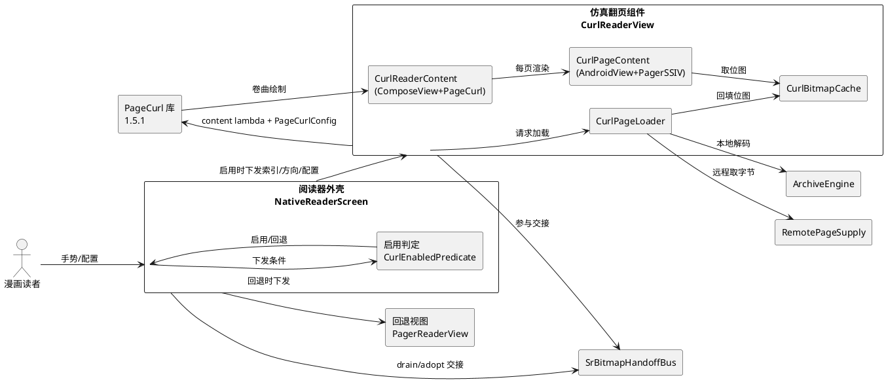
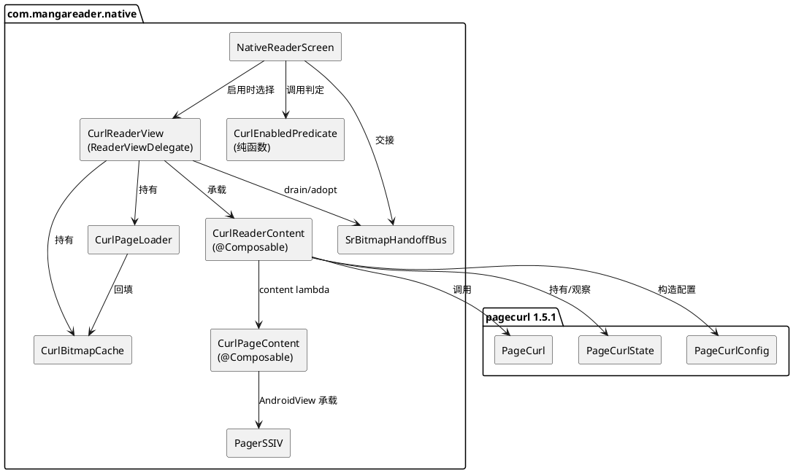
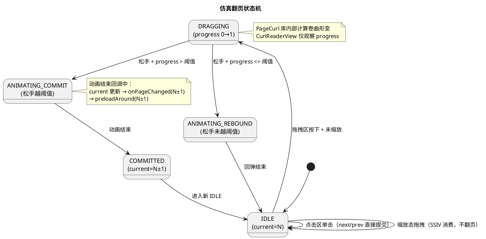
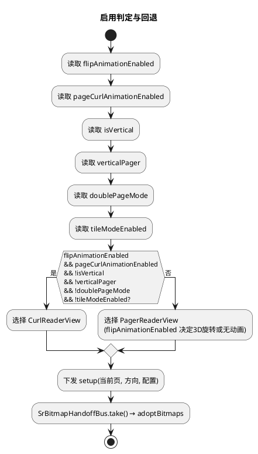
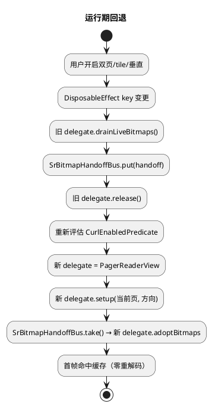
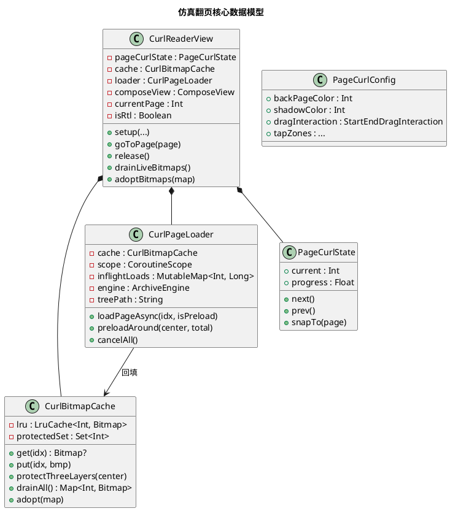
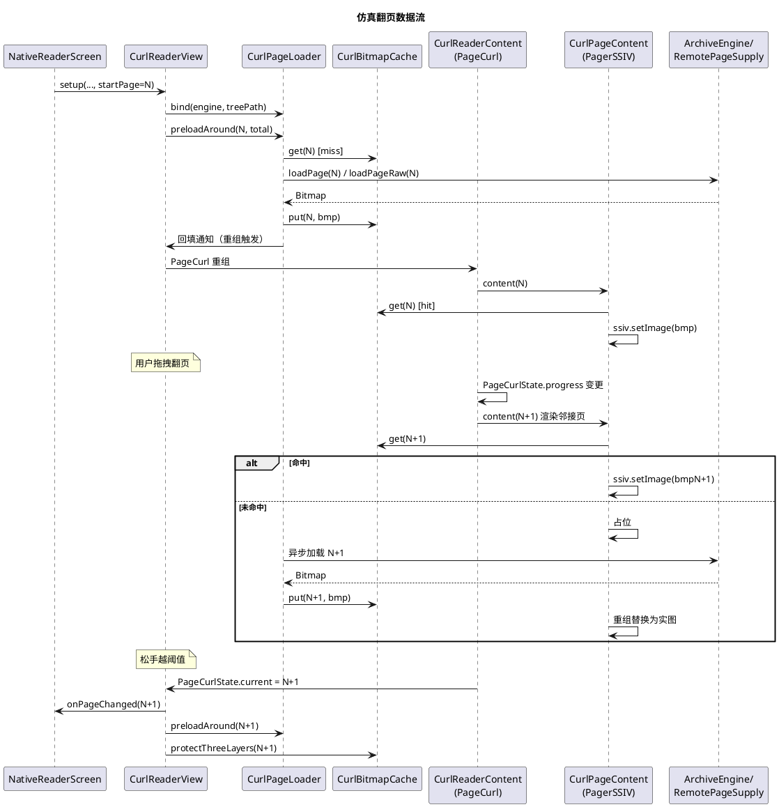

# 仿真翻页（Page Curl）技术设计文档

> 本文档将《仿真翻页需求规格》（spec.md）的外部行为需求转化为可落地的架构与接口设计。
> 范围限定为 v1（单页模式 + 静态图片）。不包含逐行代码实现。

---

# 一、需求与存量功能关系分析

## 1.1 需求功能与存量功能对比

### 1.1.1 已实现功能

| 需求功能 | 存量功能 | 代码位置 | 匹配度 |
|---------|---------|---------|--------|
| 阅读器视图委托接口（setup/goToPage/release/trimMemory/回调） | `ReaderViewDelegate` 接口已定义并由 `PagerReaderView`/`WebtoonReaderView` 实现 | `NativeReaderScreen.kt:22-41`；`PagerReaderView.kt:39,550,774,1126,1151` | 100% |
| 位图缓存（LRU 限容、按索引取用） | `bitmapCache: LruCache<Int, Bitmap>(12)`，`sizeOf` 恒 1（按张数限容） | `PagerReaderView.kt:348-350` | 100% |
| 页面异步加载（本地/远程、去重、超分注入、白边裁剪） | `loadPageAsync(idx, isPreload)` 含本地 `engine.loadPage` 与远程 `supply.loadPageRaw` 双路径，`inflightLoads` 5s 去重窗口 | `PagerReaderView.kt:893-1072` | 75% |
| 邻接页预加载（当前页 ±1） | `preloadAround(centerIdx)` 单页分支加载 `centerIdx`、`centerIdx±1` | `PagerReaderView.kt:1089-1110` | 100% |
| 单页缩放/平移/双击（未缩放时让出翻页手势） | `PagerSSIV.onTouchEvent`：未缩放 `ACTION_DOWN` 消费但不调 super，`ACTION_MOVE` 返回 false 让父消费 | `PagerSSIV.kt:66-101` | 100% |
| RTL 方向（右→左前进） | `PagerReaderView.isRtl` + `positionOf` 镜像 + `onPageSelected` 反转 | `PagerReaderView.kt:443,619-623`；`Reader.kt:213` | 75% |
| 模式切换位图交接（零重解码） | `drainLiveBitmaps`/`adoptBitmaps` + `SrBitmapHandoffBus` 跨实例总线 | `NativeReaderScreen.kt:46-82,228-238`；`PagerReaderView.kt:696-710` | 100% |
| 远程供给（SMB/WebDAV）注入 | `remotePageSupply: RemotePageSupply?` 在 setup 前挂接 | `NativeReaderScreen.kt:143,202-203`；`PagerReaderView.kt:48` | 100% |
| 翻页动画开关 | `ReaderConfig.isFlipAnimation`（默认 true）+ `PagerReaderView.flipAnimationEnabled` | `ReaderConfig.kt:18,128`；`Reader.kt:1951,2251` | 100% |
| 横屏缩放/适配屏幕/白边裁剪/页面背景色配置项 | `landscapeZoom`/`fitScreen`/`trimWhiteBorder`/`pageBgColor` 经 `NativeReaderScreen` 下发 | `NativeReaderScreen.kt:128-136,209-225` | 100% |
| `isCurrentPageReady` 就绪信号 | 查当前 ViewHolder 的 `ssiv.hasImage()` | `PagerReaderView.kt:733-738` | 100% |

### 1.1.2 需要扩展的功能

| 需求功能 | 存量功能 | 差异说明 | 扩展方向 |
|---------|---------|---------|---------|
| 阅读器外壳按启用条件在仿真翻页与回退视图间选择 | `NativeReaderScreen` 仅按 `isVertical` 在 `webtoonView`/`pagerView` 间切换 | 需新增"横向单页 + 仿真开关开"分支，选择 `CurlReaderView` 而非 `pagerView`；切换需保持当前页与方向 | 在 `NativeReaderScreen` 新增 `curlReaderView` 实例与 `activeDelegate` 三分支判定；`DisposableEffect` key 增补启用条件使条件变更触发重建 |
| 位图交接总线覆盖仿真翻页视图 | `SrBitmapHandoffBus` 仅被 `PagerReaderView`/`WebtoonReaderView` 的 drain/adopt 使用 | `CurlReaderView` 需实现 `drainLiveBitmaps`/`adoptBitmaps` 以参与跨实例交接 | `CurlReaderView` 实现两个方法，内部委托其 `CurlBitmapCache` |
| `ReaderConfig` 持久化仿真翻页开关 | `isFlipAnimation` 已持久化且语义即"翻页动画开关" | spec 新增独立"仿真翻页开关" `isPageCurlAnimation`（默认 false），与 `isFlipAnimation` 配合：前者控总开关、后者控具体效果（3D旋转/仿真翻页） | 新增 `isPageCurlAnimation: Boolean = false` 字段并持久化；启用判定读 `isFlipAnimation && isPageCurlAnimation` |
| `Reader.kt` 向 `NativeReaderScreen` 传递启用判定所需参数 | 已传 `isVertical`/`isRtl`/`verticalPager`/`pageLayout`/`tileModeEnabled`/`doublePageSplit`/`doublePageReverse` | 需补传 `flipAnimationEnabled` 与 `pageCurlAnimationEnabled`（当前仅赋给 `PagerReaderView.flipAnimationEnabled`，未作为 NES 参数） | `NativeReaderScreen` 新增 `flipAnimationEnabled`/`pageCurlAnimationEnabled` 参数；`Reader.kt` 传入 `config.isFlipAnimation`/`config.isPageCurlAnimation` |
| `ReaderSettingsSheet` 呈现仿真翻页开关 | 既有设置面板含翻页动画开关项（`isFlipAnimation`） | spec 要求新增"仿真翻页效果"开关项供用户选择3D旋转/仿真翻页 | `ReaderSettingsSheet` 新增开关项绑定 `ReaderConfig.isPageCurlAnimation`，复用既有开关项样式 |

### 1.1.3 需要新增的功能或接口

按业务模块分组：

**A. 仿真翻页视图模块（`com.mangareader.native` 包）**

1. `CurlReaderView`：实现 `ReaderViewDelegate` 的独立视图，封装 `PageCurl` 与每页 `PagerSSIV`。
   - 输入：`engine`/`treePath`/`pages`/`startPage`/`isRtl`/`remotePageSupply` 及渲染配置项。
   - 输出：`onPageChanged` 回调、`drainLiveBitmaps`/`adoptBitmaps` 交接。
   - 依赖：`CurlBitmapCache`、`CurlPageLoader`、`CurlReaderContent`（Composable）、`PagerSSIV`。

2. `CurlBitmapCache`：仿真翻页专用位图缓存，持有当前三层保护标记。
   - 输入：页面索引、位图。
   - 输出：按索引取位图、drain/adopt 批次。
   - 核心逻辑：LRU 限容 + 三层（当前页 ±1）不得淘汰。

3. `CurlPageLoader`：仿真翻页专用页面加载器，从 `PagerReaderView.loadPageAsync` 简化（仅单页 + 静图 + 远程）。
   - 输入：页面索引、是否预载。
   - 输出：解码位图回填 `CurlBitmapCache`。
   - 核心逻辑：去重、本地 `engine.loadPage` / 远程 `supply.loadPageRaw`、白边裁剪、超分注入、失败占位。

4. `CurlReaderContent`：Composable，用 `ComposeView` 承载 `PageCurl`，content lambda 用 `AndroidView` 承载 `PagerSSIV` 渲染每页。
   - 输入：总页数、`PageCurlState`、`PageCurlConfig`、按索引取位图的回调、渲染配置项。
   - 输出：翻页手势驱动的 `PageCurlState.current` 变更。

5. `CurlPageContent`：Composable，单页内容（`PagerSSIV` + 位图 + 占位/错误态）。
   - 输入：页面索引、位图（可空）、渲染配置项。
   - 输出：`PagerSSIV` 缩放态变更通知（供手势路由查询）。

**B. 启用判定模块**

6. `CurlEnabledPredicate`：纯函数，计算是否启用仿真翻页。
   - 输入：`flipAnimationEnabled`、`pageCurlAnimationEnabled`、`isVertical`、`verticalPager`、`doublePageMode`、`tileModeEnabled`。
   - 输出：布尔。
   - 核心逻辑：`flipAnimationEnabled && pageCurlAnimationEnabled && !isVertical && !verticalPager && !doublePageMode && !tileModeEnabled`。

**C. 依赖声明**

7. `app/build.gradle.kts` 新增 `io.github.oleksandrbalan:pagecurl:1.5.1` 依赖。

## 1.2 存量功能详细分析

### 1.2.1 ReaderViewDelegate 接口契约

- **接口签名**：`setup(engine, treePath, pages, startPage, vertical, clickFlip, rtl, verticalPager)`、`goToPage(page)`、`release()`、`trimMemory(level)`、`onPageChanged`/`onPageCountChanged`/`onToggleUi` 回调、`isCurrentPageReady()`、`drainLiveBitmaps()`/`adoptBitmaps(map)`。
- **业务规则**：`setup` 可被同实例多次调用（切章/切方向）；`release` 后视图可被 GC 回收但实例由 Compose `remember{}` 保活；`drainLiveBitmaps` 在 dispose 时调用，把活着的位图从缓存移除移交，`adoptBitmaps` 在 setup 后立即接管。
- **约束**：`drainLiveBitmaps` 返回的位图归调用方所有，原视图 `release` 不得 recycle 已移交位图（`PagerReaderView` 已遵循：`clearBitmapCacheRecycling` 只 `evictAll` 不 recycle）。
- **扩展点**：`CurlReaderView` 实现本接口即可被 `NativeReaderScreen` 无差别接入。

### 1.2.2 PagerReaderView 位图缓存与加载

- **bitmapCache**：`LruCache<Int, Bitmap>(12)`，`sizeOf` 恒 1（按张数限容，规避 recycle 后 byteCount 归 0 的计重失配）。不主动 recycle（SSIV/RenderThread 异步持有引用，recycle 会 UAF）。
- **loadPageAsync**：
  - 接口契约：入参 `(idx, isPreload)`，无返回值，结果经 `bitmapCache.put` + `notifyItemChanged` 回传。
  - 业务规则：`bitmapCache` 命中直接返回；`inflightLoads` 5s 去重窗口；预载走 `preloadSemaphore` 限流；本地走 `engine.loadPage`（原生下采样），远程走 `supply.loadPageRaw` + Coil3 解码；动图走 `makeAnimDrawable`；tile 走 `obtainTileFile`；白边裁剪 + 超分注入。
  - 约束：仅当前页请求切远端焦点（`remotePageSupply.onFocus`），预载页不抢焦点。
- **preloadAround**：单页分支加载 `centerIdx`、`centerIdx+1`、`centerIdx-1`；先 `prioritizeLoad` 取消 ±8 窗口外 inflight。
- **对仿真翻页的约束**：`CurlPageLoader` 复用其本地/远程/白边/超分逻辑，但**剔除**动图、tile、双页、`notifyItemChanged`（仿真翻页无 RecyclerView Adapter，改经 `PageCurlState` 驱动重组）。

### 1.2.3 PagerSSIV 手势冲突解决

- **接口契约**：`onTouchEvent(event)` 返回布尔；`scale`/`minScale`/`maxScale`/`center` 可读；`hasImage()` 表示已出图。
- **业务规则**：
  - `ACTION_DOWN`：未缩放（`scale <= minScale + 0.01`）→ 消费 DOWN（return true）但不调 super，让父 ViewPager2 接管后续手势；已缩放 → 调 super 进入 pan/zoom。
  - `ACTION_MOVE`：多指或已缩放 → `requestDisallowInterceptTouchEvent(true)` + super；未缩放 → return false 让父消费。
  - `ACTION_UP`/`CANCEL`：`consumedDown=false` → return false。
  - 双击检测器始终运行（未缩放双击放大到 2 倍，已缩放双击回 minScale）。
- **对仿真翻页的约束**：本逻辑可直接复用——`PagerSSIV` 未缩放时不消费 MOVE，父级由 ViewPager2 换成 PageCurl 即可让 PageCurl 接管拖拽。**无需修改 `PagerSSIV`**。

### 1.2.4 NativeReaderScreen 集成与位图交接

- **集成点**：`activeDelegate(isVerticalNow)` 二分支；`DisposableEffect(treePath, isVertical, isRtl, verticalPager, remoteSupply)` 做 setup/release；`AndroidView` factory 把 `webtoonView`/`pagerView` 加到 `FrameLayout`，`syncVis` 按 `isVertical` 切 VISIBLE/GONE。
- **位图交接**：dispose 时 `SrBitmapHandoffBus.put(BitmapHandoff(delegate.drainLiveBitmaps(), treePath))`；setup 后 `SrBitmapHandoffBus.take()?.let { delegate.adoptBitmaps(it.bitmaps) }`，`treePath` 不符则回收防错配。
- **对仿真翻页的约束**：需把 `activeDelegate` 扩为三分支（条漫/仿真/回退），`DisposableEffect` key 增补启用条件与 `flipAnimationEnabled`，`AndroidView` factory 增加 `curlReaderView` 子视图与 `syncVis` 三态。

### 1.2.5 ReaderConfig 配置

- **isFlipAnimation**：默认 true，已持久化（`prefs.getBoolean("isFlipAnimation", true)`），语义即"翻页动画开关"，控制是否启用翻页动画（含3D旋转与仿真翻页）。
- **isPageCurlAnimation**：新增字段，默认 false，持久化（`prefs.getBoolean("isPageCurlAnimation", false)`），语义即"仿真翻页开关"，在 `isFlipAnimation` 开启前提下控制使用仿真翻页（true）或3D旋转翻页（false）。
- **对仿真翻页的约束**：spec 要求新增独立开关与既有翻页动画开关配合——新增 `isPageCurlAnimation` 字段，启用判定读 `isFlipAnimation && isPageCurlAnimation`；`isPageCurlAnimation` 默认 false 保证既有用户体验不变（仍为3D旋转）。

---

# 二、增量设计方案

## 2.1 实现模型

### 2.1.1 上下文视图



**通信协议与频率**：
- Shell→Curl/Fallback：`setup` 一次/切章，`goToPage` 按用户跳转，`release` 一次/退出。
- Curl→Lib：content lambda 按 `PageCurlState.current` 变更重组（翻页时高频，稳态零调用）。
- Curl→Loader：`loadPageAsync` 当前页 + ±1 预载，每次翻页 3 次。
- Loader→Engine/Supply：IO 线程，预载限流。
- Shell↔Bus：dispose/setup 各一次。

### 2.1.2 服务/组件总体架构



**模块划分与职责**：
- `CurlReaderView`：视图门面，实现 `ReaderViewDelegate`，持有 `CurlBitmapCache`/`CurlPageLoader`/`ComposeView`，对外暴露与 `PagerReaderView` 一致的接口。
- `CurlReaderContent`：Composable，构造 `PageCurlState`/`PageCurlConfig`，调用 `PageCurl`，提供 content lambda。
- `CurlPageContent`：Composable，单页内容，`AndroidView` 承载 `PagerSSIV`，处理占位/错误态。
- `CurlBitmapCache`：LRU + 三层保护。
- `CurlPageLoader`：异步加载 + 去重 + 白边/超分。
- `CurlEnabledPredicate`：纯函数启用判定。

**配置项及取值策略**：
- `backPageColor`：取 `pageBgColor`（与页面背景一致）。
- `shadowColor`：默认半透明黑 `0x66000000`。
- 拖拽区/点击区：采用库默认 `StartEndDragInteraction`，RTL 时交换 forward/backward。
- `PointerBehavior`：默认（消费拖拽 + 点击）。
- `rememberSaveable`：true（进程重建恢复 `current`）。

### 2.1.3 实现设计文档

**翻页状态机**（`PageCurlState.current` 驱动）：



**启用判定流程**：



**回退切换流程**（运行期条件变更）：


## 2.2 接口设计

### 2.2.1 总体设计

| 接口 | 分类 | 稳定性 | 说明 |
|------|------|--------|------|
| `ReaderViewDelegate`（既有） | 视图委托 | 稳定 | `CurlReaderView` 实现，不修改接口 |
| `CurlEnabledPredicate` | 启用判定 | 稳定 | 纯函数，无副作用 |
| `CurlBitmapCache` | 数据 | 稳定 | 内部缓存，不对外暴露 |
| `CurlPageLoader` | 数据 | 稳定 | 内部加载器，不对外暴露 |
| `CurlReaderContent` / `CurlPageContent` | UI | 实验 | Composable，仅由 `CurlReaderView` 内部调用 |

**接口变更策略**：不修改 `ReaderViewDelegate`；`NativeReaderScreen` 新增 `flipAnimationEnabled`/`pageCurlAnimationEnabled` 参数（默认 true/false，向后兼容）；`Reader.kt` 传入 `config.isFlipAnimation`/`config.isPageCurlAnimation`；`ReaderConfig` 新增 `isPageCurlAnimation` 字段；`ReaderSettingsSheet` 新增"仿真翻页效果"开关项。

### 2.2.2 接口清单

#### CurlReaderView（实现 ReaderViewDelegate）

**接口签名**：
```
class CurlReaderView(context: Context) : FrameLayout(context), ReaderViewDelegate
```

**业务说明**：仿真翻页视图门面，封装 PageCurl 与每页 PagerSSIV，对阅读器外壳暴露与 PagerReaderView 一致的委托接口。

**前置条件**：`PageCurl` 依赖已声明；`PagerSSIV` 可正常构造。

**后置条件**：`setup` 后当前页开始加载并渲染；`release` 后停止加载、释放 ComposeView；`drainLiveBitmaps` 后缓存位图移交、release 不回收已移交位图。

**异常映射**：构造/setup 异常 → 由 `NativeReaderScreen` 捕获并回退至 `PagerReaderView`；加载失败 → 该页占位错误态，不影响其他页。

**关键方法**：
- `setup(engine, treePath, pages, startPage, vertical, clickFlip, rtl, verticalPager)`：校验 `!vertical && !verticalPager`（否则内部仍渲染但外壳不应选此视图）；初始化 `CurlBitmapCache`/`CurlPageLoader`；构造 `ComposeView` 承载 `CurlReaderContent`；`preloadAround(startPage)`。
- `goToPage(page)`：`pageCurlState.snapTo(page)`；`preloadAround(page)`。
- `release()`：取消加载协程；`ComposeView` dispose；不 recycle 位图（交由 drain 或 GC）。
- `trimMemory(level)`：`curlBitmapCache.trimNonProtected(level)`。
- `isCurrentPageReady()`：查当前页 `PagerSSIV.hasImage()`。
- `drainLiveBitmaps()`：`curlBitmapCache.drainAll()`。
- `adoptBitmaps(map)`：`curlBitmapCache.adopt(map)`。

#### CurlEnabledPredicate

**接口签名**：
```
fun isCurlEnabled(
    flipAnimationEnabled: Boolean,
    pageCurlAnimationEnabled: Boolean,
    isVertical: Boolean,
    verticalPager: Boolean,
    doublePageMode: Boolean,
    tileModeEnabled: Boolean
): Boolean
```

**业务说明**：纯函数，计算是否启用仿真翻页。

**前置条件**：无。

**后置条件**：返回 `flipAnimationEnabled && pageCurlAnimationEnabled && !isVertical && !verticalPager && !doublePageMode && !tileModeEnabled`。

**异常映射**：无异常。

#### CurlBitmapCache

**接口签名**：
```
class CurlBitmapCache(maxSize: Int = 12)
fun get(idx: Int): Bitmap?
fun put(idx: Int, bmp: Bitmap)
fun remove(idx: Int)
fun protectThreeLayers(center: Int)
fun drainAll(): Map<Int, Bitmap>
fun adopt(map: Map<Int, Bitmap>)
fun trimNonProtected(level: Int)
```

**业务说明**：仿真翻页专用位图缓存，LRU 限容 + 三层保护。

**前置条件**：无。

**后置条件**：`protectThreeLayers` 后当前页 ±1 不被淘汰；`drainAll` 后缓存清空且位图归调用方。

**异常映射**：无异常。

#### CurlPageLoader

**接口签名**：
```
class CurlPageLoader(
    context: Context,
    cache: CurlBitmapCache,
    scope: CoroutineScope,
    remoteSupply: RemotePageSupply?
)
fun loadPageAsync(idx: Int, isPreload: Boolean = false)
fun preloadAround(centerIdx: Int, totalPages: Int)
fun cancelAll()
```

**业务说明**：异步页面加载，从 `PagerReaderView.loadPageAsync` 简化（仅单页 + 静图 + 远程）。

**前置条件**：`engine` 与 `treePath` 已设置（经 `bind` 方法）。

**后置条件**：解码位图回填 `CurlBitmapCache`；同索引 5s 去重；预载限流。

**异常映射**：解码失败 → 不回填、该页占位错误态；IO 异常 → 协程取消。

#### NativeReaderScreen（既有，扩展参数）

**新增参数**：
```
flipAnimationEnabled: Boolean = true
pageCurlAnimationEnabled: Boolean = false
```

**业务说明**：传入翻页动画开关与仿真翻页开关，供 `activeDelegate` 三分支判定（条漫/仿真/回退）。

**后置条件**：`pageCurlAnimationEnabled=false`（默认）时行为与改动前完全一致（零影响，仍为3D旋转或无动画）；`flipAnimationEnabled && pageCurlAnimationEnabled` 且其他条件满足时选择 `CurlReaderView`。

## 2.3 数据模型

### 2.3.1 设计目标

- 支持业务场景：横向单页翻页 + 邻接页预加载 + RTL + 缩放/平移 + 远程供给 + 模式切换位图交接。
- 性能目标：翻页 ≥30fps（中端设备）；首帧 ≤500ms；三层缓存常驻。
- 容量目标：缓存上限 12 张（与 `PagerReaderView` 对齐），三层保护。
- 扩展性目标：v1 仅单页静图，结构预留双页/动图扩展（通过回退规避，不实现）。
- 兼容策略：复用 `ReaderViewDelegate` 接口与 `SrBitmapHandoffBus` 交接，与既有视图零摩擦。

### 2.3.2 模型实现



**对象关系**：
- `CurlReaderView` 组合持有 `CurlBitmapCache`/`CurlPageLoader`/`PageCurlState`（生命周期与视图一致）。
- `CurlPageLoader` 依赖 `CurlBitmapCache`（回填）。
- `PageCurlConfig` 由 `CurlReaderContent` 按 `isRtl`/`pageBgColor` 构造，无持久化。

**创建与销毁策略**：
- `CurlReaderView` 由 `NativeReaderScreen` 的 `remember{}` 创建，跨 setup 复用（与 `PagerReaderView` 一致）。
- `CurlBitmapCache`/`CurlPageLoader` 在 `setup` 首次初始化，切章时 `cancelAll` + `drainAll` + 重建。
- `release` 时 `cancelAll` + `ComposeView` dispose，不 recycle 位图。

**持久化策略**：
- `PageCurlState.current` 经 `rememberSaveable` 持久化，进程重建恢复。
- `isRtl` 经 `ReaderConfig.scrollMode` 持久化（既有）。
- 位图缓存不持久化（内存级），重建后重新加载。

## 2.4 组件设计

### 2.4.1 CurlReaderView

**职责**：仿真翻页视图门面，实现 `ReaderViewDelegate`，对阅读器外壳透明。

**内部状态**：
- `pageCurlState: PageCurlState` — 当前页索引与翻页进度。
- `cache: CurlBitmapCache` — 位图缓存。
- `loader: CurlPageLoader` — 页面加载器。
- `composeView: ComposeView` — 承载 `CurlReaderContent`。
- `currentPage: Int` — 当前页（与 `pageCurlState.current` 同步）。
- `isRtl: Boolean` — 阅读方向。
- 渲染配置项：`pageBgColor`/`trimWhiteBorder`/`trimThreshold`/`trimWhiteRatio`/`landscapeZoom`/`fitScreen`/`panNavigation`。

**关键方法**：
- `setup`：初始化缓存/加载器；构造 `PageCurlState`（`rememberSaveable` 初值 `startPage`）；`composeView.setContent { CurlReaderContent(...) }`；`preloadAround(startPage)`。
- `goToPage`：`pageCurlState.snapTo(page)`；`currentPage = page`；`preloadAround(page)`。
- `onPageChanged` 回调：观察 `pageCurlState.current` 变更，过滤同页，触发 `onPageChanged?.invoke(newPage)` + `preloadAround(newPage)` + `cache.protectThreeLayers(newPage)`。
- `drainLiveBitmaps`/`adoptBitmaps`：委托 `cache`。

### 2.4.2 CurlReaderContent

**职责**：Composable，构造 `PageCurlConfig` 并调用 `PageCurl`，提供 content lambda。

**内部状态**：无（纯 Composable，状态由 `pageCurlState` 与外部回调持有）。

**关键逻辑**：
- 构造 `PageCurlConfig`：`backPageColor = pageBgColor`；`shadowColor = 0x66000000`；`dragInteraction` 按 `isRtl` 选择 `StartEndDragInteraction`（FLIP 用 forward 默认，RTL 交换 forward/backward）。
- 调用 `PageCurl(count = totalPages, state = pageCurlState, config = config) { idx -> CurlPageContent(idx, cache.get(idx), ...) }`。
- 观察 `pageCurlState.current` 变更 → 回调 `onPageChanged`。

### 2.4.3 CurlPageContent

**职责**：Composable，单页内容，`AndroidView` 承载 `PagerSSIV`。

**内部状态**：占位/错误态标记。

**关键逻辑**：
- `AndroidView(factory = { PagerSSIV(it) })`。
- `update`：位图非空且未回收 → `ssiv.setImage(ImageSource.bitmap(bmp))`；位图空 → 显示占位（背景色）；加载失败 → 显示错误占位。
- 应用渲染配置：白边裁剪在加载阶段完成（`CurlPageLoader` 内），此处仅设 `pageBgColor`/`landscapeZoom`/`fitScreen`。
- `PagerSSIV` 缩放态变更无需主动通知——`PageCurl` 拖拽时 `PagerSSIV.onTouchEvent` 未缩放分支自动让出（见 2.6）。

### 2.4.4 CurlBitmapCache

**职责**：LRU 位图缓存 + 三层保护。

**内部状态**：
- `lru: LruCache<Int, Bitmap>(12)`（`sizeOf` 恒 1，与 `PagerReaderView` 对齐）。
- `protectedSet: MutableSet<Int>` — 当前三层索引。

**关键方法**：
- `put`：若 `idx` 在 `protectedSet` 中，先 `lru.remove` 受保护项再 put（防 LRU 误淘汰）。
- `protectThreeLayers(center)`：`protectedSet = {center-1, center, center+1}`。
- `drainAll`：`lru.snapshot().keys.forEach { lru.remove(it) }`，返回未回收位图 Map。
- `adopt(map)`：`map.forEach { if (!it.value.isRecycled) lru.put(it.key, it.value) }`。
- `trimNonProtected(level)`：遍历 `lru.snapshot()`，移除非 `protectedSet` 且非当前三层项。

### 2.4.5 CurlPageLoader

**职责**：异步页面加载，从 `PagerReaderView.loadPageAsync` 简化。

**内部状态**：
- `inflightLoads: MutableMap<Int, Long>` — 去重窗口。
- `preloadSemaphore: Semaphore` — 预载限流。
- `engine: ArchiveEngine?` / `treePath: String` — 经 `bind` 设置。

**关键逻辑**（剔除动图/tile/双页/`notifyItemChanged`）：
- `loadPageAsync(idx, isPreload)`：
  - `cache.get(idx)` 命中 → 超分 `attachOrScheduleFast` → 返回。
  - `inflightLoads` 5s 去重。
  - 本地：`engine.loadPage(meta, treePath)` → 白边裁剪 → 超分 `attachOrSchedule` → `cache.put`。
  - 远程：`supply.loadPageRaw(idx)` → Coil3 解码 → 白边裁剪 → 超分 → `cache.put`。
  - 失败：`cache.remove(idx)` + `inflightLoads.remove(idx)`。
- `preloadAround(center, total)`：`loadPageAsync(center)` + `loadPageAsync(center±1, isPreload=true)`。
- `cancelAll`：`scope.cancel()` + `inflightLoads.clear()`。

## 2.5 数据流

**完整数据流：页面加载 → 缓存 → 渲染 → 翻页**



**关键约束**：
- 当前页优先：`preloadAround` 先 `loadPageAsync(center)`（非 isPreload），后 ±1（isPreload）。
- 三层保护：翻页中 `protectThreeLayers` 保证 N-1/N/N+1 不被淘汰。
- 去重：`inflightLoads` 5s 窗口防重复解码。
- 零重解码：模式切换经 `SrBitmapHandoffBus` 交接，`adoptBitmaps` 首帧命中。

## 2.6 手势处理

**冲突场景**：PageCurl 拖拽翻页 vs PagerSSIV 缩放/平移。

**解决策略**：复用 `PagerSSIV` 既有手势让出逻辑，**不修改 `PagerSSIV`**。

| 场景 | PagerSSIV 行为 | PageCurl 行为 | 结果 |
|------|---------------|--------------|------|
| 未缩放 + 单指拖拽 | `ACTION_DOWN` 消费但不调 super；`ACTION_MOVE` return false | 接管 MOVE，计算卷曲 | 翻页 |
| 未缩放 + 单指单击 | `ACTION_DOWN` 消费；`ACTION_UP` return false | tap zone 判定 | 翻页（前进/后退） |
| 未缩放 + 双击 | 双击检测器放大到 2 倍 | 不介入 | 缩放 |
| 已缩放 + 单指拖拽 | `requestDisallowInterceptTouchEvent(true)` + super pan | 父被禁止拦截 | 平移 |
| 已缩放 + 双指捏合 | 多指分支 super zoom | 父被禁止拦截 | 缩放 |
| 已缩放 + 双击 | 双击回 minScale | 缩放复位后恢复翻页 | 缩放复位 |
| 多指落下 | `ACTION_MOVE` 多指分支 super | 父被禁止拦截 | 缩放 |

**关键机制**：
- `PagerSSIV` 未缩放时 `ACTION_MOVE` return false，手势冒泡至父 `ComposeView`/`PageCurl`，PageCurl 检测拖拽。
- `PagerSSIV` 已缩放时 `requestDisallowInterceptTouchEvent(true)`，阻止父拦截，PageCurl 收不到 MOVE。
- 缩放复位（双击回 minScale）后，下次 `ACTION_MOVE` 未缩放分支生效，翻页恢复。
- **无需新增手势路由代码**——`PagerSSIV` 既有逻辑已完备，PageCurl 作为父级自动接管让出的手势。

## 2.7 RTL 处理

**配置方案**：通过 `PageCurlConfig` 的 `StartEndDragInteraction` 交换 forward/backward 拖拽区与点击区。

| 方向 | forward 拖拽区 | backward 拖拽区 | 前进点击区 | 后退点击区 |
|------|--------------|---------------|-----------|-----------|
| FLIP（左→右前进） | start=右半屏, end=左半屏 | start=左半屏, end=右半屏 | 左半屏 | 右半屏 |
| RTL（右→左前进） | start=左半屏, end=右半屏 | start=右半屏, end=左半屏 | 右半屏 | 左半屏 |

**实现**：
- `CurlReaderContent` 按 `isRtl` 构造 `StartEndDragInteraction`：
  - FLIP：`StartEndDragInteraction(forward = Config(start = rightHalf, end = leftHalf), backward = Config(start = leftHalf, end = rightHalf))`。
  - RTL：交换 forward 与 backward。
- 运行期切换：`isRtl` 变更触发 `CurlReaderContent` 重组，重新构造 `PageCurlConfig`，无需重启。
- 方向缺失/非法：默认按 FLIP。

**与既有 RTL 一致性**：`PagerReaderView` 的 RTL 经 `positionOf` 镜像 + `onPageSelected` 反转实现；`CurlReaderView` 不做索引镜像（PageCurl 的 `current` 直接对应阅读顺序），方向差异完全由拖拽区/点击区映射承担，避免双重镜像。

## 2.8 回退策略

**回退条件**（`CurlEnabledPredicate` 返回 false）：
- `flipAnimationEnabled = false`（用户关闭翻页动画开关，无动画）。
- `pageCurlAnimationEnabled = false`（用户关闭仿真翻页开关，回退至3D旋转翻页）。
- `isVertical = true`（VERT / WEBTOON_GAP 条漫）。
- `verticalPager = true`（VERT_PAGER 竖向翻页）。
- `doublePageMode = true`（pageLayout = DOUBLE / DOUBLE_SHIFTED）。
- `tileModeEnabled = true`（分块超分）。

**回退目标行为**：`flipAnimationEnabled = false` 时无翻页动画；`flipAnimationEnabled = true && pageCurlAnimationEnabled = false` 时使用既有 `FlipPageTransformer` 3D旋转翻页；其余条件不满足时回退至 `PagerReaderView` 并按上述两开关决定动画效果。

**回退目标**：`PagerReaderView`（既有，不修改）。

**无缝切换机制**：
1. `NativeReaderScreen` 的 `DisposableEffect` key 增补 `flipAnimationEnabled`/`doublePageMode`/`tileModeEnabled`，任一变更触发 dispose → 重建。
2. dispose 时旧 delegate（`CurlReaderView` 或 `PagerReaderView`）`drainLiveBitmaps` → `SrBitmapHandoffBus.put`。
3. 重建时 `CurlEnabledPredicate` 重新评估，选择新 delegate。
4. 新 delegate `setup` 后 `SrBitmapHandoffBus.take` → `adoptBitmaps`，首帧命中缓存。
5. 当前页索引与方向经 `savedPage`/`isRtl` 保持（既有机制，不改动）。

**初始化失败回退**：
- `CurlReaderView` 构造/setup 抛异常 → `NativeReaderScreen` 捕获 → 标记本组件不可用 → 选择 `PagerReaderView`。
- 实现方式：`activeDelegate` 内 try-catch 包 `CurlReaderView` 实例化，失败回退。

**运行期频繁切换**：`DisposableEffect` key 变更即重建，无中间态残留；`SrBitmapHandoffBus` 单槽覆盖，最后一次交接生效。

## 2.9 依赖变更

**新增依赖**（`app/build.gradle.kts`）：

```
implementation("io.github.oleksandrbalan:pagecurl:1.5.1")
```

**依赖属性**：
- Maven Central 坐标：`io.github.oleksandrbalan:pagecurl:1.5.1`。
- 许可证：Apache 2.0（与项目 GPL v3 兼容）。
- minSdk：21（项目 minSdk=26，满足）。
- 传递依赖：仅 Jetpack Compose Foundation（项目已有），无额外第三方库。
- 绘制方式：Compose Canvas 2D（非 OpenGL）。

**许可证清单更新**：在项目依赖声明与许可证清单中如实记录 `pagecurl:1.5.1` 及 Apache 2.0。

**版本锁定**：锁定 1.5.1，避免上游破坏性变更。

## 2.10 风险与缓解

| 风险 | 等级 | 缓解措施 |
|------|------|---------|
| PageCurl Canvas 2D 大图帧率跌破 30fps | 中 | `CurlPageLoader` 复用 `engine.loadPage` 原生下采样（既有 OOM 防护）；超分注入后位图尺寸受 `DownsampleTier` 控制；极端大图经回退规避（v1 不支持 tile） |
| 三层位图同时驻留内存压力 | 中 | `CurlBitmapCache` 上限 12 张（与 `PagerReaderView` 对齐）；`trimMemory` 响应系统压力移除非保护项；单页内存由解码闸（≤6M px）兜底 |
| 手势冲突（PageCurl 拖拽 vs SSIV pan） | 低 | 复用 `PagerSSIV` 既有让出逻辑（未缩放 return false），无需新增路由；已缩放 `requestDisallowInterceptTouchEvent` 阻止父拦截 |
| 模式切换白屏（位图未交接） | 低 | 复用 `SrBitmapHandoffBus` 跨实例交接 + `adoptBitmaps` 首帧命中；`DisposableEffect` key 增补启用条件保证及时重建 |
| PageCurl 库 API 破定性 | 低 | 锁定 1.5.1；仅用公开 API（`PageCurl`/`PageCurlState`/`PageCurlConfig`/`StartEndDragInteraction`）；不反射内部 |
| RTL 方向错配（双重镜像） | 低 | `CurlReaderView` 不做索引镜像，方向完全由 `StartEndDragInteraction` 拖拽区/点击区映射承担 |
| 初始化失败未回退 | 低 | `NativeReaderScreen.activeDelegate` try-catch 包 `CurlReaderView` 实例化，失败回退 `PagerReaderView` |
| 进程重建状态丢失 | 低 | `PageCurlState` 用 `rememberSaveable`；`isRtl` 经 `ReaderConfig` 持久化；位图重新加载（内存级，可接受） |
| ComposeView 与 View 互操作性能 | 低 | 单一 `ComposeView` 承载 `PageCurl`，content lambda 按 `PageCurlState.current` 重组（稳态零调用）；`PagerSSIV` 经 `AndroidView` 复用 |

## 2.11 文件变更清单

### 新增文件

| 文件 | 职责 |
|------|------|
| `app/src/main/java/com/mangareader/native/CurlReaderView.kt` | 仿真翻页视图门面，实现 `ReaderViewDelegate` |
| `app/src/main/java/com/mangareader/native/CurlReaderContent.kt` | Composable，`ComposeView`+`PageCurl`+`PageCurlConfig` 构造，含 `CurlPageContent` |
| `app/src/main/java/com/mangareader/native/CurlBitmapCache.kt` | LRU 位图缓存 + 三层保护 |
| `app/src/main/java/com/mangareader/native/CurlPageLoader.kt` | 异步页面加载（简化版） |
| `app/src/main/java/com/mangareader/native/CurlEnabledPredicate.kt` | 启用判定纯函数 |

### 修改文件

| 文件 | 变更摘要 | 侵入度 |
|------|---------|--------|
| `app/build.gradle.kts` | 新增 `pagecurl:1.5.1` 依赖 | 极低（追加一行） |
| `app/src/main/java/com/mangareader/native/NativeReaderScreen.kt` | 新增 `flipAnimationEnabled`/`pageCurlAnimationEnabled` 参数；`activeDelegate` 扩为三分支（条漫/仿真/回退）；`DisposableEffect` key 增补 `flipAnimationEnabled`/`pageCurlAnimationEnabled`/`doublePageMode`/`tileModeEnabled`；`AndroidView` factory 增加 `curlReaderView` 子视图与 `syncVis` 三态；setup/release/交接逻辑覆盖新 delegate | 中（新增分支，不改既有分支逻辑） |
| `app/src/main/java/com/mangareader/ui/Reader.kt` | `NativeReaderScreen` 调用处传入 `flipAnimationEnabled = config.isFlipAnimation`/`pageCurlAnimationEnabled = config.isPageCurlAnimation` | 极低（追加两个参数） |
| `app/src/main/java/com/mangareader/data/ReaderConfig.kt` | 新增 `isPageCurlAnimation: Boolean = false` 字段并持久化（`prefs.getBoolean("isPageCurlAnimation", false)`） | 极低（追加一个字段，不改既有字段） |
| `app/src/main/java/com/mangareader/ui/ReaderSettingsSheet.kt` | 新增"仿真翻页效果"开关项，绑定 `ReaderConfig.isPageCurlAnimation`，复用既有开关项样式 | 低（追加一个开关项，复用既有样式） |

### 不修改文件

| 文件 | 理由 |
|------|------|
| `PagerReaderView.kt` | 非侵入式，回退视图保持原样（3D旋转翻页逻辑不变） |
| `PagerSSIV.kt` | 手势让出逻辑已完备，直接复用 |
| `WebtoonReaderView.kt` | 条漫不受影响 |

---

## 设计决策摘要

1. **复用 `ReaderViewDelegate` 接口**：`CurlReaderView` 实现既有接口，`NativeReaderScreen` 接入方式与既有视图一致，零接口变更。
2. **复用 `PagerSSIV` 手势逻辑**：未缩放让出、已缩放禁止父拦截的既有逻辑天然适配 PageCurl 作为父级，无需修改。
3. **复用 `SrBitmapHandoffBus` 交接**：模式切换零重解码机制直接复用，`CurlReaderView` 实现 `drainLiveBitmaps`/`adoptBitmaps` 即可参与。
4. **新增独立 `isPageCurlAnimation` 开关**：与既有 `isFlipAnimation` 配合，前者控总开关、后者控具体效果（3D旋转/仿真翻页），默认关闭保证既有体验不变，用户主动开启才用仿真翻页。
5. **独立缓存与加载器**：`CurlBitmapCache`/`CurlPageLoader` 从 `PagerReaderView` 简化（剔除动图/tile/双页/`notifyItemChanged`），避免侵入既有视图，易回退。
6. **RTL 经拖拽区映射**：`StartEndDragInteraction` 交换 forward/backward，`CurlReaderView` 不做索引镜像，避免双重镜像。
7. **PageCurl 锁定 1.5.1**：仅用公开 API，Canvas 2D 绘制，minSdk=21 满足，Apache 2.0 兼容 GPL v3。
