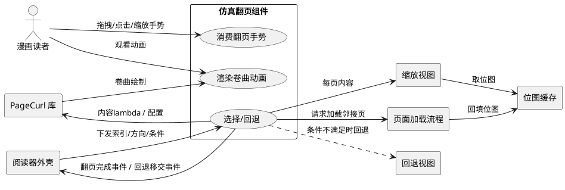
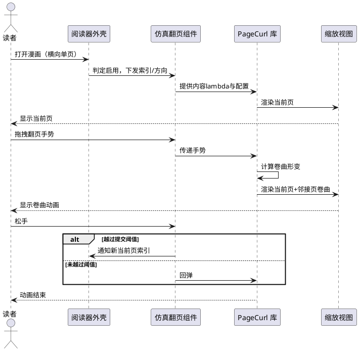
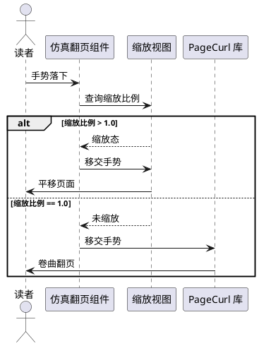
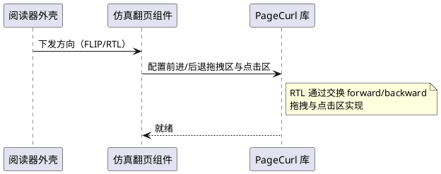
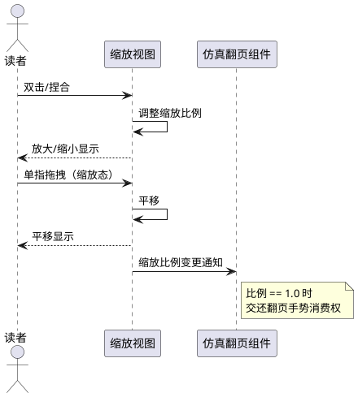
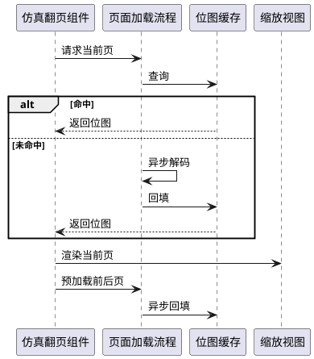
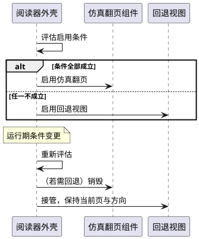
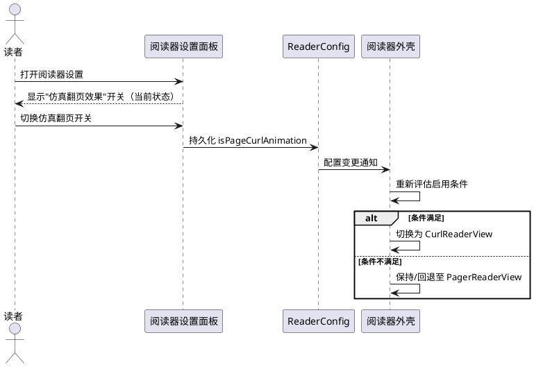

# 仿真翻页（Page Curl）需求规格

> 本文档定义 MangaReader 新增"仿真翻页"功能的外部行为、业务规则与验收条件。
> 范围限定为 v1（单页模式 + 静态图片）。不包含技术实现细节（类结构、API 签名、绘制算法）。

---

# 1. 组件定位

## 1.1 核心职责
本组件负责在横向翻页阅读模式下以"页面卷曲"效果渲染并交互翻页，与原有3D旋转翻页效果并存，由用户独立开关选择启用其一。

## 1.2 核心输入
1. **用户翻页手势**：来自屏幕的拖拽、抛掷与点击手势，由本组件消费并转化为翻页意图。
2. **用户缩放/平移手势**：双击、捏合与拖拽手势，在页面已放大时由缩放视图消费。
3. **页面索引请求**：来自阅读器外壳的"跳转到第 N 页"指令（如目录跳转、上一章/下一章衔接）。
4. **阅读方向配置**：FLIP（左→右前进）或 RTL（右→左前进）的方向标记。
5. **页面位图供给**：来自现有页面加载流程的解码位图（本组件不负责解码，仅负责持有与渲染）。

## 1.3 核心输出
1. **翻页动画渲染**：在屏幕上呈现当前页、邻接页及其卷曲形变、阴影与镜像。
2. **页面位图呈现**：将当前页位图交由缩放视图渲染。
3. **翻页完成事件**：当一次翻页动画结束且页面已变更时，向阅读器外壳通知新的当前页索引。
4. **回退移交事件**：当运行条件不满足时，向阅读器外壳通知应回退至原有翻页视图。

## 1.4 职责边界
本组件**不负责**以下事项：
1. 图片解码、降采样、分块（tile）渲染——复用现有 `SubsamplingScaleImageView` 能力。
2. 动图（APNG/WebP/GIF）播放——v1 不支持，由回退视图处理。
3. 双页（横屏并排）模式——v1 不支持，由回退视图处理。
4. 条漫（垂直连续滚动）模式——本组件仅用于横向翻页。
5. 远程供给（SMB/HTTP）与超分注入——由现有供给链负责，本组件仅消费位图。
6. 章节切换、目录加载、阅读进度持久化——由阅读器外壳负责。

---

# 2. 领域术语

**仿真翻页**
: 一种使当前页以二维卷曲形变方式翻向下一页或上一页的视觉效果，包含卷曲路径裁剪、背面镜像与阴影投射，区别于简单3D旋转。

**PageCurl**
: 本组件所采用的仿真翻页渲染库（`io.github.oleksandrbalan:pagecurl:1.5.1`，Apache 2.0），以 Compose Canvas 2D 方式绘制。
: 备注：非 OpenGL 实现。

**CurlReaderView**
: 本组件新增的、实现阅读器视图委托接口的独立视图，封装 PageCurl 与每页缩放视图。
: 备注：与原有 `PagerReaderView` 并存，互不侵入。

**前进方向**
: 一次翻页动画使阅读进度递增的屏幕手势方向；FLIP 模式下为"从右向左拖拽"，RTL 模式下为"从左向右拖拽"。

**后退方向**
: 一次翻页动画使阅读进度递减的屏幕手势方向，与前进方向相反。

**邻接页**
: 当前页的前一页与后一页，在仿真翻页过程中需同时被渲染以呈现卷曲背面与即将显露的页面。

**翻页动画开关**
: 既有配置项 `ReaderConfig.isFlipAnimation`，控制是否启用翻页动画（含3D旋转与仿真翻页）；关闭时无翻页动画，开启时再由仿真翻页开关决定具体效果。

**仿真翻页开关**
: 新增配置项 `ReaderConfig.isPageCurlAnimation`，在翻页动画开关开启的前提下，控制使用仿真翻页（开启）或3D旋转翻页（关闭，默认）；翻页动画开关关闭时本开关无意义。

**回退**
: 当运行条件不满足 v1 支持范围时，放弃使用本组件，改由原有 `PagerReaderView` 承担翻页渲染（含3D旋转或无动画，由翻页动画开关决定）。

**缩放态**
: 当前页缩放视图的缩放比例大于 1.0 的状态；在该状态下翻页手势应被抑制。

---

# 3. 角色与边界

## 3.1 核心角色
**漫画读者**：通过触摸手势与仿真翻页组件交互，执行翻页、缩放、平移操作，并感知翻页动画效果。

## 3.2 外部系统
1. **PageCurl 库**：提供仿真翻页的绘制、状态管理与手势检测能力；本组件为其提供页面内容与配置。
2. **缩放视图（PagerSSIV）**：负责单页的位图渲染、双击缩放与平移导航；本组件将其作为每页内容嵌入。
3. **位图缓存**：持有当前页及邻接页的解码位图，供渲染层按索引取用。
4. **页面加载流程**：按索引异步解码并回填位图缓存；本组件向其发起加载请求。
5. **阅读器外壳（NativeReaderScreen）**：根据运行条件在本组件与回退视图之间做选择，并向本组件下发页面索引与方向配置。
6. **回退视图（PagerReaderView）**：当本组件不适用时，承担翻页渲染的既有视图。

## 3.3 交互上下文

---

# 4. DFX约束

## 4.1 性能
1. **翻页帧率**：在中端及以上设备上，仿真翻页动画应当维持不低于 30 fps 的渲染帧率。
2. **首帧延迟**：进入仿真翻页模式后，当前页首帧渲染应当在 500 ms 内完成。
3. **邻接页预加载**：在展示当前页时，系统应当预加载前一页与后一页的位图，使翻页动画期间不出现空白。
4. **大图降级**：当单页位图像素面积超过待定阈值时，系统应当允许降级渲染或回退，避免帧率跌破红线。

## 4.2 可靠性
1. **回退保证**：当仿真翻页组件初始化失败或运行期异常时，系统应当自动回退至原有翻页视图且不中断阅读。
2. **状态一致性**：一次翻页动画结束后，当前页索引应当与动画所指向的目标页严格一致，不出现"动画结束但索引未变"或"索引已变但动画未完成"。
3. **边界稳定**：在首页向后翻或末页向前翻时，系统应当保持原位不产生越界动画。

## 4.3 安全性
1. 本组件为纯本地渲染，不引入网络访问；不涉及认证鉴权与敏感数据处理。
2. 引入的开源依赖许可证应当与本项目许可证兼容（Apache 2.0 与 GPL v3 兼容）。

## 4.4 可维护性
1. **非侵入式**：本组件应当以新增独立视图方式集成，不修改既有 `PagerReaderView` 的核心翻页逻辑。
2. **可回退**：本组件应当可通过单一开关或条件判定整体关闭，恢复原有翻页效果，且关闭时对既有功能零影响。
3. **依赖收敛**：本组件新增依赖应当仅限于 PageCurl 库及其传递依赖，不引入额外第三方库。

## 4.5 兼容性
1. **最低 SDK**：本组件运行所需最低 SDK 版本应当不高于 21（项目当前最低 26，满足）。
2. **框架兼容**：本组件应当兼容项目当前 Jetpack Compose 版本与 View 互操作机制。
3. **配置可序列化**：翻页相关配置（方向、阴影色等）应当可在进程重建后恢复。

---

# 5. 核心能力

## 5.1 仿真翻页渲染

### 5.1.1 业务规则
1. **启用判定**：当且仅当"仿真翻页开关开启"且"非垂直模式"且"非垂直分页模式"且"非双页模式"且"非 tile 模式"同时成立时，系统应当使用仿真翻页组件渲染；否则应当回退至原有翻页视图。
   - 验收条件：[开关开 + 横向单页 + 非tile] → [使用仿真翻页]；[任一条件不满足] → [使用回退视图]
2. **卷曲效果呈现**：在仿真翻页模式下，系统应当以页面卷曲形变（含裁剪、背面镜像、阴影）呈现翻页过程，而非简单3D旋转。
   - 验收条件：[用户拖拽翻页] → [可见页面沿拖拽方向卷曲，背面呈镜像，卷曲处有阴影]
3. **三层渲染**：在仿真翻页过程中，系统应当同时渲染当前页、下一页与上一页，以支撑卷曲背面与目标页显露。
   - 验收条件：[翻页动画进行中] → [当前页、目标页、背面页均可见且内容正确]
4. **动画完成提交**：当一次翻页动画结束且拖拽距离越过提交阈值时，系统应当将当前页索引更新为目标页；未越过阈值时应当回弹至原页。
   - 验收条件：[拖拽越过阈值并松手] → [索引更新为目标页]；[拖拽未越过阈值并松手] → [回弹至原页，索引不变]
5. **禁止项**：禁止在仿真翻页模式下同时显示双页并排内容。
   - 验收条件：[仿真翻页模式] → [屏幕同一时刻仅一页为主内容]

### 5.1.2 交互流程

### 5.1.3 异常场景
1. **组件初始化失败**
   a. 触发条件：仿真翻页组件在创建或首次渲染时抛出异常。
   b. 系统行为：捕获异常，标记本组件不可用。
   c. 用户感知：界面无缝切换为原有翻页视图，无崩溃提示。
2. **邻接页位图未就绪**
   a. 触发条件：翻页动画开始时目标页或背面页位图尚未解码完成。
   b. 系统行为：以占位（背景色/占位图）渲染未就绪层，待位图就绪后替换。
   c. 用户感知：翻页可继续，未就绪页短暂为占位，随后填充。
3. **越界翻页**
   a. 触发条件：在首页向后翻或末页向前翻。
   b. 系统行为：不产生翻页动画，保持原页。
   c. 用户感知：页面无位移或仅轻微回弹。

## 5.2 翻页手势交互

### 5.2.1 业务规则
1. **拖拽翻页**：当用户在翻页拖拽区域内拖拽时，系统应当沿拖拽方向产生卷曲形变并实时跟随手指。
   - 验收条件：[在拖拽区按下并移动] → [卷曲形变随手指位置实时更新]
2. **抛掷翻页**：当用户在拖拽区快速抛掷并松手时，系统应当依抛掷方向完成翻页动画并提交索引。
   - 验收条件：[快速抛掷后松手] → [依方向完成翻页并更新索引]
3. **点击翻页**：当用户在前进点击区单击时，系统应当执行前进翻页；在后退点击区单击时，系统应当执行后退翻页。
   - 验收条件：[单击前进区] → [前进一页]；[单击后退区] → [后退一页]
4. **缩放态抑制翻页**：当当前页处于缩放态时，系统应当将手势交由缩放视图消费，不触发翻页。
   - 验收条件：[缩放比例 > 1.0 且拖拽] → [页面平移，不翻页]
5. **未缩放态翻页优先**：当当前页未处于缩放态时，系统应当由仿真翻页组件消费拖拽手势以触发翻页。
   - 验收条件：[缩放比例 == 1.0 且在拖拽区拖拽] → [触发卷曲翻页]
6. **禁止项**：禁止在缩放态下因手势歧义同时触发平移与翻页。
   - 验收条件：[缩放态] → [仅平移生效，翻页不生效]

### 5.2.2 交互流程

### 5.2.3 异常场景
1. **手势落在点击区与拖拽区交界**
   a. 触发条件：按下点位于拖拽区与点击区边界附近。
   b. 系统行为：依库默认判定优先级处理（拖拽优先于点击）。
   c. 用户感知：表现为拖拽或单击之一，不产生误翻。
2. **多点触控**
   a. 触发条件：用户双指或多指同时落下。
   b. 系统行为：交由缩放视图处理捏合缩放，不触发翻页。
   c. 用户感知：进入缩放，不翻页。

## 5.3 RTL 方向支持

### 5.3.1 业务规则
1. **FLIP 方向**：当阅读方向为 FLIP（左→右前进）时，系统应当以"从右向左拖拽为前进"为默认方向。
   - 验收条件：[FLIP + 从右向左拖拽] → [前进一页]
2. **RTL 方向**：当阅读方向为 RTL（右→左前进）时，系统应当以"从左向右拖拽为前进"为方向，与 FLIP 相反。
   - 验收条件：[RTL + 从左向右拖拽] → [前进一页]
3. **方向配置切换**：当阅读方向在运行期切换时，系统应当即时更新前进/后退拖拽区与点击区映射，无需重启。
   - 验收条件：[运行期由 FLIP 切换为 RTL] → [后续从左向右拖拽为前进]
4. **禁止项**：禁止在 RTL 模式下沿用 FLIP 的默认方向导致翻页方向与阅读顺序相反。
   - 验收条件：[RTL] → [前进方向与 FLIP 严格相反]

### 5.3.2 交互流程

### 5.3.3 异常场景
1. **方向配置缺失**
   a. 触发条件：未下发方向或方向值非法。
   b. 系统行为：按 FLIP 默认方向处理。
   c. 用户感知：表现为左→右前进，不崩溃。

## 5.4 缩放与平移

### 5.4.1 业务规则
1. **双击缩放**：当用户在未缩放态双击当前页时，系统应当将页面缩放至预设放大比例并以双击点为中心。
   - 验收条件：[未缩放 + 双击] → [页面放大至预设比例]
2. **捏合缩放**：当用户在当前页双指捏合时，系统应当依捏合距离调整缩放比例。
   - 验收条件：[双指捏合扩张] → [放大]；[双指捏合收缩] → [缩小]
3. **平移导航**：当当前页处于缩放态且用户单指拖拽时，系统应当在页面内平移视图，不触发翻页。
   - 验收条件：[缩放态 + 单指拖拽] → [页面平移]
4. **缩放复位翻页恢复**：当缩放比例回到 1.0 时，系统应当恢复由仿真翻页组件消费拖拽手势。
   - 验收条件：[缩放比例回到 1.0 + 拖拽] → [触发卷曲翻页]
5. **禁止项**：禁止在缩放态下因平移越界而意外触发翻页。
   - 验收条件：[缩放态平移至边界] → [平移止于边界，不翻页]

### 5.4.2 交互流程

### 5.4.3 异常场景
1. **缩放视图初始化失败**
   a. 触发条件：单页缩放视图创建失败。
   b. 系统行为：回退至原有翻页视图。
   c. 用户感知：无缝切换，无崩溃。

## 5.5 页面加载与缓存

### 5.5.1 业务规则
1. **当前页优先**：当进入仿真翻页模式或跳转页码时，系统应当优先加载并渲染当前页位图。
   - 验收条件：[进入模式/跳转] → [当前页最先呈现]
2. **邻接页预加载**：当当前页位图就绪后，系统应当异步预加载前一页与后一页位图至缓存。
   - 验收条件：[当前页就绪] → [前后页异步进入缓存]
3. **三层缓存保障**：在仿真翻页过程中，系统应当保证当前页、前一页、后一页的位图同时驻留缓存，不被回收。
   - 验收条件：[翻页动画中] → [三层位图均可用]
4. **去重加载**：当同一索引的页面已在加载中或已缓存时，系统应当不重复发起解码请求。
   - 验收条件：[对同一索引重复请求] → [仅发起一次解码]
5. **缓存容量**：系统应当维持有限容量的位图缓存，超出容量时按最近最少使用淘汰，但不得淘汰当前三层。
   - 验收条件：[缓存满且需新增] → [淘汰非当前三层的 LRU 项]
6. **禁止项**：禁止在翻页动画进行中因缓存淘汰导致当前三层任一页位图丢失。
   - 验收条件：[翻页动画中] → [三层位图不被淘汰]

### 5.5.2 交互流程

### 5.5.3 异常场景
1. **解码失败**
   a. 触发条件：某页位图解码抛出异常。
   b. 系统行为：以错误占位渲染该页，不影响其他页。
   c. 用户感知：该页显示错误占位，可继续翻页。
2. **内存不足**
   a. 触发条件：位图缓存申请内存失败或系统内存压力高。
   b. 系统行为：缩小缓存容量或回退至原有翻页视图。
   c. 用户感知：可能感知到回退，无崩溃。

## 5.6 模式选择与回退

### 5.6.1 业务规则
1. **启用条件**：系统应当仅在"翻页动画开关开启 且 仿真翻页开关开启 且 非垂直模式 且 非垂直分页模式 且 非双页模式 且 非 tile 模式"时启用本组件。
   - 验收条件：[全部条件成立] → [启用仿真翻页]；[翻页动画开关开 + 仿真翻页开关关 + 横向单页] → [使用3D旋转翻页]；[翻页动画开关关] → [无翻页动画]；[其他任一不成立] → [回退]
2. **回退无缝**：当由仿真翻页回退至原有视图时，系统应当保持当前页索引与阅读方向不变，无闪屏与进度丢失。
   - 验收条件：[触发回退] → [当前页与方向保持，无闪屏]
3. **运行期切换**：当用户在运行期改变任一启用条件（如开启双页模式）时，系统应当即时回退至原有视图。
   - 验收条件：[运行期开启双页模式] → [即时回退]
4. **开关默认**：翻页动画开关默认值保持既有语义（默认开启）；仿真翻页开关默认关闭，用户主动开启后才使用仿真翻页，未开启时在翻页动画开关开启下沿用原有3D旋转翻页效果，不强制改变用户既有体验。
   - 验收条件：[未显式设置仿真翻页开关] → [仿真翻页关闭，沿用3D旋转]；[翻页动画开关关闭] → [无翻页动画]
5. **禁止项**：禁止在回退后仍残留仿真翻页组件的手势消费或渲染层。
   - 验收条件：[回退完成] → [仿真组件不再消费手势、不再渲染]

### 5.6.2 交互流程

### 5.6.3 异常场景
1. **回退视图同样不可用**
   a. 触发条件：回退目标视图初始化亦失败。
   b. 系统行为：上报阅读器外壳错误状态。
   c. 用户感知：显示错误提示，不崩溃。
2. **运行期频繁切换**
   a. 触发条件：用户快速反复切换启用条件。
   b. 系统行为：对每次变更重新评估并切换，避免竞态。
   c. 用户感知：最终状态与最后一次条件一致，无中间态残留。

## 5.7 仿真翻页开关设置

### 5.7.1 业务规则
1. **开关呈现**：当阅读器设置面板打开时，系统应当呈现"仿真翻页效果"开关项，供用户开启或关闭仿真翻页。
   - 验收条件：[打开阅读器设置] → [可见"仿真翻页效果"开关项]
2. **开关语义**：仿真翻页开关仅在翻页动画开关开启时有意义；翻页动画开关关闭时，仿真翻页开关不产生效果（无翻页动画）。
   - 验收条件：[翻页动画开关关 + 仿真翻页开关开] → [无翻页动画]
3. **开关持久化**：仿真翻页开关状态应当在进程重建后恢复。
   - 验收条件：[开启仿真翻页 + 杀进程重建] → [仿真翻页仍开启]
4. **即时生效**：当用户在运行期切换仿真翻页开关时，系统应当即时在仿真翻页与3D旋转翻页间切换，当前页与方向保持。
   - 验收条件：[运行期开启仿真翻页] → [即时切换为仿真翻页，当前页不变]；[运行期关闭仿真翻页] → [即时切换为3D旋转，当前页不变]
5. **禁止项**：禁止仿真翻页开关在垂直/双页/tile等不支持模式下残留生效；不支持模式下开关切换不改变当前翻页视图（仍为回退视图）。
   - 验收条件：[垂直模式 + 切换仿真翻页开关] → [仍为条漫视图]

### 5.7.2 交互流程

### 5.7.3 异常场景
1. **翻页动画开关关闭时切换仿真翻页开关**
   a. 触发条件：翻页动画开关已关闭，用户切换仿真翻页开关。
   b. 系统行为：持久化仿真翻页开关状态，但不产生翻页动画效果变化（仍无动画）。
   c. 用户感知：无翻页动画，开关状态已记录待翻页动画开启后生效。

---

# 6. 数据约束

## 6.1 翻页状态
1. **当前页索引**：非负整数，取值范围为 `[0, 总页数-1]`；进程重建后可恢复。
2. **翻页进度**：浮点数，取值范围为 `[0.0, 1.0]`，表示一次卷曲动画的完成度；动画结束时应归零或归一。
3. **目标页索引**：非负整数，在一次动画期间为当前页 ±1；动画提交后成为新的当前页索引。

## 6.2 翻页配置
1. **阅读方向**：枚举值，取值集合为 `{FLIP, RTL}`；默认 FLIP；进程重建后可恢复。
2. **背面颜色**：颜色值，用于卷曲背面填充；默认与页面背景色一致。
3. **阴影颜色**：颜色值，用于卷曲处阴影；默认半透明黑。
4. **拖拽区**：以相对坐标 `[0.0, 1.0]` 表示的矩形区域，定义可触发拖拽翻页的屏幕区域。
5. **前进点击区**：以相对坐标 `[0.0, 1.0]` 表示的矩形区域，单击触发前进翻页。
6. **后退点击区**：以相对坐标 `[0.0, 1.0]` 表示的矩形区域，单击触发后退翻页；与前进点击区不重叠。
7. **提交阈值**：浮点数，取值范围 `(0.0, 1.0)`，拖拽距离越过该阈值时松手提交翻页；默认值由库提供。

## 6.3 位图缓存项
1. **页面索引**：非负整数，与翻页状态索引同域；唯一键。
2. **位图引用**：解码后的位图对象；同一索引在缓存中至多存在一份。
3. **就绪标记**：布尔值，标识该索引位图是否已解码完成并可渲染。
4. **保护标记**：布尔值，标识该项是否属于当前三层（当前页±1）而不得被淘汰。

## 6.4 启用条件
1. **翻页动画开关**：布尔值，既有配置项 `isFlipAnimation`，默认开启；进程重建后可恢复。
2. **仿真翻页开关**：布尔值，新增配置项 `isPageCurlAnimation`，默认关闭；进程重建后可恢复。
3. **是否垂直模式**：布尔值，来自阅读模式枚举（VERT / WEBTOON_GAP）。
4. **是否垂直分页模式**：布尔值，来自阅读模式枚举（VERT_PAGER）。
5. **是否双页模式**：布尔值，来自阅读器外壳配置。
6. **是否 tile 模式**：布尔值，来自阅读器外壳配置。
7. **启用判定**：当且仅当 `翻页动画开关 且 仿真翻页开关 且 非(垂直模式) 且 非(垂直分页模式) 且 非(双页模式) 且 非(tile模式)` 为真时启用本组件；翻页动画开关开启且仿真翻页开关关闭时使用原有3D旋转翻页效果；翻页动画开关关闭时无翻页动画。

---

# 7. 约束需求

## 7.1 许可证约束
1. 新引入依赖 `io.github.oleksandrbalan:pagecurl:1.5.1` 的许可证为 Apache 2.0，应当与本项目 GPL v3 兼容。
2. 应当在项目依赖声明与许可证清单中如实记录该依赖及其许可证。

## 7.2 API 兼容约束
1. 本组件所依赖的 PageCurl 库 API 应当锁定在 `1.5.1` 版本，避免上游破坏性变更引入风险。
2. 本组件应当仅使用 PageCurl 公开 API，不反射或修改其内部实现。

## 7.3 平台约束
1. 本组件运行所需最低 SDK 版本应当不高于 21。
2. 本组件应当兼容项目当前 Jetpack Compose 版本及 View 互操作（`AndroidView`）机制。

## 7.4 集成约束
1. 本组件应当以新增独立视图方式集成，不修改既有 `PagerReaderView` 的核心翻页逻辑。
2. 本组件应当实现阅读器视图委托接口，使其对阅读器外壳的接入方式与既有视图一致。
3. 本组件应当可通过单一条件判定整体禁用并回退，禁用时对既有功能零影响。

---

# 8. 排除需求（v1 不支持）

以下能力在 v1 中**明确不支持**，由回退视图（`PagerReaderView`）承担，本组件在对应条件下应主动回退：

1. **双页（横屏并排）模式**：当双页模式开启时，本组件不启用。
2. **动图（APNG/WebP/GIF）播放**：当当前页或邻接页为动图时，本组件不启用或对该页回退。
3. **tile（分块超分）模式**：当 tile 模式开启时，本组件不启用。
4. **垂直阅读模式**：当阅读模式为 VERT、WEBTOON_GAP 或 VERT_PAGER 时，本组件不启用。
5. **OpenGL 硬件加速绘制**：本组件采用 Canvas 2D 绘制，不提供 OpenGL 路径；大图或低端设备性能不足时通过回退规避。
6. **自定义卷曲物理参数**：v1 不向用户暴露卷曲刚度、阻尼等物理参数，采用库默认值。

---

# 9. 验收场景（端到端）

> 以下为面向测试与业务干系人的端到端验收场景，每条以 EARS 句式表达。

1. **场景-启用**：当用户在横向单页、非 tile、非双页模式下且仿真翻页开关开启时，系统应当以仿真翻页效果呈现翻页。
   - 验收：翻页可见卷曲、镜像与阴影。
2. **场景-回退-双页**：当用户在仿真翻页模式下开启双页模式时，系统应当即时回退至原有翻页视图且当前页不变。
   - 验收：无闪屏，当前页与方向保持。
3. **场景-RTL**：当阅读方向为 RTL 时，从左向右拖拽应当前进一页。
   - 验收：进度递增。
4. **场景-缩放抑制翻页**：当当前页已放大时，单指拖拽应当平移页面而不翻页。
   - 验收：索引不变，页面平移。
5. **场景-缩放复位**：当缩放比例回到 1.0 时，拖拽应当重新触发卷曲翻页。
   - 验收：可翻页。
6. **场景-邻接预加载**：当当前页就绪后，前后页应当被异步预加载，翻页动画期间不出现空白。
   - 验收：翻页无空白层。
7. **场景-越界**：在首页向后翻或末页向前翻时，应当不产生翻页动画。
   - 验收：页面保持原位。
8. **场景-初始化失败回退**：当仿真组件初始化抛出异常时，应当无缝回退至原有视图。
   - 验收：无崩溃，可继续阅读。
9. **场景-许可证兼容**：引入依赖的 Apache 2.0 许可证应当与项目 GPL v3 兼容并如实记录。
   - 验收：依赖清单含该依赖与许可证。
10. **场景-进程重建**：当进程被系统杀死并重建后，当前页索引与阅读方向应当恢复。
    - 验收：恢复至重建前状态。11. **场景-开关并存**：当翻页动画开关开启且仿真翻页开关关闭时，系统应当使用原有3D旋转翻页效果；开启仿真翻页开关后应当切换为仿真翻页。
    - 验收：关闭时3D旋转，开启时卷曲。
12. **场景-开关默认**：未显式设置仿真翻页开关时，系统应当沿用原有3D旋转翻页效果（默认关闭）。
    - 验收：默认3D旋转，既有体验不变。
13. **场景-开关持久化**：开启仿真翻页开关后杀死进程并重建，开关状态应当恢复为开启。
    - 验收：重建后仍为仿真翻页。
14. **场景-开关即时生效**：运行期切换仿真翻页开关应当即时在仿真翻页与3D旋转间切换，当前页与方向保持。
    - 验收：无闪屏，当前页与方向保持。