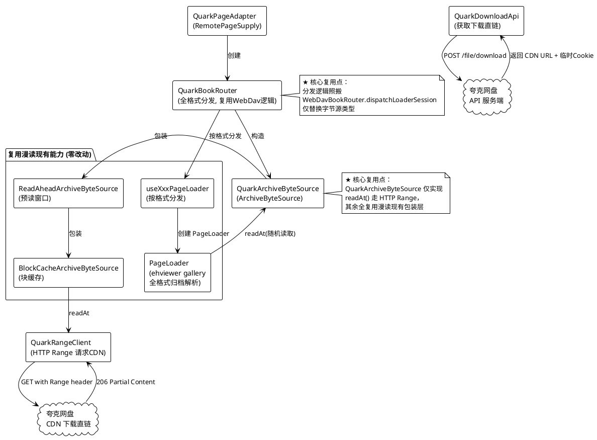
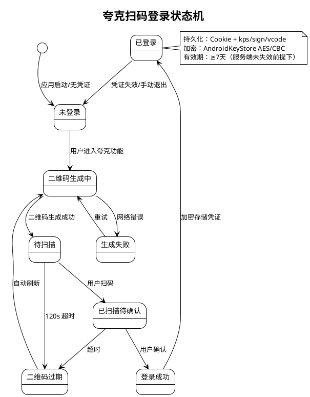
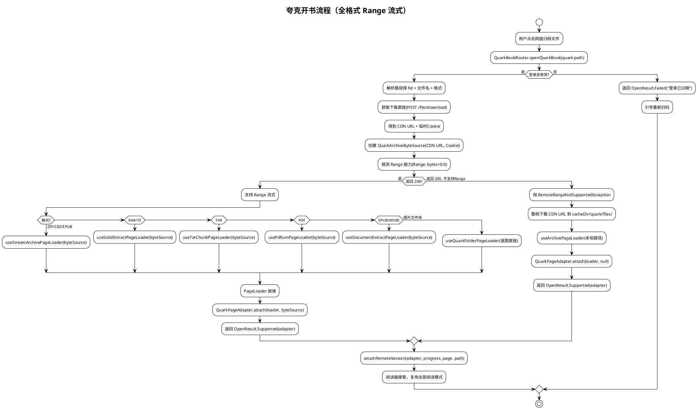
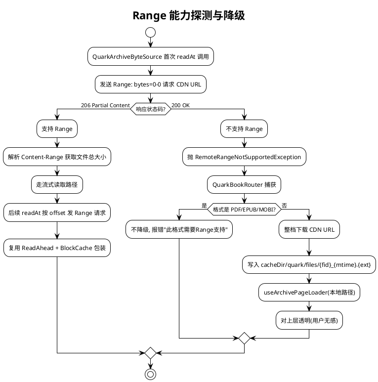
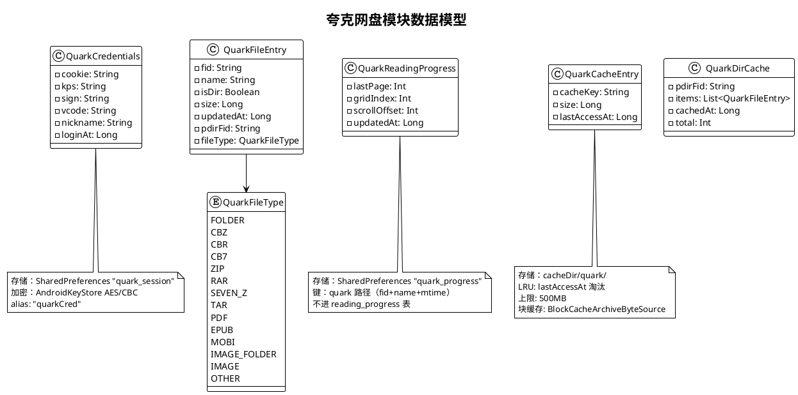
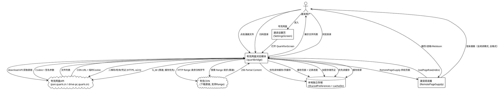

# 夸克网盘浏览功能 技术方案设计

> **项目**: 漫读（MangaReader）
> **版本**: v1.501+
> **日期**: 2026-10-14
> **功能代号**: quark_pan
> **文档类型**: 技术方案设计（design）
> **上游需求**: `docs/夸克网盘浏览功能_需求规格.md`
> **状态**: 待用户确认
> **修订说明**: 本次修订根据用户意见，将原"自研 ZIP Range 引擎（仅 CBZ/ZIP）"方案改为"复用漫读 WebDAV 的 ArchiveByteSource + PageLoader 全格式流式架构"，实现全格式（ZIP/RAR/7Z/PDF/EPUB/MOBI/TAR/文件夹）Range 流式阅读，与 WebDAV 体验完全一致。

---

# 一、需求与存量功能关系分析

## 1.1 需求功能与存量功能对比

漫读已具备成熟的"远程来源 → 阅读器"bridge 架构（SMB / WebDAV / Komga / OPDS 四套 bridge）。**本次分析的关键发现**：漫读 WebDAV/SMB 的远程流式阅读并非各自独立解析归档格式，而是统一基于 `ArchiveByteSource`（随机读取字节源）+ `PageLoader`（ehviewer gallery 全格式归档解析）的两层架构。夸克网盘只需实现 `ArchiveByteSource` 接口走 HTTP Range 请求夸克下载直链，即可**零成本复用漫读全部归档格式的流式解析能力**。

### 1.1.1 已实现功能（可直接复用）

| 需求功能 | 存量功能 | 代码位置 | 匹配度 |
|---------|---------|---------|--------|
| 远程页面流式供给接入阅读器 | `RemotePageSupply` 接口：`loadPageRaw`/`loadBitmap`/`onFocus`/`close` | `native/RemotePageSupply.kt:18` | 100% |
| **远程归档随机读取字节源**（★本次核心复用点） | `ArchiveByteSource` 接口：`readAt(offset,buf,off,len)` + `size` + 预读/重连 | `com/hippo/ehviewer/library/ArchiveByteSource.kt:7` | 100% |
| **全格式归档流式解析**（★本次核心复用点） | `PageLoader`（ehviewer gallery）消费 `ArchiveByteSource`，支持 ZIP/RAR/7Z/PDF/EPUB/MOBI/TAR/文件夹 | `WebDavBookRouter.dispatchLoaderSession:192-338` | 100% |
| **HTTP Range 字节源实现范本** | `WebDavArchiveByteSource`：`readAt` 走 `WebDavClient.readRange` + `ReadAheadArchiveByteSource` 预读 + `BlockCacheArchiveByteSource` 块缓存 | `com/hippo/ehviewer/webdav/WebDavArchiveByteSource.kt:29` | 100% |
| **Range 不支持降级机制** | `WebDavRangeFallbackHandler`：`RemoteRangeNotSupportedException` → 整档下载 → 本地 `useArchivePageLoader` | `webdavbridge/WebDavRangeFallbackHandler.kt:21` | 100% |
| RemotePageSupply 通用实现范本 | `WebDavPageAdapter` / `SmbPageAdapter`：持有 PageLoader，与格式无关 | `webdavbridge/WebDavPageAdapter.kt:26`、`smbbridge/SmbPageAdapter.kt:33` | 100% |
| 路径前缀路由分发 | `Reader.kt` 按 `smb:`/`webdav:`/`komga:`/`opds:` 前缀分发 | `ui/Reader.kt:1138-1144` | 100% |
| 远程会话接入阅读视图 | `attachRemoteSession(supply, saved, targetPage, path)` | `ui/Reader.kt:726` | 100% |
| 凭证加密存储 | AndroidKeyStore + AES/CBC/PKCS7 | `komgabridge/data/KomgaCredentialCrypto.kt` | 100% |
| 连接配置持久化 | SharedPreferences + kotlinx.serialization | `komgabridge/data/KomgaConnectionStore.kt` | 100% |
| HTTP 客户端共享连接池 | Ktor HttpClient 封装 | `komgabridge/api/KomgaHttpClient.kt` | 100% |
| 磁盘缓存目录管理 | cacheDir + LRU | `opdsbridge/cache/OpdsCache.kt` | 100% |
| 模块零侵入初始化注入 | `XxxBridges.init(context)` 单点注入 | `komgabridge/KomgaBridges.kt:13`、`App.kt:158` | 100% |
| 设置页远程服务器入口 | SettingsScreen 中 `if (showXxxServers) XxxServersScreen(...)` | `ui/SettingsScreen.kt:500-511` | 100% |
| 14 套主题 + 深色模式 | Compose MaterialTheme 全局配色 | 主题系统全局 | 100% |
| 翻页/Webtoon/逐格/超分全阅读模式 | PagerReaderView / WebtoonReaderView / CurlReaderView 消费 RemotePageSupply | `native/PagerReaderView.kt:78` | 100% |

### 1.1.2 需要扩展的功能（部分匹配，需改造）

| 需求功能 | 存量功能 | 差异说明 | 扩展方向 |
|---------|---------|---------|---------|
| 扫码登录 + 登录态持久化 | Komga 用 API Key/账号密码认证，无扫码流程 | 夸克无官方 API，需扫码登录获取 Cookie；登录态含 Cookie + kps/sign/vcode 签名参数 | 新建 `QuarkLoginFlow` + `QuarkSessionStore`，复用 `KomgaCredentialCrypto` 加密模式但独立 Keystore alias |
| 网盘目录浏览（分页/缓存/排序） | KomgaBrowserScreen 浏览系列/卷/章 | 夸克目录是扁平文件系统（fid/pdir_fid 树），非 Komga 的系列结构；需分页 50 条、文件夹优先排序 | 新建 `QuarkBrowserScreen`，目录列表 API 独立封装，缓存复用 OpdsCache 模式 |
| 阅读进度记忆（独立存储） | ReadingProgress 表（bookId + path），Komga 进度还回写服务端 | 夸克漫画**不进书架**（不插 manga_books 表），无 bookId；进度需独立存储，不回写夸克 | 新建 `QuarkProgressStore`（独立 SharedPreferences），以 fid+mtime 为键 |
| 反封控（限速/UA 伪装/缓存优先） | 各 bridge 无主动限速 | 夸克无官方 API，需控制请求频率（≤2/s，随机间隔 500-2000ms）、伪装官方 UA、风控降级暂停 | 新建 `QuarkRateLimiter`（全局令牌桶 + 随机抖动）+ `QuarkRequestExecutor` |

### 1.1.3 需要新增的功能或接口

**A. 扫码登录模块（全新）**
- 二维码生成/轮询/确认全流程，120s 有效期自动刷新
- 登录凭证获取（Cookie + 签名参数），加密持久化
- 登录态恢复：应用启动时验证凭证有效性
- 依赖：Ktor + AndroidKeyStore

**B. 网盘目录浏览模块（全新）**
- 目录列表：按 pdir_fid 列目录，分页 50 条，文件夹优先 + 时间倒序
- 目录缓存：本地缓存，二次进入先展示缓存再后台刷新
- 依赖：登录模块（Cookie）、限速模块

**C. 流式阅读模块（全新，★本次核心重构）**
- 下载链接获取：按 fid 获取文件下载直链（HTTP CDN URL）+ 临时 Cookie
- **QuarkArchiveByteSource**：实现 `ArchiveByteSource` 接口，`readAt` 走 HTTP Range 请求 CDN URL
- **QuarkBookRouter**：复用 `WebDavBookRouter.dispatchLoaderSession` 的全格式分发逻辑（按格式选择 useXxxPageLoader）
- **QuarkPageAdapter**：与 `WebDavPageAdapter` 同构，持有 PageLoader，实现 RemotePageSupply
- Range 能力探测：首次请求检测 CDN URL 是否返回 206 Partial Content，不支持则降级全量缓存
- 依赖：`ArchiveByteSource` 接口、`PageLoader`（ehviewer gallery）、`RemotePageSupply` 接口

**D. 缓存与进度模块（全新）**
- 页面数据缓存：复用 `BlockCacheArchiveByteSource` 块缓存（ArchiveByteSource 层）+ 独立 LRU 总量控制
- 阅读进度存储：独立 SharedPreferences，以 fid+mtime 为键
- 退出登录清缓存
- 依赖：无外部模块依赖

**E. 反封控模块（全新）**
- 全局限速器：≤2 req/s，随机间隔 500-2000ms
- UA 伪装：使用夸克官方客户端 UA
- 风控降级：收到限流响应暂停 30s 后低频重试
- 依赖：无外部模块依赖

## 1.2 存量功能详细分析

### 1.2.1 RemotePageSupply 接口契约

**接口定义**（`native/RemotePageSupply.kt:18`）：

| 方法 | 签名 | 语义 |
|------|------|------|
| `pageCount` | `val pageCount: Int` | 总页数 |
| `onPageCountGrow` | `val onPageCountGrow: MutableList<(Int)->Unit>` | 页数增长回调（TAR/RAR 渐进索引） |
| `loadPageRaw` | `suspend fun loadPageRaw(index: Int): ByteArray?` | 供给原始字节；null=该页暂不可用 |
| `loadBitmap` | `suspend fun loadBitmap(index: Int): Bitmap?` | 供给解码位图（含降采样 + OOM 降级） |
| `onFocus` | `fun onFocus(index: Int)` | 焦点页通知（驱动 loader 预取窗口） |
| `close` | `suspend fun close()` | 释放远程会话 |

**关键约束**：阅读视图持有非 null 的 supply 时，页面解析改走远程会话，**完全绕开 ArchiveEngine 的本地路径**（ArchiveEngine 对远程路径有 require 守卫，本地行为零改动）。实现方只需供给字节，翻页/Webtoon/逐格/超分/双指缩放/亮度全部由阅读视图处理。

### 1.2.2 ArchiveByteSource 接口契约（★本次核心复用点）

**接口定义**（`com/hippo/ehviewer/library/ArchiveByteSource.kt:7`）：

```kotlin
interface ArchiveByteSource : AutoCloseable {
    val size: Long                                    // 归档文件总大小
    val isRandomAccess: Boolean get() = true          // 是否支持随机寻址
    fun readAt(offset: Long, buf: ByteArray, off: Int, len: Int): Int  // ★核心：随机读取
    fun warm(offset: Long, length: Int) = Unit        // 预读（下一页/顺序预热）
    fun dropQueuedReads() = Unit                      // 丢弃排队读（seek 前清队列）
    fun requestReconnect() = Unit                     // 重连死连接（SMB sticky）
    override fun close()
}
```

**语义**：`readAt(offset, buf, off, len)` 从归档文件的 `offset` 位置读取最多 `len` 字节到 `buf[off]`，返回实际读取数（0=EOF，-1=错误）。方法是**阻塞**的，仅在归档/IO 线程调用。

**关键发现**：此接口与归档格式**完全无关**——它只提供"远程文件的随机字节读取"能力。归档格式解析（ZIP 中央目录、RAR 索引、PDF xref 等）由上层 `PageLoader` 完成。因此，**任何能提供 HTTP Range 随机读取的远程源，实现此接口后即可复用漫读全格式归档解析**。

### 1.2.3 WebDavBookRouter 全格式分发逻辑（★本次核心复用点）

`WebDavBookRouter.dispatchLoaderSession`（`webdavbridge/WebDavBookRouter.kt:192-338`）展示了漫读如何用 `ArchiveByteSource` + 各种 `useXxxPageLoader` 实现**全格式流式**：

| 格式 | 分发函数 | 说明 |
|------|---------|------|
| 文件夹（含图片序列） | `useWebDavFolderPageLoader` | 逐图加载，非归档解析 |
| PDF（fastMode） | `usePdfiumPageLoader(byteSource)` | Pdfium 流式渲染 |
| PDF/EPUB/MOBI（document） | `useDocumentExtractPageLoader(byteSource)` | 记录级流式文档管线 |
| RAR/7Z（solid） | `useSolidExtractPageLoader(byteSource)` | solid 归档流式提取，失败降级整档下载 |
| TAR/CBT | `useTarChunkPageLoader(byteSource)` | TAR 块流式 |
| ZIP/CBZ/EPUB（stream） | `useStreamArchivePageLoader(byteSource)` | ZIP 中央目录流式 |
| 单图 | `useWebDavFolderPageLoader` | 归入父目录图片序列 |

**所有 `useXxxPageLoader` 都消费同一个 `ArchiveByteSource` 参数**——即 `WebDavArchiveByteSource`（HTTP Range 字节源）。格式分发仅按文件扩展名判断（`isPdfFileName`/`isSolidArchiveFileName`/`isTarArchiveFileName`/`isZipArchiveFileName` 等），与字节源实现无关。

**复用结论**：夸克只需将 `WebDavArchiveByteSource` 替换为 `QuarkArchiveByteSource`，**分发逻辑可完全复用**（按格式选择 useXxxPageLoader 的代码原样照搬）。这实现了用户要求的"复用 WebDAV 流式逻辑，全格式支持"。

### 1.2.4 WebDavArchiveByteSource HTTP Range 实现范本

`WebDavArchiveByteSource`（`com/hippo/ehviewer/webdav/WebDavArchiveByteSource.kt:29`）的实现结构：

```
WebDavArchiveByteSource (入口)
  ├─ ZipAsDirListing 检测（zip 内成员路径 → 递归打开）
  └─ RawWebDavArchiveByteSource (原始 Range 读取)
       ├─ size: HEAD/PROPFIND 探测文件大小（带 3 次重试 + failFast）
       └─ readAt: WebDavClient.readRange(source, password, remote, offset, buf, off, len)
            ↓ 包装层
       ReadAheadArchiveByteSource (预读窗口，顺序归档解析加速)
            ↓ 包装层
       BlockCacheArchiveByteSource (块缓存，近期页回看零网络)
```

**关键设计**：
- `size` 惰性探测，缓存后不再重复请求
- `readAt` 每次一次 Range GET，`RemoteRangeNotSupportedException` 透传给上层降级
- `ReadAheadArchiveByteSource`：固定 8MiB 窗口预读，顺序归档解析（ZIP 中央目录、RAR 索引）加速
- `BlockCacheArchiveByteSource`：块级缓存，近期页回看不重走网络

**复用结论**：`QuarkArchiveByteSource` 照此结构实现，仅将 `WebDavClient.readRange` 替换为对夸克下载直链的 HTTP Range 请求。`ReadAheadArchiveByteSource` 和 `BlockCacheArchiveByteSource` 是**格式无关的通用包装层，可直接复用实例**。

### 1.2.5 Range 不支持降级机制

`WebDavRangeFallbackHandler`（`webdavbridge/WebDavRangeFallbackHandler.kt:21`）处理 `RemoteRangeNotSupportedException`：
1. 调用 `RemoteArchiveOpen.ensureWebDavArchive` 整档下载到本地缓存（含断点续传）
2. 切换为本地 `useArchivePageLoader` 打开（对上层透明）
3. v1 静默降级（不弹提示，用户无感）

`WebDavBookRouter` 中 PDF/EPUB 不做整档降级（`isDocumentFileName` 时直接抛异常），其余格式降级。

**复用结论**：夸克降级逻辑照此模式——`QuarkArchiveByteSource.readAt` 检测到 Range 不支持时抛 `RemoteRangeNotSupportedException`，`QuarkBookRouter` 捕获后整档下载 CDN URL 到 `cacheDir/quark/files/`，再用 `useArchivePageLoader` 本地打开。

### 1.2.6 路由分发机制

**分发逻辑**（`Reader.kt:1138-1148`）：
```
path.startsWith("smb:")    → enterRemoteReader(isSmb=true)
path.startsWith("webdav:") → enterRemoteReader(isSmb=false)
path.startsWith("komga:")  → enterKomgaReader
path.startsWith("opds:")   → enterOpdsReader
path.startsWith("/")       → enterLocalArchiveReader
其余                        → ArchiveEngine.listPages
```

**约束**：夸克需新增 `quark:` 前缀路由 + `enterQuarkReader` 方法，与 `enterKomgaReader` 同构但**不查 manga_books 表**（因夸克不进书架，无 bookId）。

### 1.2.7 bridge 模块零侵入模式

**Komga bridge 结构**（零侵入范本）：
```
komgabridge/
├── KomgaBridges.kt          # 入口：init(context, database) 单点注入
├── KomgaConstants.kt        # 常量
├── api/                     # HTTP 客户端 + API 封装 + 异常
├── data/                    # 连接配置 + 凭证加密
├── reader/                  # 开书路由 + PageAdapter + 路径解析 + 进度回写
└── ui/                      # 服务器列表 + 浏览界面
```

**零侵入保证**：模块所有代码在独立 package，对外仅暴露 `init()` + `openXxxBook()` + UI Screen。仅在三处接入点添加调用（App.kt / Reader.kt / SettingsScreen.kt）。移除模块：删除 package + 还原三处调用，编译运行不受影响。

**约束**：夸克模块照此模式，但**不需要 database 参数**（不进书架，不读写 manga_books/ReadingProgress 表）。

### 1.2.8 凭证加密机制

`KomgaCredentialCrypto`：AES/CBC/PKCS7Padding，密钥 256 位，AndroidKeyStore 硬件隔离，`enc1:` 前缀 + Base64(IV + ciphertext)，Keystore 不可用时降级返回空串不崩溃。

**约束**：夸克复用此模式，独立 Keystore alias（`quarkCred`）+ 独立 prefs（`quark_session`）。

### 1.2.9 夸克网盘 API 调用逻辑（参考 quark-auto-save，独立重写）

从 `quark_auto_save.py` 提取的接口信息（**仅参考 API 端点和参数逻辑，不复制任何代码**）：

| 功能 | 端点 | 方法 | 关键参数 |
|------|------|------|---------|
| 账号信息 | `https://pan.quark.cn/account/info` | GET | `fr=pc, platform=pc` |
| 列目录 | `https://drive-pc.quark.cn/1/clouddrive/file/sort` | GET | `pdir_fid, _page, _size=50, _sort=file_type:asc,updated_at:desc, fetch_risk_file_name=1` |
| 获取下载链接 | `https://drive-pc.quark.cn/1/clouddrive/file/download` | POST | `{fids: [fid]}` → 返回下载 URL + 临时 Cookie |
| 路径转 fid | `https://drive-pc.quark.cn/1/clouddrive/file/info/path_list` | POST | `{file_path: [...], namespace: "0"}` |

**认证方式**：Cookie 字符串（`cookie` header），从 Cookie 中正则提取 `kps`/`sign`/`vcode` 签名参数用于移动端接口。

**User-Agent**：`Mozilla/5.0 (Windows NT 10.0; Win64; x64) AppleWebKit/537.36 (KHTML, like Gecko) quark-cloud-drive/3.14.2 Chrome/112.0.5615.165 Electron/24.1.3.8 Safari/537.36 Channel/pckk_other_ch`

**扫码登录**：quark-auto-save 未实现扫码登录（仅 Cookie 配置），扫码接口需在实现期通过抓包夸克网盘 Web 端（`pan.quark.cn`）登录流程确认。预期接口模式：生成二维码 → 轮询状态 → 确认后获取 Cookie。

**下载直链特性**：夸克 `download` API 返回的是 HTTP CDN URL（带临时 Cookie）。大多数 CDN 支持 HTTP Range 请求（返回 206 Partial Content），**这是本次方案全格式流式的基础**。需在运行期验证具体 CDN 是否支持 Range，不支持则降级全量缓存。

**许可证合规**：以上 API 信息为接口事实（端点/参数/响应格式），非代码复制。夸克网盘 Web 接口为公开可观察的 HTTP 协议，独立编写 Kotlin 实现不引入 AGPL 代码。

---

# 二、增量设计方案

## 2.1 核心技术问题与方案演进

夸克网盘浏览功能的核心技术挑战是：**如何让漫读阅读器流式渲染夸克网盘中的漫画归档文件（全格式）**。

### 原方案的问题

原方案二"自研 RemoteZipReader 仅支持 ZIP/CBZ Range 流式"，存在三个问题：
1. **格式覆盖不足**：仅 ZIP/CBZ 流式，RAR/7Z/PDF/EPUB 降级为全量下载，体验割裂
2. **重复造轮子**：自研 ZIP 中央目录解析 + DEFLATE 解压，而漫读已有成熟的 `PageLoader` 全格式解析
3. **维护负担**：自研 ZIP 引擎需跟进 ZIP 格式变更，且每种新格式都需自研

### 本次方案的核心洞察

**漫读 WebDAV 的流式阅读不是自研归档解析，而是基于两层架构**：
- **底层 `ArchiveByteSource`**：提供远程文件的随机字节读取（HTTP Range），与格式无关
- **上层 `PageLoader`**：消费 `ArchiveByteSource` 做全格式归档解析（ZIP/RAR/7Z/PDF/EPUB/MOBI/TAR）

夸克下载 API 返回的是 HTTP CDN URL，若该 URL 支持 Range 请求（大多数 CDN 支持），则：
- **夸克流式 = 夸克 API 获取下载 URL → 对该 URL 实现 ArchiveByteSource（HTTP Range）→ 复用 PageLoader 全格式解析**

这样**所有格式都能流式**，跟 WebDAV 体验完全一致，且无需自研任何归档解析逻辑。

## 2.2 最终方案：复用 WebDAV 流式架构，全格式 Range 流式

### 2.2.1 方案概述

将夸克网盘的远程归档流式阅读**架构对齐漫读 WebDAV**：

1. **QuarkArchiveByteSource**：实现 `ArchiveByteSource` 接口，`readAt` 走 HTTP Range 请求夸克下载直链（CDN URL），复用 `ReadAheadArchiveByteSource` 预读窗口 + `BlockCacheArchiveByteSource` 块缓存
2. **QuarkBookRouter**：复用 `WebDavBookRouter.dispatchLoaderSession` 的全格式分发逻辑（按格式选择 `useXxxPageLoader`），仅将字节源替换为 `QuarkArchiveByteSource`
3. **QuarkPageAdapter**：与 `WebDavPageAdapter` 同构，持有 PageLoader，实现 `RemotePageSupply`
4. **Range 降级**：CDN URL 不支持 Range 时，整档下载到 `cacheDir/quark/files/`，用 `useArchivePageLoader` 本地打开（复用 `WebDavRangeFallbackHandler` 模式）

### 2.2.2 技术架构设计



### 2.2.3 QuarkArchiveByteSource 实现要点

**职责**：对夸克下载直链（CDN URL）提供 `ArchiveByteSource` 随机读取能力。

**实现结构**（照 `WebDavArchiveByteSource` 同构）：
```
QuarkArchiveByteSource (入口)
  └─ RawQuarkArchiveByteSource (原始 Range 读取)
       ├─ size: HEAD 请求探测 CDN 文件大小（带重试 + failFast）
       └─ readAt: QuarkRangeClient.readRange(cdnUrl, tempCookie, offset, buf, off, len)
            ↓ 复用现有包装层（无需新写）
       ReadAheadArchiveByteSource (预读窗口，直接复用)
            ↓ 复用现有包装层（无需新写）
       BlockCacheArchiveByteSource (块缓存，直接复用)
```

**关键实现**：
- `size`：首次 `HEAD` 请求 CDN URL 获取 `Content-Length`，缓存后不再重复；失败 3 次重试 + failFast 1.5s
- `readAt(offset, buf, off, len)`：构造 `Range: bytes={offset}-{offset+len-1}` 请求 CDN URL，携带下载 API 返回的临时 Cookie；返回 `206` 时读取 body 到 buf；返回 `200`（不支持 Range）时抛 `RemoteRangeNotSupportedException` 触发上层降级
- `close()`：取消所有 in-flight Range 请求协程
- **复用 `ReadAheadArchiveByteSource` 和 `BlockCacheArchiveByteSource`**：这两个是格式无关的通用包装层，直接实例化包装，无需新写

**与 `WebDavArchiveByteSource` 的差异**：
| 维度 | WebDavArchiveByteSource | QuarkArchiveByteSource |
|------|------------------------|----------------------|
| 远程协议 | WebDAV PROPFIND/GET | HTTP GET with Range |
| 认证 | WebDAV BasicAuth（source 配置） | 下载 API 返回的临时 Cookie |
| size 探测 | `WebDavClient.fileSizeOrNull` | `HEAD` 请求 CDN URL |
| Range 读取 | `WebDavClient.readRange` | `QuarkRangeClient.readRange`（Ktor HttpClient） |
| 预读/块缓存 | `ReadAheadArchiveByteSource` + `BlockCacheArchiveByteSource` | **直接复用**（相同实例） |
| zip-as-dir | `ZipAsDirListing` 支持 | 暂不支持（夸克无此场景） |

### 2.2.4 QuarkBookRouter 分发逻辑（复用 WebDavBookRouter）

**职责**：按归档格式选择 `useXxxPageLoader`，创建 `PageLoader` 并接入 `QuarkPageAdapter`。

**实现方式**：`QuarkBookRouter.dispatchLoaderSession` 的分发逻辑**照搬 `WebDavBookRouter.dispatchLoaderSession:192-338`**，仅做以下替换：
- `WebDavArchiveByteSource(source, password, remote, ...)` → `QuarkArchiveByteSource(cdnUrl, tempCookie, ...)`
- `WebDavGateway.listDirectory` → `QuarkDirService.listDir`（文件夹书场景）
- `useWebDavFolderPageLoader` → 需新建 `useQuarkFolderPageLoader`（或复用通用文件夹 loader，见下文）
- 其余 `usePdfiumPageLoader`/`useDocumentExtractPageLoader`/`useSolidExtractPageLoader`/`useTarChunkPageLoader`/`useStreamArchivePageLoader` **原样复用**（它们只消费 `ArchiveByteSource`，与字节源实现无关）

**格式分发表**（与 WebDAV 完全一致）：

| 格式 | 分发函数 | 流式方式 | Range 降级 |
|------|---------|---------|-----------|
| ZIP/CBZ/EPUB | `useStreamArchivePageLoader` | ZIP 中央目录流式 | 整档下载 |
| RAR/CBR/7Z/CB7 | `useSolidExtractPageLoader` | solid 归档流式提取 | 整档下载（已有降级） |
| TAR/CBT | `useTarChunkPageLoader` | TAR 块流式 | 整档下载 |
| PDF | `usePdfiumPageLoader` / `useDocumentExtractPageLoader` | Pdfium/记录级流式 | 不降级（v1） |
| EPUB/MOBI | `useDocumentExtractPageLoader` | 记录级流式文档 | 不降级（v1） |
| 文件夹（图片序列） | `useQuarkFolderPageLoader` | 逐图直链加载 | 不适用 |
| 单图 | `useQuarkFolderPageLoader` | 归入父目录 | 不适用 |

**文件夹书处理**：夸克网盘的"图片文件夹"场景（一个文件夹含 JPG/PNG/WebP 序列）需新建 `useQuarkFolderPageLoader`。实现方式：对文件夹内每张图片调用夸克 `download` API 获取直链，`loadPageRaw(index)` 直接 GET 第 index 张图片直链。这与 `useWebDavFolderPageLoader` 同构，仅将 WebDAV 文件读取替换为夸克直链 GET。

### 2.2.5 Range 能力探测与降级策略

**探测时机**：`QuarkArchiveByteSource` 首次 `readAt` 调用时（或首次 `size` 探测时附带探测）。

**探测方式**：发送 `Range: bytes=0-0` 请求 CDN URL：
- 返回 `206 Partial Content` → 支持 Range，走流式
- 返回 `200 OK`（完整文件） → 不支持 Range，抛 `RemoteRangeNotSupportedException`

**降级流程**（照 `WebDavRangeFallbackHandler` 模式）：
1. `QuarkBookRouter` 捕获 `RemoteRangeNotSupportedException`
2. 整档下载 CDN URL 到 `cacheDir/quark/files/{fid}_{mtime}.{ext}`（Ktor 流式写文件，显示进度）
3. 用 `useArchivePageLoader(localPath)` 本地打开（复用漫读本地 ArchiveEngine 全格式能力）
4. 对上层 `QuarkPageAdapter` 透明（`resetForRetry` 后重新 attach 本地 loader）
5. PDF/EPUB/MOBI 不做整档降级（与 WebDAV 一致，直接报错）

**降级触发频率预期**：大多数 CDN 支持 Range（206），降级为罕见路径。但作为兜底必须存在，保证可用性。

### 2.2.6 适用场景与优势

| 维度 | 评估 |
|------|------|
| **格式覆盖** | 100%（ZIP/RAR/7Z/PDF/EPUB/MOBI/TAR/文件夹），与 WebDAV 完全一致 |
| **首屏性能** | 优（只需首页数据 + 归档索引，非整文件），所有格式均边下边看 |
| **带宽消耗** | 低（按页/按块请求，非整文件） |
| **缓存空间** | 低（块缓存 + 页缓存，非整文件） |
| **二次浏览** | 快（块缓存命中 + 页缓存命中） |
| **实现复杂度** | ★★☆☆☆（低，复用 PageLoader + ArchiveByteSource 架构，仅新写字节源 ~150 行） |
| **维护成本** | 极低（格式新增跟随漫读主版本，无需自研归档解析） |
| **与 WebDAV 一致性** | 高（架构同构，分发逻辑照搬，字节源仅协议差异） |

## 2.3 三个视角审视

### 2.3.1 用户视角

| 关注点 | 评估 | 设计保障 |
|--------|------|---------|
| **体验是否流畅** | ✅ 优 | 全格式边下边看，首屏只需首页数据（非整文件）；翻到已缓存页 300ms 内切换；预读窗口覆盖邻近页 |
| **登录是否方便** | ✅ 优 | 扫码登录（夸克 App 扫码），与微信/支付宝扫码体验一致；登录态加密持久化，重启免重登；7 天有效期 |
| **浏览是否直观** | ✅ 优 | 目录浏览复用漫读现有 UI 模式（与 Komga/WebDAV 浏览同构）；文件夹优先 + 时间倒序；文件类型区分标识；下拉刷新 |
| **出错提示是否友好** | ✅ 优 | 网络异常自动重试 3 次（指数退避）+ 友好提示；Range 不支持静默降级（用户无感）；登录过期引导重登；API 变更提示"服务接口可能已变更"；风控提示"访问被限制，请稍后再试" |
| **阅读模式完整** | ✅ 优 | 复用漫读全部阅读能力（翻页/Webtoon/逐格/超分/双指缩放/亮度），与本地/WebDAV 打开体验完全一致 |
| **进度记忆** | ✅ 优 | 自动记录阅读位置（页码/格索引/滚动偏移），二次打开恢复并提示 |

### 2.3.2 开发经理视角

| 关注点 | 评估 | 设计保障 |
|--------|------|---------|
| **工期是否合理** | ✅ 合理 | 复用 ArchiveByteSource + PageLoader 架构，新增代码量 ~1800 行（vs 原方案 ~2250 行）；核心流式逻辑仅 ~350 行（字节源 + 路由），其余为登录/浏览/缓存/UI |
| **风险是否可控** | ✅ 可控 | 主要风险：扫码登录接口（需抓包，有 Cookie 导入降级）、Range 支持（有全量缓存降级）；所有风险均有降级路径，无单点不可恢复 |
| **维护成本** | ✅ 极低 | 复用 PageLoader 全格式解析，格式新增/变更跟随漫读主版本；不自研归档解析，无 ZIP/RAR 格式跟进负担；与 WebDAV 架构同构，排查问题可参照 WebDAV |
| **零侵入** | ✅ 真正零侵入 | 仅修改 3 个现有文件约 35 行（App.kt 1 行 init + Reader.kt 1 行路由 + SettingsScreen.kt ~30 行入口）；全部新增逻辑在 `quarkbridge/` 独立 package；不读写 manga_books/ReadingProgress 核心表；移除模块还原 35 行即可 |
| **许可证合规** | ✅ 合规 | 全部独立编写，仅参考 API 端点事实；不引入 AGPL 代码；不复制 quark-auto-save 任何源码 |

### 2.3.3 程序员视角

| 关注点 | 评估 | 设计保障 |
|--------|------|---------|
| **代码结构是否清晰** | ✅ 清晰 | `QuarkArchiveByteSource` 与 `WebDavArchiveByteSource` 同构（仅协议差异）；`QuarkBookRouter` 分发逻辑照搬 `WebDavBookRouter`（仅替换字节源）；`QuarkPageAdapter` 与 `WebDavPageAdapter` 同构；层次分明：字节源 → PageLoader → PageAdapter → RemotePageSupply |
| **接口设计是否合理** | ✅ 合理 | 实现两个现有接口（`ArchiveByteSource` + `RemotePageSupply`），不引入新接口；接口契约明确（readAt 阻塞语义、loadPageRaw null 语义）；与 WebDAV/SMB 实现一致，可对比验证 |
| **错误处理是否完备** | ✅ 完备 | `RemoteRangeNotSupportedException` 降级；`IOException` 软失败不崩溃；网络重试 3 次指数退避；size 探测 failFast 防锤击；close 取消所有 in-flight 协程；OOM 降级（loadBitmap 降采样 + gc 兜底） |
| **测试是否方便** | ✅ 方便 | `QuarkArchiveByteSource` 可 mock HTTP Range 响应（206/200）单元测试；分发逻辑与 WebDAV 同构可对比验证；`QuarkRateLimiter` 可独立测试令牌桶逻辑；登录流程可 mock API 响应测试状态机 |

## 2.4 关键技术决策依据

| 决策 | 选择 | 依据 |
|------|------|------|
| **流式架构** | **复用 ArchiveByteSource + PageLoader**（★本次核心变更） | 用户要求复用 WebDAV 流式逻辑全格式支持；漫读已有成熟两层架构，无需自研归档解析 |
| **归档字节源** | `QuarkArchiveByteSource : ArchiveByteSource`，HTTP Range 请求 CDN URL | 接口与格式无关，仅提供随机读取；复用 ReadAhead + BlockCache 包装层 |
| **格式分发** | 照搬 `WebDavBookRouter.dispatchLoaderSession` | 全格式 useXxxPageLoader 只消费 ArchiveByteSource，与字节源实现无关 |
| **Range 降级** | 整档下载 + `useArchivePageLoader` 本地打开 | 复用 `WebDavRangeFallbackHandler` 模式；保证可用性兜底 |
| 模块架构 | 独立 bridge（`quarkbridge/` package） | 零侵入原则，照 Komga/OPDS bridge 模式 |
| 阅读器接入 | 实现 `RemotePageSupply` 接口 | 漫读唯一远程阅读接入点，复用全部阅读能力 |
| 路径前缀 | `quark:` | 与 `komga:`/`smb:`/`webdav:`/`opds:` 同构 |
| 书架隔离 | 不插 manga_books 表，不生成 Book 记录 | 需求明确"夸克漫画不进书架" |
| 进度存储 | 独立 SharedPreferences（`quark_progress`） | 不进 ReadingProgress 表（无 bookId），独立以 fid+mtime 为键 |
| 凭证加密 | AndroidKeyStore + AES/CBC/PKCS7，独立 alias `quarkCred` | 复用 KomgaCredentialCrypto 模式，独立 alias 隔离 |
| 认证方式 | 扫码登录 + Cookie 持久化 | 需求明确要求扫码登录 |
| HTTP 客户端 | Ktor（已有依赖） | 复用漫读现有 HTTP 栈，不引入新依赖 |
| 限速 | 全局令牌桶 ≤2 req/s + 随机间隔 500-2000ms | 反封控需求 |
| 缓存 | cacheDir/quark/，LRU 500MB 上限 + BlockCacheArchiveByteSource 块缓存 | 复用 OpdsCache 模式 + 现有块缓存层 |
| 许可证 | 全部独立编写，不引入 AGPL 代码 | 仅参考 API 端点事实，合规 |

## 2.5 模块总体架构

```plantuml
@startuml
!theme plain
skinparam componentStyle rectangle
skinparam packageStyle frame

package "quarkbridge (独立模块)" {
    component "QuarkBridges\n(入口: init)" as bridges
    component "QuarkConstants" as consts

    package "auth" {
        component "QuarkLoginFlow\n(扫码登录)" as login
        component "QuarkSessionStore\n(凭证持久化)" as session
        component "QuarkCredentialCrypto\n(加密)" as crypto
    }

    package "api" {
        component "QuarkHttpClient\n(Ktor共享池)" as http
        component "QuarkApiClient\n(接口封装)" as api
        component "QuarkRateLimiter\n(限速器)" as limiter
        component "QuarkException" as exc
    }

    package "browser" {
        component "QuarkDirService\n(目录列表+缓存)" as dir
    }

    package "reader" {
        component "QuarkBookRouter\n(开书路由+全格式分发)" as router
        component "QuarkPageAdapter\n(RemotePageSupply)" as adapter
        component "QuarkArchiveByteSource\n(HTTP Range字节源)" as byteSource
        component "QuarkRangeClient\n(Range请求CDN)" as rangeClient
        component "QuarkFolderReader\n(图片文件夹)" as folderReader
        component "QuarkPaths\n(路径解析)" as paths
    }

    package "data" {
        component "QuarkProgressStore\n(独立进度)" as progress
        component "QuarkCacheManager\n(缓存+LRU)" as cache
    }

    package "ui" {
        component "QuarkLoginScreen\n(扫码界面)" as loginUi
        component "QuarkBrowserScreen\n(目录浏览)" as browserUi
    }
}

package "复用漫读现有 (零改动)" #LightBlue {
    component "PageLoader\n(ehviewer gallery)" as loader
    component "ReadAheadArchiveByteSource" as readAhead
    component "BlockCacheArchiveByteSource" as blockCache
    component "useXxxPageLoader\n(全格式分发)" as useLoader
    component "RemotePageSupply\n(阅读器接口)" as rps
    component "ArchiveByteSource\n(字节源接口)" as abs
}

component "App.kt\n(注入点)" as app
component "Reader.kt\n(路由点)" as readerKt
component "SettingsScreen.kt\n(入口点)" as settings
cloud "夸克网盘服务端" as server
cloud "夸克CDN\n(下载直链)" as cdn

app --> bridges : init(context)
settings --> loginUi : 入口
settings --> browserUi : 入口
readerKt --> router : quark: 路由
router --> adapter : 创建
router --> useLoader : 按格式分发
useLoader --> loader : 创建
loader --> byteSource : readAt
adapter ..|> rps : 实现
byteSource ..|> abs : 实现
byteSource --> readAhead : 包装
readAhead --> blockCache : 包装
blockCache --> rangeClient : readAt
rangeClient --> cdn : HTTP Range
api --> server : HTTPS
api --> limiter : 限速
login --> server : 扫码
session --> crypto : 加密

@enduml
```

## 2.6 实现设计文档（核心流程）

### 2.6.1 扫码登录状态机



### 2.6.2 开书流程（全格式流式，复用 WebDAV 分发）



### 2.6.3 Range 能力探测与降级流程



## 2.7 需修改的具体代码文件

本功能遵循零侵入原则，对现有代码的修改**仅限 3 个文件的极少量新增行**，不改动任何现有逻辑。

### 文件 1：`app/src/main/java/com/mangareader/App.kt`

**修改位置**：第 158 行附近（`KomgaBridges.init` 之后）
**修改内容**：新增 1 行初始化调用

```kotlin
// 现有：
com.mangareader.komgabridge.KomgaBridges.init(this@App, db)
// 新增（1行）：
com.mangareader.quarkbridge.QuarkBridges.init(this@App)
```

**影响范围**：仅新增一行调用，不改动现有 init 链。夸克不需要 database 参数（不进书架）。

### 文件 2：`app/src/main/java/com/mangareader/ui/Reader.kt`

**修改位置 A**：第 1142-1144 行附近（路由分发区）
**修改内容**：新增 1 行路由

```kotlin
// 现有：
if (path.startsWith("komga:")) return enterKomgaReader(b, path, targetPage)
if (path.startsWith("opds:")) return enterOpdsReader(b, path, targetPage)
// 新增（1行，插入 komga 和 opds 之间）：
if (path.startsWith("quark:")) return enterQuarkReader(path, targetPage)
```

**修改位置 B**：第 907 行附近（`enterKomgaReader` 方法之后）
**修改内容**：新增 `enterQuarkReader` 方法（约 30 行，与 `enterKomgaReader` 同构但**不查 manga_books 表**）

```kotlin
// 新增方法（约30行，与 enterKomgaReader 同构）：
suspend fun enterQuarkReader(path: String, targetPage: Int): List<...> {
    loading = true
    try {
        val saved = QuarkProgressStore(QuarkBridges.context).getProgress(path)
        val resumePage = if (targetPage >= 0) targetPage else (saved?.lastPage ?: 0)
        when (val r = QuarkBookRouter.openQuarkBook(path, resumePage)) {
            is QuarkBookRouter.OpenResult.Supported ->
                return attachRemoteSession(r.supply, null, targetPage, path)
            is QuarkBookRouter.OpenResult.Failed -> {
                Toast.makeText(ctx, r.message, Toast.LENGTH_SHORT).show()
                viewing = false; loading = false; return emptyList()
            }
        }
    } catch (t: Throwable) { ... }
}
```

**关键差异**：`enterQuarkReader` 不接收 `Book` 参数（夸克无 Book 记录），`attachRemoteSession` 的 `saved` 参数传 `null`（进度由 QuarkProgressStore 独立管理）。

**影响范围**：新增 1 行路由 + 1 个新方法，不改动任何现有方法。

### 文件 3：`app/src/main/java/com/mangareader/ui/SettingsScreen.kt`

**修改位置**：第 506-511 行附近（远程服务器入口区）
**修改内容**：新增 3 行（1 个 if 块 + 1 个状态变量）

```kotlin
// 现有：
if (showKomgaServers) { KomgaServersScreen(...) }
if (showOpdsServers) { OpdsServersScreen(...) }
// 新增（3行）：
if (showQuarkPan) {
    com.mangareader.quarkbridge.ui.QuarkPanScreen(onBack = { showQuarkPan = false }, onOpenBook = { id -> onOpenBook?.invoke(id, null, -1) })
}
```

另需在设置列表中新增一个入口项（约 5 行 Compose 代码，与 SMB/Komga 入口同构）。

**影响范围**：新增 1 个 if 块 + 1 个入口项，不改动现有设置项。

### 新增文件清单（全部在 `quarkbridge/` package，零侵入）

| 文件 | 职责 | 行数估算 | 复用说明 |
|------|------|---------|---------|
| `quarkbridge/QuarkBridges.kt` | 模块入口，init(context) | ~15 | 照 KomgaBridges |
| `quarkbridge/QuarkConstants.kt` | 常量（SCHEME/alias/prefs/tag） | ~15 | 照 KomgaConstants |
| `quarkbridge/auth/QuarkLoginFlow.kt` | 扫码登录流程（生成/轮询/确认） | ~200 | 全新 |
| `quarkbridge/auth/QuarkSessionStore.kt` | 凭证持久化（加密 Cookie） | ~80 | 照 KomgaConnectionStore |
| `quarkbridge/auth/QuarkCredentialCrypto.kt` | AndroidKeyStore 加密 | ~65 | 照 KomgaCredentialCrypto |
| `quarkbridge/api/QuarkHttpClient.kt` | Ktor 客户端（共享池 + UA 伪装） | ~60 | 照 KomgaHttpClient |
| `quarkbridge/api/QuarkApiClient.kt` | 接口封装（ls_dir/download/account） | ~200 | 全新 |
| `quarkbridge/api/QuarkRateLimiter.kt` | 全局限速器（令牌桶 + 随机抖动） | ~80 | 全新 |
| `quarkbridge/api/QuarkException.kt` | 异常体系 | ~30 | 照 KomgaException |
| `quarkbridge/browser/QuarkDirService.kt` | 目录列表 + 缓存 | ~150 | 全新 |
| `quarkbridge/reader/QuarkBookRouter.kt` | 开书路由 + **全格式分发（照搬 WebDavBookRouter）** | ~250 | ★分发逻辑复用 |
| `quarkbridge/reader/QuarkPageAdapter.kt` | RemotePageSupply 实现 | ~200 | ★照 WebDavPageAdapter |
| `quarkbridge/reader/QuarkArchiveByteSource.kt` | **HTTP Range 字节源（★本次核心）** | ~150 | ★照 WebDavArchiveByteSource |
| `quarkbridge/reader/QuarkRangeClient.kt` | HTTP Range 请求 CDN | ~80 | 全新 |
| `quarkbridge/reader/QuarkFolderReader.kt` | 图片文件夹逐图读取 | ~100 | 照 useWebDavFolderPageLoader |
| `quarkbridge/reader/QuarkPaths.kt` | 路径解析（quark:{fid}:{name}.{ext}） | ~40 | 照 WebDavPaths |
| `quarkbridge/data/QuarkProgressStore.kt` | 独立进度存储 | ~70 | 全新 |
| `quarkbridge/data/QuarkCacheManager.kt` | 缓存管理 + LRU | ~100 | 照 OpdsCache |
| `quarkbridge/ui/QuarkPanScreen.kt` | 夸克网盘主界面（登录/浏览分发） | ~80 | 全新 |
| `quarkbridge/ui/QuarkLoginScreen.kt` | 扫码登录界面 | ~150 | 全新 |
| `quarkbridge/ui/QuarkBrowserScreen.kt` | 目录浏览界面 | ~250 | 照 KomgaBrowserScreen |
| **合计** | | **~2185 行** | |

**与原方案对比**：原方案 ~2250 行（含自研 `QuarkZipStreamReader` ~350 行），本次 ~2185 行（无自研 ZIP 引擎，但 `QuarkBookRouter` 分发逻辑 ~250 行含全格式分发）。核心变化：**删除自研 ZIP 引擎，改为复用 PageLoader 全格式解析**。

### 零侵入保证

1. **编译期隔离**：全部新增代码在 `com.mangareader.quarkbridge` package，不 import 任何现有模块内部类（仅 import `ArchiveByteSource` + `RemotePageSupply` 接口 + `useXxxPageLoader` 函数 + `ReadAheadArchiveByteSource`/`BlockCacheArchiveByteSource` 通用包装层 + Context）
2. **运行期隔离**：不读写 manga_books / ReadingProgress / bookmarks 等核心表；不调用 ArchiveEngine 的远程路径方法（仅调用本地文件方法，降级时）
3. **移除保证**：删除 `quarkbridge/` package + 还原 3 个文件的约 35 行新增代码 → 漫读编译运行完全不受影响

## 2.8 接口设计

### 2.8.1 总体设计

| 接口分类 | 接口名 | 稳定性 | 说明 |
|---------|--------|:---:|------|
| 模块入口 | `QuarkBridges.init(context)` | 稳定 | App.kt 单点调用 |
| 开书路由 | `QuarkBookRouter.openQuarkBook(path, page)` | 稳定 | Reader.kt 路由调用 |
| **归档字节源** | `QuarkArchiveByteSource : ArchiveByteSource` | 稳定 | ★本次核心，HTTP Range |
| 页面供给 | `QuarkPageAdapter : RemotePageSupply` | 稳定 | 阅读器接口实现 |
| 登录流程 | `QuarkLoginFlow` | 实验 | 扫码接口待确认 |
| 目录服务 | `QuarkDirService` | 稳定 | 浏览界面调用 |
| 进度存储 | `QuarkProgressStore` | 稳定 | 阅读器外读写 |
| 缓存管理 | `QuarkCacheManager` | 稳定 | 设置界面调用 |

### 2.8.2 接口清单

#### QuarkBridges（模块入口）

```kotlin
object QuarkBridges {
    fun init(context: Context)   // App.kt 调用，注入 applicationContext
    val context: Context          // 模块内获取上下文
}
```
- **前置条件**：Application onCreate 中调用
- **后置条件**：模块内可通过 `QuarkBridges.context` 获取上下文
- **注意**：不需要 database 参数（不进书架）

#### QuarkBookRouter（开书路由）

```kotlin
object QuarkBookRouter {
    sealed interface OpenResult {
        class Supported(val supply: RemotePageSupply) : OpenResult
        class Failed(val message: String) : OpenResult
    }
    suspend fun openQuarkBook(filePath: String, startPage: Int = 0): OpenResult
}
```
- **业务说明**：解析 `quark:` 路径，获取下载直链，创建 QuarkArchiveByteSource，按格式分发 useXxxPageLoader，创建 RemotePageSupply
- **前置条件**：已登录（QuarkSessionStore 有有效凭证）
- **后置条件**：返回 Supported 时 supply 可直接传入 attachRemoteSession
- **异常映射**：认证失败→Failed("登录已过期")；网络超时→Failed("连接超时")；Range 不支持→内部降级（对上层透明）；格式不支持→Failed("暂不支持此格式")
- **与 WebDavBookRouter 的差异**：不返回 bookId（不进书架）；不回写服务端进度；字节源为 QuarkArchiveByteSource（HTTP Range）而非 WebDavArchiveByteSource（WebDAV PROPFIND/GET）

#### QuarkArchiveByteSource（★本次核心接口实现）

```kotlin
class QuarkArchiveByteSource(
    private val cdnUrl: String,          // 夸克下载直链（HTTP CDN URL）
    private val tempCookie: String,      // 下载 API 返回的临时 Cookie
    private val knownSize: Long = -1L,   // 已知大小（跳过 HEAD 探测）
    private val rateLimiter: QuarkRateLimiter,  // 限速器
) : ArchiveByteSource {
    override val size: Long
    override fun readAt(offset: Long, buf: ByteArray, off: Int, len: Int): Int
    override fun close()
    // warm/dropQueuedReads/requestReconnect 由 ReadAheadArchiveByteSource 包装层提供
}
```
- **业务说明**：对夸克 CDN URL 提供 ArchiveByteSource 随机读取；readAt 走 HTTP Range 请求
- **前置条件**：cdnUrl 有效（未过期），tempCookie 有效
- **size 语义**：首次 HEAD 请求 CDN URL 获取 Content-Length，缓存后不再重复
- **readAt 语义**：构造 `Range: bytes={offset}-{offset+len-1}` 请求；206→读取 body；200→抛 RemoteRangeNotSupportedException
- **限速**：每次 readAt 前调用 rateLimiter.acquire()
- **复用包装层**：构造时用 `ReadAheadArchiveByteSource` + `BlockCacheArchiveByteSource` 包装（与 WebDavArchiveByteSource 相同）

#### QuarkPageAdapter（页面供给）

```kotlin
class QuarkPageAdapter(
    private val scope: CoroutineScope = CoroutineScope(SupervisorJob() + Dispatchers.IO),
) : RemotePageSupply {
    override val pageCount: Int
    override val onPageCountGrow: MutableList<(Int) -> Unit>
    override suspend fun loadPageRaw(index: Int): ByteArray?
    override suspend fun loadBitmap(index: Int): Bitmap?
    override fun onFocus(index: Int)
    override suspend fun close()
    suspend fun attach(loader: PageLoader, source: ArchiveByteSource?, sizeSettled: Boolean)
    suspend fun awaitReady(): PageLoader
    suspend fun awaitClose()
    fun failAsync(t: Throwable)
    fun resetForRetry()
}
```
- **业务说明**：持有 PageLoader，与格式无关；与 WebDavPageAdapter 同构
- **loadPageRaw 语义**：通过 loader.openSource(index) 获取页面字节源，读取原始字节
- **与 WebDavPageAdapter 的差异**：无差异（实现照搬）

#### QuarkLoginFlow（扫码登录）

```kotlin
class QuarkLoginFlow(private val apiClient: QuarkApiClient) {
    sealed class QrState {
        object Generating : QrState()
        class Waiting(val qrImageBytes: ByteArray) : QrState()
        object Scanned : QrState()
        object Confirmed : QrState()
        object Expired : QrState()
        class Failed(val message: String) : QrState()
    }
    suspend fun generateQrCode(): QrState.Waiting
    suspend fun pollStatus(token: String): QrState
    suspend fun confirmAndGetCredentials(token: String): QuarkCredentials
}
```
- **业务说明**：扫码登录全流程（生成→轮询→确认→获取凭证）
- **稳定性**：实验（扫码接口待实现期抓包确认）

#### QuarkDirService（目录浏览）

```kotlin
class QuarkDirService(private val apiClient: QuarkApiClient, private val cache: QuarkCacheManager) {
    suspend fun listDir(pdirFid: String, page: Int = 1, forceRefresh: Boolean = false): QuarkDirResult
}
data class QuarkDirResult(val items: List<QuarkFileEntry>, val hasMore: Boolean, val fromCache: Boolean)
data class QuarkFileEntry(val fid: String, val name: String, val isDir: Boolean, val size: Long, val updatedAt: Long, val pdirFid: String)
```
- **业务说明**：列目录，缓存优先 + 后台刷新

#### QuarkProgressStore（独立进度）

```kotlin
class QuarkProgressStore(context: Context) {
    fun getProgress(path: String): QuarkReadingProgress?
    fun saveProgress(path: String, progress: QuarkReadingProgress)
    fun clearAll()
}
data class QuarkReadingProgress(val lastPage: Int, val gridIndex: Int, val scrollOffset: Int, val updatedAt: Long)
```
- **业务说明**：夸克漫画阅读进度独立存储（SharedPreferences，以 path 为键）
- **与 ReadingProgress 表的关系**：完全独立，不读写 manga_books / reading_progress 表

#### QuarkRateLimiter（限速器）

```kotlin
class QuarkRateLimiter(
    private val maxPerSecond: Int = 2,
    private val minIntervalMs: Long = 500,
    private val maxIntervalMs: Long = 2000,
) {
    suspend fun acquire()  // 阻塞直到获得令牌（含随机抖动）
    fun suspendFor(seconds: Long)  // 风控降级暂停
}
```
- **业务说明**：全局请求限速，≤2 req/s，随机间隔 500-2000ms

## 2.9 数据模型

### 2.9.1 设计目标

- 支持夸克网盘目录浏览、流式阅读、进度记忆、缓存管理全部业务场景
- **不修改漫读任何现有数据库表**（manga_books / reading_progress / bookmarks 等核心表零变更）
- 夸克数据全部使用独立存储（SharedPreferences + 文件系统），与书架/记忆库完全隔离
- 凭证加密存储，进度/缓存可明文（非敏感数据）

### 2.9.2 模型实现



### 2.9.3 存储策略

| 数据 | 存储方式 | 加密 | 生命周期 | 与核心表关系 |
|------|---------|:---:|---------|:---:|
| 登录凭证（Cookie/kps/sign/vcode） | SharedPreferences `quark_session` | ✅ AndroidKeyStore | 登录→退出/失效 | 无关 |
| 账号昵称/登录时间 | SharedPreferences `quark_session` | ❌ 明文 | 同上 | 无关 |
| 目录列表缓存 | 文件 `cacheDir/quark/dirs/{pdirFid}.json` | ❌ 明文 | 浏览→LRU淘汰/退出清 | 无关 |
| **归档流式块缓存** | `BlockCacheArchiveByteSource` 内存块缓存 | ❌ 明文 | 阅读→关闭释放 | 无关 |
| 页面数据缓存 | 文件 `cacheDir/quark/pages/{fid}/{index}.dat` | ❌ 明文 | 阅读→LRU淘汰/退出清 | 无关 |
| 归档全量缓存（Range降级） | 文件 `cacheDir/quark/files/{fid}_{mtime}.{ext}` | ❌ 明文 | 阅读→LRU淘汰/退出清 | 无关 |
| 阅读进度 | SharedPreferences `quark_progress` | ❌ 明文 | 阅读→退出清 | **不进 reading_progress 表** |
| 限速配置 | 代码常量（不持久化） | — | — | 无关 |

### 2.9.4 书架隔离处理（特殊约束）

| 环节 | Komga 做法 | 夸克做法 | 理由 |
|------|-----------|---------|------|
| 打开漫画时 | `dao.insertBookWithStableId(Book(...))` 插入 manga_books | **不插入** manga_books | 不进书架 |
| 阅读进度 | `dao.getProgress(bookId, path)` | `QuarkProgressStore.getProgress(path)` 独立存储 | 无 bookId |
| 封面显示 | `coverPath = "cv:komga:..."` 写入 Book | **不生成** coverPath，浏览界面内联加载缩略图 | 不进书架 |
| 书架列表 | source="komga" 的 Book 出现在书架 | **不出现**（无 Book 记录） | 隔离 |
| 退出登录 | `dao.deleteKomgaBooks(serverId)` | `QuarkProgressStore.clearAll()` + `QuarkCacheManager.clearAll()` | 独立清理 |

**隔离保证**：夸克漫画在漫读书架、记忆库、阅读历史中**完全不可见**，仅通过夸克网盘浏览界面访问。

## 2.10 上下文视图



## 2.11 实施步骤规划

| 阶段 | 内容 | 依赖 | 产出 |
|------|------|------|------|
| **P1 基础设施** | QuarkBridges/Constants/HttpClient/RateLimiter/Exception | 无 | 限速 HTTP 底座 |
| **P2 扫码登录** | QuarkLoginFlow/SessionStore/CredentialCrypto + LoginScreen | P1 | 登录态获取与持久化 |
| **P3 目录浏览** | QuarkApiClient(ls_dir) + QuarkDirService + BrowserScreen | P2 | 网盘目录浏览 |
| **P4 全格式流式阅读**（★本次核心） | QuarkArchiveByteSource + QuarkRangeClient + QuarkBookRouter(全格式分发) + QuarkPageAdapter + Reader.kt 接入 | P3 | **全格式 Range 流式可用** |
| **P5 Range 降级** | 整档下载 + useArchivePageLoader 本地打开降级路径 | P4 | Range 不支持兜底 |
| **P6 图片文件夹** | QuarkFolderReader + useQuarkFolderPageLoader | P4 | 文件夹漫画支持 |
| **P7 进度与缓存** | QuarkProgressStore + QuarkCacheManager + SettingsScreen 入口 | P6 | 进度记忆 + 缓存管理 |
| **P8 反封控完善** | UA 伪装验证 + 风控降级 + 请求参数完整性 | P7 | 反封控达标 |

每个阶段一个独立 commit（遵循可回退可溯源原则）。

**与原方案对比**：原方案 P4（全量缓存）+ P5（Range 流式 ZIP）两阶段，本次合并为 P4（全格式流式）一阶段——因为复用 PageLoader 全格式解析，无需分"全量"和"Range"两套实现。Range 降级（P5）作为 P4 的兜底补充。

## 2.12 风险点及应对措施

| 风险 | 等级 | 影响 | 应对措施 |
|------|:---:|------|---------|
| **夸克扫码登录接口未知** | 高 | 无法实现登录 | 实现期抓包 `pan.quark.cn` 登录流程；预留接口抽象，接口确认后填充；若扫码不可行则降级为 Cookie 导入（用户手动从浏览器复制 Cookie） |
| **下载直链不支持 Range** | 中 | 流式降级为全量缓存 | 运行期检测 Range 支持（Range: bytes=0-0 看 206 响应），不支持则整档下载 + useArchivePageLoader 本地打开（复用 WebDavRangeFallbackHandler 模式）；大多数 CDN 支持 Range，降级为罕见路径 |
| **夸克 API 变更** | 中 | 功能失效 | 接口抽象层隔离；API 返回异常格式时提示"服务接口可能已变更"；不崩溃 |
| **反封控触发** | 中 | 请求被拒 | 限速 ≤2/s + 随机间隔 + UA 伪装 + 缓存优先；收到限流暂停 30s |
| **AGPL 许可证风险** | 低 | 法律风险 | 全部独立编写，仅参考 API 端点事实；代码审查无 AGPL 项目代码痕迹 |
| **大文件 OOM** | 低 | 崩溃 | Range 仅读单页/单块（非整文件入内存）；全量降级用流式写文件；页面解码复用 loadBitmap 的 OOM 降级（降采样 + gc） |
| **缓存空间不足** | 低 | 缓存写入失败 | LRU 淘汰 + 空间检查；写入失败静默跳过（不影响阅读） |
| **登录态过期** | 低 | 需重新登录 | 启动时轻量验证；过期自动引导重登；凭证 ≥7 天有效 |
| **CDN URL 过期** | 低 | 流式中断 | 下载直链有有效期，过期后重新调用 download API 获取新直链；QuarkArchiveByteSource 内置 URL 刷新逻辑 |

---

> **文档说明**
> 本文档为技术方案设计（design），描述"如何构建"。本次修订的核心变化：**将原"自研 ZIP Range 引擎（仅 CBZ/ZIP）"方案改为"复用漫读 WebDAV 的 ArchiveByteSource + PageLoader 全格式流式架构"**，实现全格式（ZIP/RAR/7Z/PDF/EPUB/MOBI/TAR/文件夹）Range 流式阅读，与 WebDAV 体验完全一致。
>
> 核心复用点：夸克下载 API 返回 HTTP CDN URL → `QuarkArchiveByteSource` 实现 `ArchiveByteSource` 接口走 HTTP Range → 复用 `PageLoader`（ehviewer gallery）全格式归档解析 → 复用 `WebDavBookRouter.dispatchLoaderSession` 分发逻辑。无需自研任何归档解析代码。
>
> 本功能遵循零侵入原则，仅修改 3 个现有文件的约 35 行新增代码，全部新增逻辑在 `quarkbridge/` 独立 package。夸克漫画不进书架/记忆库，数据独立存储。
>
> 夸克网盘 API 调用逻辑参考了社区项目 quark-auto-save（AGPL-3.0）的接口信息（端点/参数/响应格式），但本功能所有代码均为独立编写，不复制任何 AGPL 项目源代码。扫码登录接口需在实现期抓包确认。
>
> 本文档不包含具体代码实现，仅描述架构、接口和数据模型。代码实现由后续阶段处理。