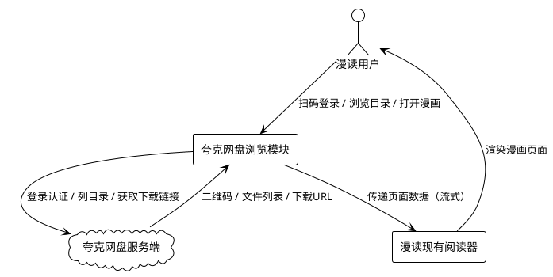

# 夸克网盘浏览功能 需求规格

> **项目**: 漫读（MangaReader）  
> **版本**: v1.501+  
> **日期**: 2026-10-14  
> **功能代号**: quark_pan  
> **文档类型**: 需求规格（spec）  
> **状态**: 待用户确认  

---

# **1. 组件定位**

## **1.1 核心职责**

本组件负责通过夸克网盘的 Web 接口浏览网盘中的漫画归档文件并在线流式阅读，实现无需下载即可查看网盘漫画内容的能力。

## **1.2 核心输入**

1. **用户扫码操作**：用户在登录界面发起扫码登录请求，使用夸克网盘 App 扫描二维码完成登录授权。
2. **目录浏览请求**：用户在网盘浏览界面点击文件夹或执行下拉刷新，触发目录列表加载。
3. **漫画打开请求**：用户点击网盘中的漫画归档文件（CBZ/CBR/CB7/ZIP/RAR/7Z/PDF/文件夹等），触发流式阅读。
4. **翻页/滚动操作**：用户在阅读过程中翻页或滚动，触发后续页面流式加载。
5. **缓存清理指令**：用户在设置中执行缓存清理操作。
6. **应用重启信号**：应用启动时触发登录态恢复检查。

## **1.3 核心输出**

1. **登录状态反馈**：向用户展示二维码图片、扫码状态（待扫描/已扫描/已确认/已过期）及登录结果。
2. **目录列表展示**：向用户展示网盘文件夹和文件列表，包含名称、类型、大小、缩略图等信息。
3. **漫画页面渲染**：将网盘漫画的图片页面流式渲染到阅读器视图，复用漫读现有阅读链路。
4. **阅读进度记录**：将阅读位置（页码/格索引/滚动偏移）持久化存储到本地。
5. **缓存内容**：将已浏览的文件数据和目录列表缓存到本地存储。
6. **错误提示**：在登录失败、网络异常、文件不存在等场景下向用户展示错误信息。

## **1.4 职责边界**

本组件 **不负责** 以下事项：

1. **不提供下载功能**：禁止将网盘文件下载到本地设备存储，不提供"下载到本地"按钮或入口。
2. **不加入书架收藏**：禁止将网盘漫画加入漫读书架/记忆库，网盘漫画与本地书架完全隔离。
3. **不改动核心模块**：禁止修改阅读器核心、SMB 模块、WebDAV 模块、本地扫描模块、书架模块、数据库核心表的任何代码。
4. **不提供文件管理**：不支持在网盘上创建、重命名、删除、移动文件或文件夹，仅提供只读浏览。
5. **不提供文件上传**：不支持向夸克网盘上传文件。
6. **不提供分享转存**：不支持将夸克网盘分享链接转存到网盘，仅浏览已登录账号的网盘内容。
7. **不引入 AGPL 代码**：禁止引入或复制任何 AGPL-3.0（或类似强传染性协议）项目的源代码。

---

# **2. 领域术语**

**夸克网盘**
: 阿里巴巴旗下夸克浏览器提供的云端存储服务，用户可在其中存储和管理文件。本功能通过其 Web 接口访问用户网盘中的漫画文件。

**扫码登录**
: 用户使用夸克网盘 App 扫描漫读生成的二维码，完成身份认证授权的登录方式。登录成功后漫读获得代表用户身份的凭证。

**登录态**
: 表示用户与夸克网盘的认证会话状态，包含 Cookie 和签名参数等凭证信息。登录态有效时用户无需重新登录即可访问网盘。

**流式阅读**
: 漫画文件不完全下载到本地即可开始阅读的方式。系统按需加载当前及邻近页面的数据，已加载部分缓存到本地，未加载部分在后台持续获取。

**网盘文件条目**
: 夸克网盘中一个文件或文件夹的元信息，包含文件 ID、名称、类型（文件/文件夹）、大小、修改时间等属性。

**漫画归档文件**
: 存储在夸克网盘中的漫画压缩包或文档，格式包括 CBZ、CBR、CB7、ZIP、RAR、7Z、PDF 等，以及包含图片序列的文件夹。

**本地缓存**
: 漫读在设备本地存储中为已浏览的网盘文件保留的数据副本，用于减少重复网络请求、加速二次浏览。

**阅读进度**
: 用户在某本漫画中上次阅读到的位置记录，包含页码、逐格索引、Webtoon 滚动偏移量等维度。

**反封控**
: 为避免触发夸克网盘服务端的反爬虫/反自动化策略而采取的请求频率控制、身份伪装、缓存优化等综合措施。
: 备注：本功能为合法的网盘文件浏览，非爬取公开内容，但仍需控制请求频率以保障服务稳定性。

**零侵入**
: 本功能作为独立新增模块接入漫读，仅通过接口调用现有阅读器能力，不修改任何已有模块的内部实现。

---

# **3. 角色与边界**

## **3.1 核心角色**

**漫读用户**：已安装漫读 App 的 Android 设备使用者，拥有夸克网盘账号并已在手机上安装夸克网盘 App。通过扫码登录后浏览和阅读网盘中的漫画文件。

## **3.2 外部系统**

**夸克网盘服务端**：本组件的上游依赖系统。通过其 Web HTTP 接口进行交互，包括：二维码登录接口、账号信息查询接口、目录列表接口、文件下载链接获取接口。所有交互基于 HTTPS 协议。

**漫读现有阅读器**：本组件的下游依赖。通过漫读内部的阅读器接口将流式获取的漫画页面数据传递给阅读器视图进行渲染，复用现有的翻页、Webtoon、逐格等阅读模式。

## **3.3 交互上下文**



---

# **4. DFX约束**

## **4.1 性能**

1. **目录列表响应**：当用户打开一个网盘目录时，系统必须在 5 秒内展示首批文件列表（含网络请求时间）；若已有缓存，必须在 500 毫秒内展示缓存列表并同时后台刷新。
   - 验收条件：[用户点击目录] → [5 秒内可见首批文件列表]

2. **首屏页面加载**：当用户打开一本网盘漫画时，系统必须在 8 秒内渲染出第一页画面（含获取下载链接 + 首页数据加载 + 解码）。
   - 验收条件：[用户点击漫画文件] → [8 秒内可见第一页]

3. **翻页响应**：当用户翻到已缓存的相邻页面时，系统必须在 300 毫秒内完成页面切换；翻到未缓存页面时，必须在 5 秒内加载并显示，超时需显示加载指示器。
   - 验收条件：[翻到已缓存页] → [300ms 内完成切换]；[翻到未缓存页] → [5 秒内显示或出现加载指示器]

4. **缓存命中率**：二次浏览同一目录时，系统必须达到 90% 以上的本地缓存命中率（即 90% 的文件列表信息从本地缓存读取，不发起网络请求）。
   - 验收条件：[二次打开同一目录] → [≥90% 信息来自本地缓存]

5. **请求限速**：系统对夸克网盘服务端的 API 请求频率必须控制在每秒不超过 2 次，连续请求之间必须有 500~2000 毫秒的随机间隔。
   - 验收条件：[任意时间段内统计] → [每秒请求数 ≤ 2，且相邻请求间隔 ∈ [500ms, 2000ms] 随机分布]

## **4.2 可靠性**

1. **登录态持久化**：当应用被系统杀死或用户手动退出后重新启动应用时，系统必须自动恢复上次的夸克网盘登录态，无需用户重新扫码。
   - 验收条件：[应用重启] → [自动恢复登录态，用户可直接浏览网盘]

2. **登录态有效期**：登录态必须至少保持 7 天有效（在夸克网盘服务端未主动失效的前提下）。
   - 验收条件：[登录后 7 天内重启应用] → [登录态仍然有效]

3. **网络中断容错**：当网络中断时，系统必须优雅降级——已缓存的目录和已加载的页面继续可浏览，未加载部分显示"网络不可用"提示而非崩溃。
   - 验收条件：[浏览过程中网络断开] → [已缓存内容可继续查看，未加载部分显示网络提示]

4. **自动重试**：当网络请求失败时，系统必须自动重试最多 3 次，重试间隔采用指数退避（1秒、2秒、4秒），3 次仍失败后向用户展示错误信息。
   - 验收条件：[请求失败] → [自动重试 ≤ 3 次（指数退避），仍失败则展示错误提示]

5. **请求超时**：目录列表请求超时阈值必须为 15 秒，文件下载链接获取超时阈值必须为 10 秒，页面数据加载超时阈值必须为 30 秒。
   - 验收条件：[各类型请求超过对应阈值] → [中止请求并触发重试或错误提示]

## **4.3 安全性**

1. **凭证加密存储**：登录态（Cookie、签名参数等敏感凭证）必须使用加密存储方式保存在设备本地，禁止以明文形式存储。
   - 验收条件：[检查本地存储] → [所有凭证均为加密形态，无可读明文]

2. **HTTPS 强制**：所有与夸克网盘服务端的通信必须通过 HTTPS 加密通道进行，禁止任何明文 HTTP 请求。
   - 验收条件：[抓包检查所有网络请求] → [均为 HTTPS 连接]

3. **凭证不外泄**：登录态凭证禁止出现在任何日志输出、崩溃报告、分享内容或 analytics 上报中。
   - 验收条件：[检查日志/崩溃报告/分享内容] → [不含任何凭证字段]

4. **User-Agent 伪装**：系统必须使用与夸克网盘官方客户端一致的 User-Agent 标识发起请求，避免因异常 User-Agent 触发服务端拦截。
   - 验收条件：[检查请求头] → [User-Agent 与夸克官方客户端格式一致]

## **4.4 可维护性**

1. **模块独立**：本功能必须作为独立模块（类似 Komga/OPDS bridge）接入漫读，模块内部代码自包含，不与现有模块产生编译期耦合。
   - 验收条件：[移除本模块代码] → [漫读现有功能编译和运行不受影响]

2. **许可证合规**：本功能引入的所有第三方库和组件的许可证必须排除 AGPL-3.0、GPL-3.0 及类似强传染性开源协议。本功能的夸克网盘 API 调用逻辑必须为独立编写，不得复制任何 AGPL 项目源代码。
   - 验收条件：[审查所有新增依赖的 LICENSE] → [无 AGPL/GPL 等强传染性协议]；[代码审查] → [无任何 AGPL 项目代码复制痕迹]

3. **日志规范**：本功能必须输出结构化日志，包含请求 URL（脱敏）、响应状态码、耗时、缓存命中/未命中等信息，便于问题排查。
   - 验收条件：[启用调试日志] → [可见结构化的请求/缓存/登录日志]

## **4.5 兼容性**

1. **阅读器复用**：本功能必须通过漫读现有的阅读器接口传递页面数据，复用现有的翻页、Webtoon、逐格、超分辨率等全部阅读能力，不新建独立的渲染视图。
   - 验收条件：[打开网盘漫画] → [阅读界面与打开本地/SMB/WebDAV 漫画时完全一致，所有阅读模式可用]

2. **数据库零侵入**：本功能禁止修改漫读现有的任何数据库核心表结构，如需持久化数据必须使用独立的存储方式（SharedPreferences / 独立表 / 文件存储）。
   - 验收条件：[对比功能上线前后的数据库 schema] → [核心表结构无变化]

3. **主题适配**：本功能的浏览界面必须适配漫读现有的 14 套主题和深色/浅色模式，不引入独立的配色体系。
   - 验收条件：[切换任意主题] → [网盘浏览界面跟随主题变化]

4. **API 变更容错**：当夸克网盘服务端 API 发生变更导致请求失败时，系统必须给出明确的"服务接口变更"提示，而非通用错误或崩溃。
   - 验收条件：[模拟 API 返回异常格式] → [展示"服务接口可能已变更"提示，不崩溃]

---

# **5. 核心能力**

## **5.1 扫码登录与登录态管理**

### **5.1.1 业务规则**

1. **二维码生成**：当用户首次进入夸克网盘功能或登录态已失效时，系统必须向夸克网盘服务端请求生成登录二维码，并在界面上展示二维码图片。
   - 验收条件：[用户进入网盘功能且未登录] → [界面展示可扫描的二维码图片]

2. **扫码状态轮询**：当二维码展示后，系统必须持续轮询扫码状态，状态包括"等待扫描"、"已扫描等待确认"、"已确认登录"、"二维码已过期"。
   - 验收条件：[二维码展示期间] → [实时反映用户的扫码操作状态]

3. **二维码有效期**：二维码必须在 120 秒内有效，超时后系统必须自动刷新生成新的二维码，并提示用户重新扫描。
   - 验收条件：[二维码展示超过 120 秒未被确认] → [自动刷新二维码并提示"二维码已过期，请重新扫描"]

4. **登录成功凭证获取**：当用户在夸克网盘 App 中确认登录后，系统必须获取并保存完整的登录凭证（Cookie、签名参数等）。
   - 验收条件：[用户确认登录] → [系统获取并保存登录凭证，进入网盘浏览界面]

5. **登录态加密持久化**：系统必须将登录凭证以加密形式存储在设备本地，确保应用重启后可恢复。
   - 验收条件：[登录成功后检查本地存储] → [凭证以加密形态存在]；[应用重启] → [自动恢复登录态]

6. **登录态有效性检查**：当应用启动恢复登录态后，系统必须向夸克网盘服务端发起一次轻量请求验证凭证是否仍然有效。
   - 验收条件：[应用启动且有保存的登录态] → [自动验证凭证有效性]

7. **登录态失效处理**：当验证发现登录态已失效（服务端返回认证失败）时，系统必须清除本地凭证并引导用户重新扫码登录。
   - 验收条件：[凭证验证失败] → [清除本地凭证，展示登录界面并提示"登录已过期，请重新扫码"]

8. **手动退出登录**：用户必须能够手动退出登录，退出后系统必须清除所有本地凭证和缓存数据。
   - 验收条件：[用户执行退出登录] → [本地凭证和网盘缓存全部清除，回到登录界面]

9. **禁止项**：禁止以任何形式明文展示完整 Cookie 或签名参数。
   - 验收条件：[检查所有界面和日志] → [不出现完整凭证明文]

### **5.1.2 交互流程**

```plantuml
@startuml
!theme plain
actor 用户 as user
participant "网盘浏览模块" as quark
cloud "夸克网盘服务端" as server

user -> quark : 进入夸克网盘功能
quark -> server : 请求生成登录二维码
server --> quark : 返回二维码图片 + token
quark --> user : 展示二维码

loop 状态轮询
    quark -> server : 查询扫码状态(token)
    server --> quark : 返回状态
    alt 等待扫描
        quark --> user : 显示"请使用夸克App扫描"
    else 已扫描待确认
        quark --> user : 显示"请在手机上确认登录"
    else 已确认
        quark -> server : 获取登录凭证
        server --> quark : 返回 Cookie + 签名参数
        quark -> quark : 加密存储凭证
        quark --> user : 进入网盘浏览界面
    else 已过期
        quark -> server : 请求新二维码
        server --> quark : 返回新二维码
        quark --> user : 提示重新扫描
    end
end

@enduml
```

### **5.1.3 异常场景**

1. **二维码请求失败**
   - 触发条件：网络不可用或夸克网盘服务端无响应
   - 系统行为：自动重试 3 次（指数退避），仍失败则展示错误提示和"重试"按钮
   - 用户感知：显示"无法连接夸克网盘，请检查网络后重试"

2. **扫码状态轮询超时**
   - 触发条件：轮询请求连续超时或服务端返回异常
   - 系统行为：中止轮询，保留当前二维码，展示"状态获取异常"提示
   - 用户感知：显示"登录状态获取异常，请重试"并提供重新生成二维码按钮

3. **凭证获取失败**
   - 触发条件：用户已确认登录但凭证获取请求失败
   - 系统行为：清除临时状态，提示用户重新扫码
   - 用户感知：显示"登录凭证获取失败，请重新扫码"

---

## **5.2 网盘目录浏览**

### **5.2.1 业务规则**

1. **根目录展示**：当用户登录成功后进入网盘浏览界面时，系统必须展示网盘根目录下的文件和文件夹列表。
   - 验收条件：[登录成功后进入浏览界面] → [展示根目录文件列表]

2. **目录列表分页**：当目录包含大量文件时，系统必须支持分页加载，每页加载 50 个条目，滚动到底部时自动加载下一页。
   - 验收条件：[目录文件数 > 50 且用户滚动到底部] → [自动加载下一页文件列表]

3. **文件夹下钻**：当用户点击一个文件夹时，系统必须展示该文件夹下的文件列表，并支持返回上级目录。
   - 验收条件：[点击文件夹] → [展示子目录文件列表]；[点击返回] → [回到上级目录列表]

4. **文件类型识别**：系统必须识别文件类型并区分展示：文件夹、漫画归档文件（CBZ/CBR/CB7/ZIP/RAR/7Z/PDF 等）、图片文件夹、其他文件。漫画归档文件必须显示可打开标识。
   - 验收条件：[浏览目录] → [不同类型文件有区分标识，漫画文件可点击打开]

5. **目录列表缓存**：当用户浏览过一个目录后，系统必须将目录列表缓存到本地。再次进入同一目录时优先展示缓存列表，同时后台静默刷新。
   - 验收条件：[二次进入同一目录] → [立即展示缓存列表，后台同步刷新]

6. **下拉刷新**：当用户在目录列表中执行下拉刷新操作时，系统必须强制从夸克网盘服务端重新获取最新列表，更新缓存。
   - 验收条件：[下拉刷新] → [从服务端获取最新列表并更新展示和缓存]

7. **目录列表排序**：系统必须支持按文件类型（文件夹优先）和修改时间（新到旧）默认排序。
   - 验收条件：[展示目录列表] → [文件夹排在文件前面，同类型按修改时间新到旧排列]

8. **文件名安全显示**：当夸克网盘返回的文件名包含违规标记（如被服务端替换为 `***`）时，系统必须原样展示，不进行额外处理。
   - 验收条件：[服务端返回文件名含 `***`] → [原样展示该文件名]

9. **禁止项**：禁止在浏览界面提供任何文件管理操作（创建/删除/重命名/移动/上传）。
   - 验收条件：[检查浏览界面所有操作入口] → [仅包含浏览和打开操作，无管理操作]

### **5.2.2 交互流程**

```plantuml
@startuml
!theme plain
actor 用户 as user
participant "网盘浏览模块" as quark
cloud "夸克网盘服务端" as server
database "本地缓存" as cache

user -> quark : 进入目录
quark -> cache : 查询目录缓存
alt 缓存命中
    cache --> quark : 返回缓存列表
    quark --> user : 立即展示缓存列表
    quark -> server : 后台刷新目录
    server --> quark : 返回最新列表
    quark -> cache : 更新缓存
    quark --> user : 静默更新展示
else 缓存未命中
    quark -> server : 请求目录列表
    server --> quark : 返回文件列表
    quark -> cache : 写入缓存
    quark --> user : 展示文件列表
end

@enduml
```

### **5.2.3 异常场景**

1. **目录列表请求失败**
   - 触发条件：网络不可用或服务端返回错误
   - 系统行为：若有缓存则展示缓存列表 + 离线提示；若无缓存则展示错误信息和重试按钮
   - 用户感知：有缓存时显示"当前为离线缓存内容"；无缓存时显示"加载失败，请重试"

2. **目录为空**
   - 触发条件：目录下无任何文件和文件夹
   - 系统行为：展示空状态提示
   - 用户感知：显示"此文件夹为空"

3. **分享链接已失效**
   - 触发条件：访问的分享资源已被分享者删除
   - 系统行为：展示资源失效提示
   - 用户感知：显示"该资源已失效或被删除"

---

## **5.3 流式在线阅读**

### **5.3.1 业务规则**

1. **漫画文件打开**：当用户点击一个漫画归档文件时，系统必须获取该文件的下载链接，并以流式方式加载文件内容，进入漫读阅读器界面。
   - 验收条件：[点击漫画归档文件] → [获取下载链接并进入阅读器界面，显示第一页]

2. **流式按需加载**：系统必须按需加载漫画页面数据——优先加载当前页及邻近页（前 1 页 + 后 2 页），不一次性加载所有页面。
   - 验收条件：[阅读到第 N 页] → [第 N-1 至 N+2 页数据已加载或正在加载，其余页面未加载]

3. **边下边看**：系统必须在首页数据到达后立即渲染第一页，不等待所有页面加载完成。后续页面在后台持续加载。
   - 验收条件：[打开漫画] → [首页到达后立即显示，不等全部页面]

4. **阅读器能力复用**：网盘漫画打开后必须完整复用漫读现有的阅读能力，包括：翻页模式、Webtoon 模式、逐格阅读、超分辨率、双指缩放、亮度调节等。
   - 验收条件：[打开网盘漫画] → [所有现有阅读模式和功能均可用]

5. **归档内文件列表获取**：对于压缩包格式的漫画（CBZ/CBR 等），系统必须利用归档格式的特性（如 ZIP 中央目录在文件尾部），优先获取文件列表，再按需加载单张图片，避免整包下载。
   - 验收条件：[打开压缩包漫画] → [先获取归档内文件列表，按需加载单张图片，非整包下载]

6. **文件夹漫画支持**：当网盘中的一个文件夹包含图片序列（JPG/PNG/WebP 等）时，系统必须将其识别为可阅读的漫画并支持流式打开。
   - 验收条件：[打开含图片序列的文件夹] → [进入阅读器，图片按文件名自然排序展示]

7. **页面加载指示**：当页面数据正在加载时，系统必须在对应位置展示加载指示器（如进度条或旋转动画），加载完成后切换为页面内容。
   - 验收条件：[翻到未加载页面] → [展示加载指示器，加载完成后显示页面]

8. **禁止项**：禁止提供"下载到本地"功能或入口；禁止将网盘漫画加入书架/记忆库。
   - 验收条件：[检查阅读界面所有操作] → [无"下载"和"加入书架"入口]

### **5.3.2 交互流程**

```plantuml
@startuml
!theme plain
actor 用户 as user
participant "网盘浏览模块" as quark
cloud "夸克网盘服务端" as server
participant "漫读阅读器" as reader
database "本地缓存" as cache

user -> quark : 点击漫画文件
quark -> server : 获取文件下载链接
server --> quark : 返回下载URL + 临时Cookie
quark -> server : 流式请求首页数据
server --> quark : 返回首页数据
quark -> cache : 缓存首页数据
quark -> reader : 传递首页数据，启动阅读器
reader --> user : 显示第一页

loop 阅读过程
    user -> reader : 翻页/滚动
    reader -> quark : 请求第N页数据
    alt 页面已缓存
        quark -> cache : 读取缓存
        cache --> quark : 返回数据
    else 页面未缓存
        quark -> server : 流式请求第N页
        server --> quark : 返回数据
        quark -> cache : 缓存数据
    end
    quark -> reader : 返回页面数据
    reader --> user : 显示页面
end

@enduml
```

### **5.3.3 异常场景**

1. **下载链接获取失败**
   - 触发条件：获取下载链接的请求失败或服务端拒绝
   - 系统行为：自动重试 3 次，仍失败则返回浏览界面并提示错误
   - 用户感知：显示"无法获取文件下载链接，请稍后重试"

2. **页面数据加载超时**
   - 触发条件：单页数据请求超过 30 秒未返回
   - 系统行为：中止当前请求，展示超时提示和重试按钮
   - 用户感知：对应页面位置显示"加载超时，点击重试"

3. **文件格式不支持**
   - 触发条件：用户点击的文件格式漫读不支持
   - 系统行为：提示格式不支持，不进入阅读器
   - 用户感知：显示"暂不支持此文件格式"

4. **归档文件损坏**
   - 触发条件：下载的归档文件数据不完整或格式损坏
   - 系统行为：提示文件损坏，返回浏览界面
   - 用户感知：显示"文件可能已损坏，无法打开"

5. **服务端限流/封控**
   - 触发条件：夸克网盘服务端返回限流或封控响应
   - 系统行为：暂停请求，提示用户稍后重试
   - 用户感知：显示"请求过于频繁，请稍后再试"

---

## **5.4 本地缓存管理**

### **5.4.1 业务规则**

1. **缓存内容范围**：系统必须缓存以下数据：目录列表信息、已浏览的漫画页面数据、归档文件列表索引。不缓存未浏览的文件内容。
   - 验收条件：[浏览网盘后检查本地缓存] → [已浏览的目录列表和页面数据已缓存，未浏览内容未缓存]

2. **缓存容量上限**：本地缓存总容量必须设有上限（默认 500MB，用户可调整），超限时按 LRU（最近最少使用）策略自动淘汰最旧缓存。
   - 验收条件：[缓存总量超过上限] → [自动淘汰最旧缓存条目，总量降至上限以内]

3. **缓存清理入口**：用户必须能够在设置中查看当前缓存占用大小并手动清理全部缓存。
   - 验收条件：[进入设置中的网盘缓存项] → [可见缓存大小和"清理缓存"按钮]；[点击清理] → [缓存全部清除]

4. **缓存清理粒度**：用户必须能够选择清理全部缓存或仅清理某本漫画的缓存。
   - 验收条件：[在阅读界面操作清理] → [可选择清理当前漫画缓存或全部缓存]

5. **退出登录清缓存**：当用户退出夸克网盘登录时，系统必须自动清除所有网盘相关缓存数据。
   - 验收条件：[退出登录] → [所有网盘缓存被清除]

6. **缓存有效性**：当检测到网盘文件修改时间变化时，系统必须使该文件的缓存失效，重新从服务端获取。
   - 验收条件：[网盘文件被修改后再次浏览] → [缓存失效，从服务端获取最新数据]

7. **禁止项**：禁止将缓存数据暴露为用户可直接访问的文件管理入口；禁止缓存数据计入漫读书架/记忆库。
   - 验收条件：[检查书架/记忆库] → [无网盘缓存条目]

### **5.4.2 异常场景**

1. **缓存空间不足**
   - 触发条件：设备本地存储空间不足以写入新缓存
   - 系统行为：先执行 LRU 淘汰释放空间，仍不足则跳过缓存写入但不影响阅读
   - 用户感知：无感知（阅读正常进行，仅缓存写入被跳过）；设置中可见缓存大小偏小提示

2. **缓存数据损坏**
   - 触发条件：本地缓存文件损坏无法读取
   - 系统行为：删除损坏的缓存条目，从服务端重新获取
   - 用户感知：无感知（自动回退为从服务端加载）

---

## **5.5 阅读进度记忆**

### **5.5.1 业务规则**

1. **进度自动记录**：当用户在阅读网盘漫画时，系统必须自动记录当前阅读位置，记录维度包括：漫画文件标识、页码、逐格索引（逐格模式下）、Webtoon 滚动偏移量（Webtoon 模式下）。
   - 验收条件：[阅读过程中翻页/切换格/滚动] → [对应维度的进度被记录]

2. **进度恢复**：当用户再次打开同一本网盘漫画时，系统必须恢复到上次的阅读位置，并提示"已恢复到上次阅读位置"。
   - 验收条件：[二次打开同一漫画] → [自动跳转到上次位置并显示恢复提示]

3. **进度独立存储**：网盘漫画的阅读进度必须独立存储，不与本地书架/记忆库的进度数据混存。
   - 验收条件：[检查进度存储] → [网盘进度与本地进度分离存储]

4. **进度清除**：当用户退出登录或清理缓存时，系统必须清除所有网盘漫画的阅读进度记录。
   - 验收条件：[退出登录/清理缓存] → [网盘阅读进度全部清除]

5. **进度不同步**：阅读进度仅在本地记录，禁止向夸克网盘服务端写入任何进度数据。
   - 验收条件：[检查所有网络请求] → [无向服务端写入进度数据的请求]

### **5.5.2 异常场景**

1. **进度记录失败**
   - 触发条件：本地存储写入失败（空间不足或 IO 错误）
   - 系统行为：静默失败，不影响阅读体验
   - 用户感知：无感知（下次打开可能无法恢复进度）

2. **进度数据损坏**
   - 触发条件：存储的进度数据损坏无法解析
   - 系统行为：清除损坏的进度记录，从头开始阅读
   - 用户感知：打开漫画时从第一页开始，无恢复提示

---

## **5.6 反封控策略**

### **5.6.1 业务规则**

1. **请求频率限制**：系统必须对所有发往夸克网盘服务端的请求进行限速，确保每秒请求数不超过 2 次，连续请求之间插入 500~2000 毫秒随机延迟。
   - 验收条件：[任意时间段统计请求数] → [每秒 ≤ 2 次，间隔随机分布]

2. **User-Agent 一致性**：系统必须使用与夸克网盘官方客户端一致的 User-Agent 发起所有请求，不使用漫读自身的 User-Agent 或通用浏览器 User-Agent。
   - 验收条件：[检查所有请求头] → [User-Agent 为夸克客户端格式]

3. **缓存优先策略**：对于已缓存的目录列表和页面数据，系统必须优先使用缓存，仅在缓存失效或用户主动刷新时才向服务端发起请求。
   - 验收条件：[访问已缓存内容] → [优先返回缓存数据，不发起网络请求（除非主动刷新）]

4. **请求参数完整性**：系统必须在请求中携带与夸克官方客户端一致的设备参数（设备型号、平台标识、版本号等），避免因参数缺失触发风控。
   - 验收条件：[检查请求参数] → [包含完整的设备伪装参数集]

5. **错误响应降级**：当服务端返回风控/限流相关错误时，系统必须自动降低请求频率并暂停一段时间（建议 30 秒）后重试，不持续高频重试。
   - 验收条件：[收到限流错误] → [暂停请求 30 秒后以更低频率重试]

6. **禁止项**：禁止使用任何绕过验证码、IP 代理池、多账号轮换等对抗性反封控手段。
   - 验收条件：[审查系统行为] → [无验证码绕过、代理池、账号轮换等机制]

### **5.6.2 异常场景**

1. **服务端封控触发**
   - 触发条件：夸克网盘服务端检测到异常访问并返回封控响应
   - 系统行为：暂停所有请求，展示封控提示，建议用户稍后重试或检查账号状态
   - 用户感知：显示"访问被限制，请稍后再试。如频繁出现，请在夸克App中确认账号正常"

2. **Cookie 过期**
   - 触发条件：登录凭证中的 Cookie 过期，服务端返回认证失败
   - 系统行为：清除过期凭证，引导用户重新扫码登录
   - 用户感知：显示"登录已过期，请重新扫码登录"

---

# **6. 数据约束**

## **6.1 夸克登录态**

1. **Cookie**：夸克网盘认证 Cookie 字符串，必须加密存储，禁止明文。
2. **签名参数（kps/sign/vcode）**：从 Cookie 中提取的移动端签名参数，必须加密存储。
3. **账号昵称**：登录用户昵称，用于界面展示，可明文存储。
4. **登录时间**：最近一次登录成功的时间戳，用于估算凭证有效期。
5. **凭证有效期**：至少 7 天（在服务端未主动失效前提下），过期后必须重新登录。

## **6.2 网盘文件条目**

1. **文件 ID（fid）**：夸克网盘中文件的唯一标识符，必须持久化用于后续请求。
2. **文件名**：文件或文件夹名称，原样展示服务端返回值。
3. **文件类型**：区分文件夹和文件，文件需进一步识别是否为漫画归档格式。
4. **文件大小**：文件字节数，用于界面展示。
5. **修改时间**：文件最后修改时间戳，用于缓存有效性判断。
6. **父目录 ID（pdir_fid）**：所在父目录的文件 ID，用于目录导航。
7. **分享令牌（stoken）**：访问分享资源时的临时令牌，仅在访问分享链接时使用。

## **6.3 阅读进度记录**

1. **漫画文件标识**：由网盘文件 ID + 文件名 + 修改时间组合生成的唯一标识，用于关联进度与文件。
2. **页码**：当前阅读页码（从 0 开始），翻页模式下使用。
3. **逐格索引**：当前格索引（从 0 开始），逐格阅读模式下使用。
4. **滚动偏移量**：Webtoon 模式下的垂直滚动像素偏移量。
5. **最后阅读时间**：最近一次阅读的时间戳，用于进度列表排序。
6. **约束**：每本漫画最多保留一条进度记录，重新阅读时覆盖旧记录。

## **6.4 本地缓存条目**

1. **缓存键**：由网盘文件 ID + 数据类型（目录列表/页面数据/归档索引）+ 文件修改时间组合生成的唯一键。
2. **缓存数据**：实际的缓存内容（目录列表 JSON / 图片字节流 / 归档文件索引）。
3. **缓存大小**：该条目占用的字节数，用于总量统计和容量控制。
4. **最后访问时间**：最近一次读取该缓存的时间戳，用于 LRU 淘汰策略。
5. **约束**：缓存总大小不得超过用户设定的上限（默认 500MB）；同一缓存键的新数据覆盖旧数据。

## **6.5 反封控配置**

1. **最大请求频率**：每秒最大请求数，默认值 2，禁止用户修改为超过 2 的值。
2. **最小请求间隔**：相邻请求最小间隔毫秒数，默认值 500。
3. **最大请求间隔**：相邻请求最大间隔毫秒数，默认值 2000。
4. **风控暂停时长**：触发风控后的暂停时长（秒），默认值 30。
5. **约束**：以上配置为系统内部参数，不暴露为用户可调节的设置项。

---

> **文档说明**  
> 本文档为需求规格（spec），描述"构建什么"而非"如何构建"。技术架构设计、API 端点细节、数据结构实现、缓存策略算法等"如何构建"的内容属于设计阶段（design.md），由后续设计阶段处理。  
>  
> 本功能遵循零侵入原则，作为独立模块接入漫读，类似 Komga/OPDS 的 bridge 模式。  
>  
> 夸克网盘 API 调用逻辑参考了社区项目 quark-auto-save（AGPL-3.0）的接口信息，但本功能所有代码均为独立编写，不复制任何 AGPL 项目源代码，确保许可证合规。