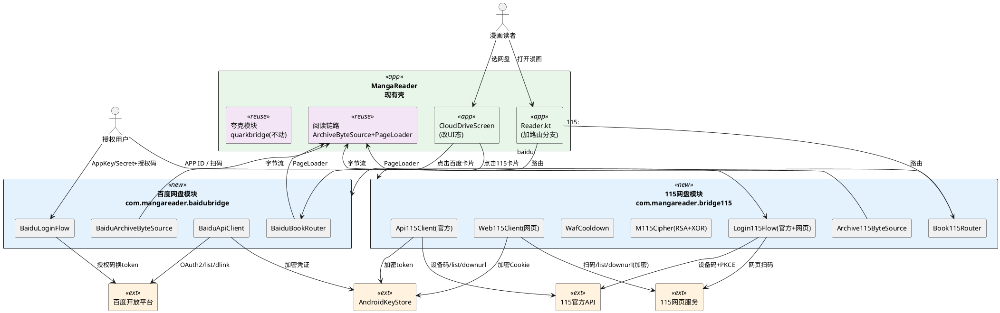
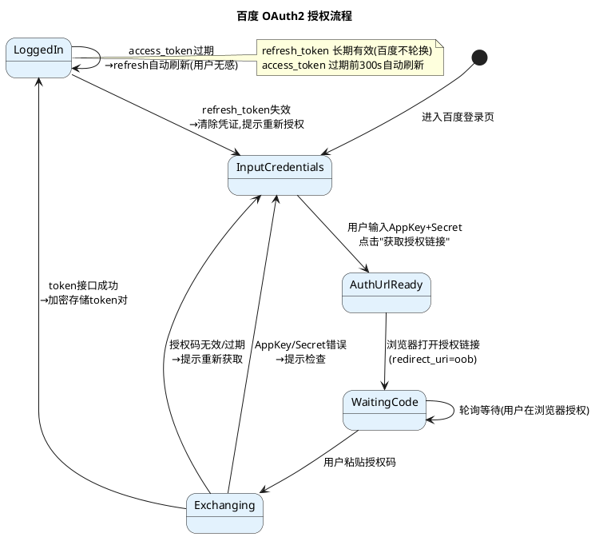
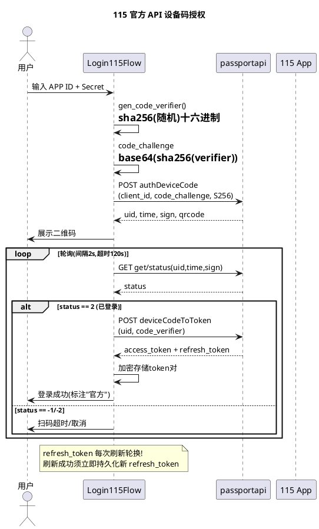
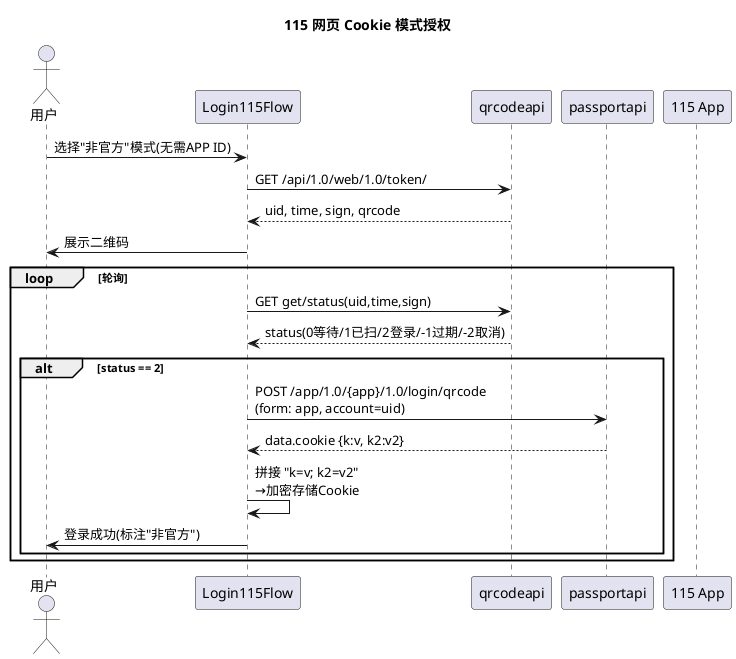
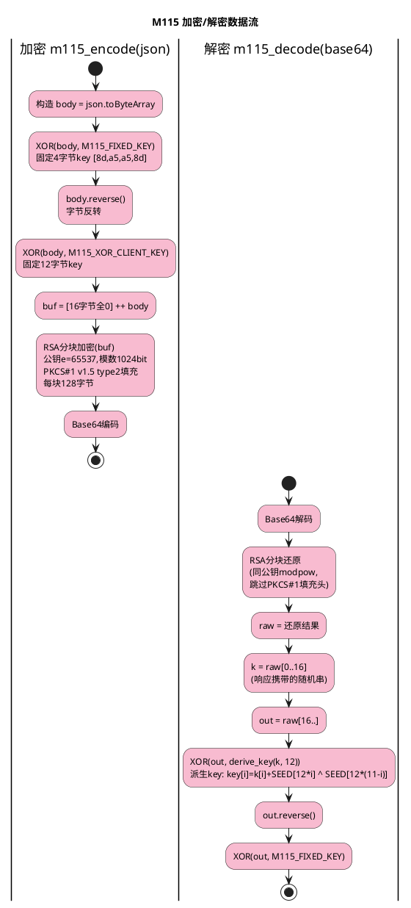
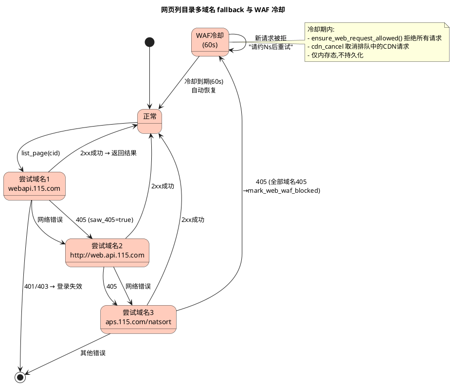
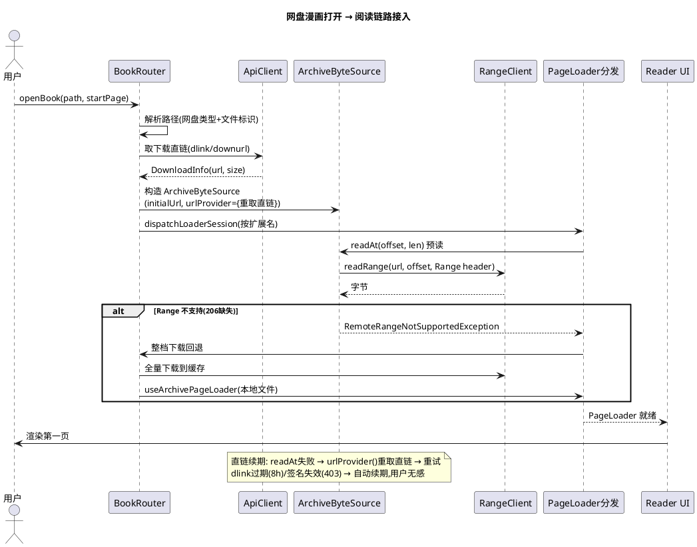
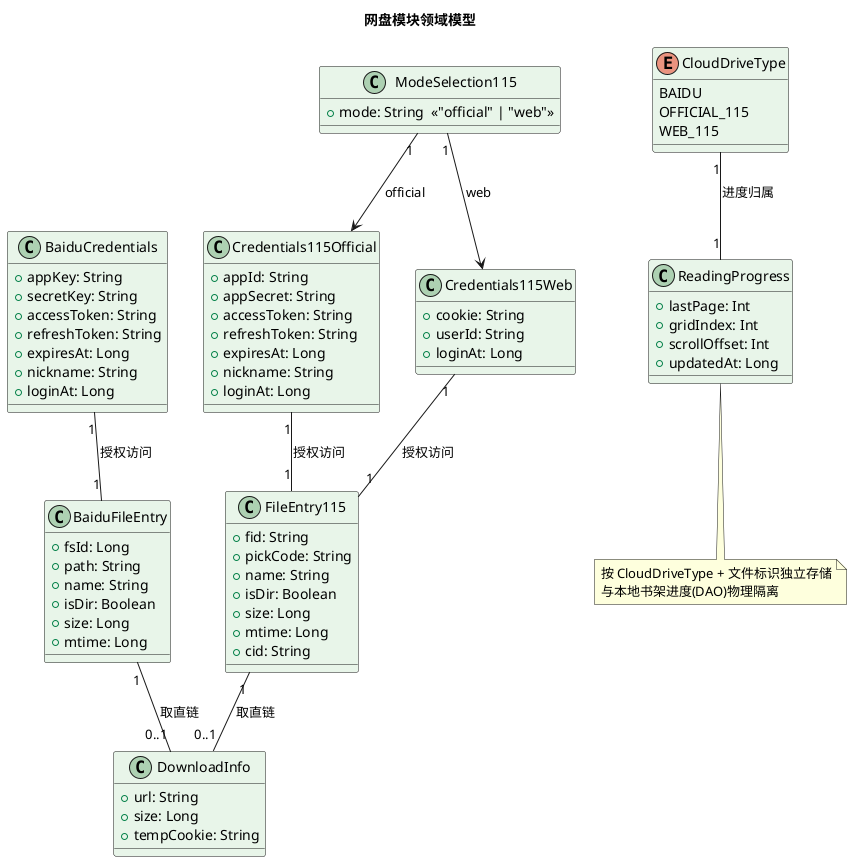

# 百度网盘 + 115 网盘浏览功能 技术方案设计

> 本文档将《百度115网盘浏览功能_需求规格.md》中的 WHAT 转化为 HOW。
> 设计基线：复用现有夸克网盘模块 `com.mangareader.quarkbridge` 的限速底座 / 凭证加密 / 缓存管理 / 进度存储 / 阅读链路（ArchiveByteSource + PageLoader 全格式分发），以**独立 package** 实现百度与 115，对夸克模块零侵入。
> 参考实现：`X:\MANDU\new\RCH-master\app\rust\src\source\baidu.rs`（767 行）、`cloud115.rs`（2272 行）。

---

# 一、需求与存量功能关系分析

## 1.1 需求功能与存量功能对比

### 1.1.1 已实现功能（夸克底座可直接复用）

下表为需求中与 `com.mangareader.quarkbridge` 存量代码**高度匹配**的能力。这些能力以"底座"形式存在，新模块通过同构复制 + 参数化即可获得，无需改动夸克源文件。

| 需求功能 | 存量功能 | 代码位置 | 匹配度 |
|---------|---------|---------|--------|
| 反封控限速（随机间隔 + 风控降级暂停） | `QuarkRateLimiter`：maxPerSecond + minInterval/maxInterval 随机抖动 + `suspendFor(seconds)` | `quarkbridge/api/QuarkRateLimiter.kt` | 100% |
| 共享 HTTP 客户端（超时/连接配置） | `QuarkHttpClient`：Ktor(OkHttp) 单例，connect 15s / request 60s / socket 30s | `quarkbridge/api/QuarkHttpClient.kt` | 100% |
| 凭证 AndroidKeyStore 加密存储 | `QuarkCredentialCrypto`：AES-256-CBC + PKCS7，IV 拼接，`enc1:` 前缀，KeyStore 不可用时降级返回空 | `quarkbridge/auth/QuarkCredentialCrypto.kt` | 100% |
| 会话凭证持久化（加密读写 + 有效期） | `QuarkSessionStore`：SharedPreferences + 逐字段加密 + `isValid()` 天数判定 | `quarkbridge/auth/QuarkSessionStore.kt` | 100% |
| 目录缓存（缓存优先 + 后台刷新 + 失败回退缓存） | `QuarkDirService` + `QuarkCacheManager`：dirs/pages/files 三级缓存 + LRU 淘汰 | `quarkbridge/browser/QuarkDirService.kt`、`data/QuarkCacheManager.kt` | 100% |
| 阅读进度独立存储（按路径键，互不干扰） | `QuarkProgressStore`：独立 SharedPreferences，`${path}:lastPage/gridIndex/scrollOffset/updatedAt` | `quarkbridge/data/QuarkProgressStore.kt` | 100% |
| 压缩包字节源接入阅读链路（预读 + 块缓存 + 断点续传 + 直链续期） | `QuarkArchiveByteSource`：RawSource → ReadAheadArchiveByteSource → BlockCacheArchiveByteSource，`urlProvider` 直链续期，`requestReconnect` 重连 | `quarkbridge/reader/QuarkArchiveByteSource.kt` | 100% |
| 全格式 PageLoader 分发（zip/cbz/pdf/epub/mobi/solid/tar + Range 不支持时整档下载回退） | `QuarkBookRouter.dispatchLoaderSession` + `downloadWholeFile` 回退 | `quarkbridge/reader/QuarkBookRouter.kt:140-244` | 100% |
| 异常体系（Auth/Api/RateLimit/ApiChanged） | `QuarkException` 四级异常 | `quarkbridge/api/QuarkException.kt` | 100% |
| 网盘列表页卡片视觉风格 | `CloudDriveScreen`：Card + RoundedCornerShape(12dp) + 图标 + 标题 + 状态副标题 + ChevronRight | `quarkbridge/ui/CloudDriveScreen.kt:84-109` | 100% |
| 登录/浏览切换入口（已登录→Browser，未登录→Login） | `QuarkPanScreen`：`isLoggedIn` 分支 + `LaunchedEffect` 账号校验 | `quarkbridge/ui/QuarkPanScreen.kt` | 100% |

### 1.1.2 需要扩展的功能

下表为需求与存量代码**部分匹配**，需在现有文件上做最小改动（零侵入边界内的唯一两处修改点）。

| 需求功能 | 存量功能 | 差异说明 | 扩展方向 |
|---------|---------|---------|---------|
| 网盘列表页激活百度/115 占位卡片 | `CloudDriveScreen.kt:111-175` 两张灰色占位 Card（`alpha=0.4f` + `grayFilter` + "即将支持"） | 占位卡片当前不可点击、无 `clickable`、无状态绑定 | 将两张占位 Card 改为 `clickable`，去掉灰度滤镜，绑定百度/115 登录状态，点击进入对应 PanScreen。**仅改此文件 UI 态，不改夸克卡片** |
| Reader 路由分发网盘漫画 | `Reader.kt:1199` `if (path.startsWith("quark:")) return enterQuarkReader(...)` | 当前仅识别 `quark:` 前缀，无 `baidu:` / `115:` 分支 | 新增 `baidu:` / `115:` 前缀分支，调用新增的 `enterBaiduReader` / `enter115Reader`（与 `enterQuarkReader` 同构） |
| Reader 进度保存/读取按网盘类型分流 | `Reader.kt:673` `if (b.source == "quark")` 保存进度；`Reader.kt:2369` 同结构读取 | 仅 `quark` 分支走 `QuarkProgressStore`，其余走本地 DAO | 新增 `baidu` / `115_official` / `115_web` 分支，调用对应 ProgressStore |

### 1.1.3 需要新增的功能或接口

以下功能在存量代码中**完全无对应实现**，须在独立 package 内新建。

#### 百度网盘模块 `com.mangareader.baidubridge`

| 功能点 | 输入 | 输出 | 核心逻辑 | 依赖 |
|--------|------|------|---------|------|
| OAuth2 授权链接生成 | App Key | 授权 URL | 拼接 `openapi.baidu.com/oauth/2.0/authorize`（response_type=code, redirect_uri=oob, scope=basic,netdisk） | 无 |
| 授权码换 Token | App Key + Secret + code | access_token + refresh_token | POST `oauth/2.0/token`（grant_type=authorization_code） | HttpClient |
| Token 自动刷新 | refresh_token | 新 token 对（轮换 refresh_token） | POST token 接口（grant_type=refresh_token），更新内存 + 持久化 | SessionStore |
| 列目录 | 目录路径 + access_token | 文件列表（含 fs_id/path/isdir） | GET `xpan/file?method=list`，分页拉全（limit=200），目录在前自然排序 | RateLimiter |
| 路径查 fs_id | 完整文件路径 | fs_id | 列父目录分页查找匹配项 | ApiClient |
| 取下载直链 dlink | fs_id + access_token | dlink + size | GET `xpan/multimedia?method=filemetas&dlink=1` | ApiClient |
| dlink 拼接 token | dlink + access_token | 带 token 的 URL | 替换/追加 `access_token` 查询参数（避免 31045） | 无 |
| Range 流式读 | dlink + offset + len | 字节 | GET dlink + Range header，UA=`pan.baidu.com`；403 时重取 dlink 重试 | RangeClient |

#### 115 网盘模块 `com.mangareader.bridge115`

| 功能点 | 输入 | 输出 | 核心逻辑 | 依赖 |
|--------|------|------|---------|------|
| **官方 API 模式** | | | | |
| PKCE 生成 | 无 | code_verifier + code_challenge | verifier=sha256(随机)十六进制；challenge=base64(sha256(verifier)) | 无 |
| 设备码授权启动 | APP ID | uid/time/sign/qrcode | POST `authDeviceCode`（client_id, code_challenge, code_challenge_method=sha256） | HttpClient |
| 扫码状态轮询 | uid/time/sign | status / token 对 | GET `get/status`；status=2 时 POST `deviceCodeToToken`（uid, code_verifier） | LoginFlow |
| 官方 Token 刷新（轮换） | refresh_token | 新 token 对 | POST `refreshToken`，**立即持久化新 refresh_token** | SessionStore |
| 审方列目录 | 文件夹 ID + token | 文件列表 | GET `proapi.115.com/open/ufile/files` | RateLimiter |
| 审方取直链 | pick_code + token | 下载 URL + size | GET `proapi.115.com/open/ufile/downurl` | ApiClient |
| **网页 Cookie 模式** | | | | |
| 网页二维码生成 | 无 | uid/time/sign/qrcode | GET `qrcodeapi.115.com/api/1.0/web/1.0/token/` | HttpClient |
| 网页扫码轮询 | uid/time/sign | status(0/1/2/-1/-2) | GET `get/status` | LoginFlow |
| 网页换 Cookie | uid + app | Cookie 字符串 | POST `passportapi/app/1.0/{app}/1.0/login/qrcode`，拼 `data.cookie` map → `k=v; k2=v2` | HttpClient |
| 网页列目录（多域名 fallback） | 文件夹 ID + Cookie | 文件列表 | 依次尝试 webapi.115.com → http://web.api.115.com → aps.115.com/natsort，任一成功返回；全部 405 触发 WAF 冷却 | RateLimiter + WafCooldown |
| RSA+XOR 加密请求体 | pick_code + user_id | base64 密文 | 固定 key XOR → 字节反转 → XOR client key → 前置 16 字节 0 → RSA(1024bit,e=65537) 分块 → base64 | M115Cipher |
| RSA+XOR 解密响应 | base64 密文 | 明文 JSON | RSA 分块还原 → 取前 16 字节派生 key → XOR derive_key → 反转 → XOR 固定 key | M115Cipher |
| 网页取直链 | pick_code + Cookie | 下载 URL | POST `proapi.115.com/app/chrome/downurl?t=ms`，form data=加密体，UA/Referer 一致；解密响应取 url | M115Cipher + RateLimiter |
| WAF 冷却 | HTTP 405 | 暂停 + 自动恢复 | 设 `waf_cooldown_until = now + 60s`，冷却期拒绝请求，冷却结束自动恢复；取消排队中的 CDN 请求 | WafCooldown |
| 模式选择 UI | 无 | "official"/"web" | 首次进入展示选择界面，选择后持久化 | ModeStore |

## 1.2 存量功能详细分析

对 1.1.1 中将直接复用的夸克底座，给出其接口契约、业务规则、扩展点与约束，作为新模块同构复用的依据。

### 1.2.1 QuarkRateLimiter（限速底座）

- **接口契约**：`suspend fun acquire()`（挂起至满足限速）、`fun suspendFor(seconds: Long)`（风控降级，设 `suspendedUntilMs`）。
- **业务规则**：每次 acquire 先检查是否处于 suspend 期（是则 delay 到期）；再计算距上次请求的 elapsed，与 `[minIntervalMs, maxIntervalMs]` 随机抖动比较，不足则 delay。`lastAcquireNs` 用 AtomicLong 保证线程安全。
- **扩展点**：构造参数 `maxPerSecond / minIntervalMs / maxIntervalMs` 可按网盘定制。百度默认 `minInterval=1000ms`（≥1 r/s），115 官方 `minInterval≈666ms`（≥1.5 r/s），115 网页 `minInterval=1000ms`（≥1 r/s）。
- **约束**：单实例非全局；每个 ApiClient 持有独立 limiter，互不影响。`suspendFor` 是风控降级入口（如遇 429/32010）。

### 1.2.2 QuarkCredentialCrypto（凭证加密底座）

- **接口契约**：`fun encrypt(plain: String): String`（返回 `enc1:` + Base64(IV+密文)）、`fun decryptStored(stored: String): String`。
- **业务规则**：AndroidKeyStore 生成 AES-256-CBC + PKCS7 密钥（alias 隔离），IV 随机生成并拼在密文前。KeyStore 不可用时 `getOrCreateKey()` 返回 null → encrypt 返回空串（**降级不存储**，符合需求 4.3.3）。
- **扩展点**：每个网盘用**不同 KeyStore alias**（`baiduCred` / `115Cred`）隔离密钥，互不可解密。
- **约束**：明文绝不落盘；`ENCRYPT_PREFIX` 前缀用于区分已加密/未加密（兼容迁移）。

### 1.2.3 QuarkArchiveByteSource（阅读链路接入底座）

- **接口契约**：实现 `ArchiveByteSource`（`size / isRandomAccess / readAt / warm / dropQueuedReads / requestReconnect / close`）。构造参数含 `initialUrl / initialCookie / urlProvider / rateLimiter / knownSize / readahead`。
- **业务规则**：三层包装——`RawQuarkArchiveByteSource`（实际 Range 请求）→ `ReadAheadArchiveByteSource`（预读窗口）→ `BlockCacheArchiveByteSource`（块缓存）。`readAt` 失败时调用 `urlProvider()` 重取直链续期；size 探测有 3 次重试 + fail-fast 1.5s 冷却。
- **扩展点**：`urlProvider: suspend () -> DownloadInfo` 是直链续期钩子，百度传 `{ dlink + token }`，115 传 `{ pick_code → downurl }`。`rateLimiter` 注入使 Range 请求也受限速约束。
- **约束**：`runBlocking` + `activeJobs` 跟踪保证 close 时取消所有在途请求；`RemoteRangeNotSupportedException` 向上透传触发整档下载回退。

### 1.2.4 QuarkBookRouter（全格式分发底座）

- **接口契约**：`suspend fun openQuarkBook(filePath, startPage): OpenResult`（`Supported(pageLoader, source, supply)` / `Failed(message)`）。
- **业务规则**：解析路径 → 取下载直链 → 构造 ArchiveByteSource → `dispatchLoaderSession` 按扩展名分发到 `useStreamArchivePageLoader / usePdfiumPageLoader / useDocumentExtractPageLoader / useSolidExtractPageLoader / useTarChunkPageLoader`。Range 不支持时 `downloadWholeFile` 整档下载回退到本地 `useArchivePageLoader`。
- **扩展点**：`dispatchLoaderSession` 是纯函数式分发，新模块的 BookRouter 可直接复用此方法（改为 internal 可见性或复制），仅替换"取直链"前置步骤。
- **约束**：`OPEN_TIMEOUT_MS=15s` 等待 PageLoader 就绪；`QuarkPageAdapter` 桥接 RemotePageSupply 到 Reader UI。

### 1.2.5 CloudDriveScreen / Reader.kt 集成点（零侵入边界）

- **CloudDriveScreen.kt**：第 84-109 行为夸克可点击卡片模板；第 111-175 行为百度/115 灰色占位卡片（`colorFilter=grayFilter` + `alpha=0.4f` + 无 `clickable` + "即将支持"）。**唯一允许的改动**：将占位卡片改为可交互态。
- **Reader.kt**：第 1199 行 `path.startsWith("quark:")` 路由分支；第 673/2369 行 `b.source == "quark"` 进度分流。**唯一允许的改动**：新增 `baidu:` / `115:` 路由分支与 `baidu` / `115_official` / `115_web` 进度分支。
- **约束**：不修改 `com.mangareader.quarkbridge` 包内任何文件的业务逻辑（仅 CloudDriveScreen.kt 的 UI 态切换 + Reader.kt 的新增分支）。

---
# 二、增量设计方案

## 2.1 实现模型

### 2.1.1 上下文视图



**通信协议与频率**：
- 百度 ↔ 开放平台：HTTPS，限速 ≥1 r/s（API），dlink 下载 Range 请求复用限速
- 115 官方 ↔ proapi/passportapi：HTTPS，限速 ≥1.5 r/s
- 115 网页 ↔ webapi/proapi：HTTPS，限速 ≥1 r/s（API），CDN Range 4 r/s + burst 6
- 凭证存储 ↔ AndroidKeyStore：本地 JNI，无网络

### 2.1.2 服务/组件总体架构

两个新模块**对称同构**，均复用夸克底座的六层结构。下图展示模块内组件划分与依赖。

```plantuml
@startuml
skinparam component {
    BackgroundColor<<api>>    #BBDEFB
    BackgroundColor<<auth>>   #C8E6C9
    BackgroundColor<<data>>   #FFF9C4
    BackgroundColor<<reader>> #FFCCBC
    BackgroundColor<<ui>>     #D1C4E9
    BackgroundColor<<crypto>> #F8BBD0
}

package "com.mangareader.baidubridge" {
    component "BaiduConstants" <<api>>
    component "BaiduHttpClient\n(复用QuarkHttpClient模式)" <<api>>
    component "BaiduRateLimiter\n(复用QuarkRateLimiter,1r/s)" <<api>>
    component "BaiduApiClient\n(list/dlink/account)" <<api>>
    component "BaiduException" <<api>>
    component "BaiduCredentialCrypto\n(KeyStore alias=baiduCred)" <<auth>>
    component "BaiduSessionStore\n(token对加密存储)" <<auth>>
    component "BaiduLoginFlow\n(OAuth2授权码)" <<auth>>
    component "BaiduCacheManager\n(复用QuarkCacheManager模式)" <<data>>
    component "BaiduProgressStore\n(独立prefs)" <<data>>
    component "BaiduDirService\n(缓存优先)" <<data>>
    component "BaiduRangeClient\n(Range读+UA=pan.baidu.com)" <<reader>>
    component "BaiduArchiveByteSource\n(复用三层包装)" <<reader>>
    component "BaiduBookRouter\n(全格式分发)" <<reader>>
    component "BaiduPageAdapter\n(复用QuarkPageAdapter模式)" <<reader>>
    component "BaiduPanScreen\n(登录/浏览切换)" <<ui>>
    component "BaiduLoginScreen\n(AppKey输入+授权码)" <<ui>>
    component "BaiduBrowserScreen\n(目录浏览)" <<ui>>
}

package "com.mangareader.bridge115" {
    component "Constants115" <<api>>
    component "HttpClient115\n(复用模式)" <<api>>
    component "RateLimiter115\n(官方1.5r/s/网页1r/s)" <<api>>
    component "Api115Client\n(官方:list/downurl)" <<api>>
    component "Web115Client\n(网页:list+多域名fallback)" <<api>>
    component "Exception115" <<api>>
    component "CredentialCrypto115\n(alias=115Cred)" <<auth>>
    component "SessionStore115\n(token/Cookie加密)" <<auth>>
    component "Login115Flow\n(设备码PKCE+网页扫码)" <<auth>>
    component "ModeStore115\n(official/web选择)" <<auth>>
    component "M115Cipher\n(RSA+XOR加密)" <<crypto>>
    component "WafCooldown\n(405冷却60s)" <<crypto>>
    component "CacheManager115" <<data>>
    component "ProgressStore115\n(官方/网页独立)" <<data>>
    component "DirService115" <<data>>
    component "Archive115ByteSource" <<reader>>
    component "Book115Router" <<reader>>
    component "Pan115Screen\n(模式选择+登录/浏览)" <<ui>>
    component "Login115Screen\n(官方/网页双模式)" <<ui>>
    component "Browser115Screen" <<ui>>
}

component "阅读链路\nReadAhead+BlockCache+PageLoader" as Chain <<reader>>
component "CloudDriveScreen" as CDS <<ui>>
component "Reader.kt" as ReaderKt <<ui>>

BaiduBookRouter --> Chain
BaiduArchiveByteSource --> BaiduRangeClient
BaiduApiClient --> BaiduRateLimiter
BaiduApiClient --> BaiduSessionStore
BaiduSessionStore --> BaiduCredentialCrypto
BaiduLoginFlow --> BaiduApiClient

Book115Router --> Chain
Api115Client --> RateLimiter115
Web115Client --> RateLimiter115
Web115Client --> M115Cipher
Web115Client --> WafCooldown
SessionStore115 --> CredentialCrypto115
Login115Flow --> Api115Client
Login115Flow --> Web115Client

CDS --> BaiduPanScreen
CDS --> Pan115Screen
ReaderKt --> BaiduBookRouter : "baidu:"
ReaderKt --> Book115Router : "115:"

@enduml
```



**模块划分职责**：
- **api 层**：HTTP 客户端、限速器、API 客户端（列目录/取直链/账号信息）、异常体系。每网盘独立常量（API base / UA / 限速参数 / KeyStore alias / prefs 名）。
- **auth 层**：凭证加密（独立 KeyStore alias）、会话存储（独立 prefs）、登录流程（百度 OAuth2 / 115 设备码+网页扫码）。
- **data 层**：目录缓存、进度存储（独立 prefs，按网盘类型隔离）、目录服务（缓存优先+后台刷新）。
- **reader 层**：Range 客户端、ArchiveByteSource（三层包装）、BookRouter（全格式分发）、PageAdapter。
- **ui 层**：PanScreen（登录/浏览切换）、LoginScreen、BrowserScreen。
- **crypto 层（115 独有）**：M115Cipher（RSA+XOR 加密）、WafCooldown（WAF 冷却）。

### 2.1.3 实现设计文档

#### 2.1.3.1 百度网盘 OAuth2 授权状态机



**关键设计**：
- `ensureToken()`：检查内存缓存 `(access_token, expiresAt)`，过期（含 300s 提前量）则调 `refresh()`。百度 refresh_token **长期有效不轮换**，仅需持久化一次。
- `dlinkWithAccessToken(dlink, token)`：替换 dlink 中已有 access_token 参数（避免残留失效 token 导致 31045）。
- 错误码自动重试：API 返回 errno ∈ {-6, 110, 31045} 时，清空 access 缓存 → `ensureToken()` 刷新 → 重试一次（仅一次，防死循环）。

#### 2.1.3.2 115 官方设备码 + PKCE 授权流程



**PKCE 安全设计**：
- `code_verifier`：SHA-256(纳秒时间 + 线程标识) 的十六进制摘要（64 位，符合 43~128 位 + 字符集 [A-Za-z0-9-._~]）。
- `code_challenge`：Base64(SHA-256(verifier))，method=sha256。
- verifier 在授权流程中**临时内存持有**（`verifiers` map: uid → verifier），换取 token 后立即移除，不持久化。
- **refresh_token 轮换**：115 官方每次刷新返回**新 refresh_token**，`refresh()` 须立即加密写回 SessionStore，否则下次启动失效。

#### 2.1.3.3 115 网页扫码授权流程



**设计要点**：
- 扫码设备 `app` 从 `{web, android, ios, tv, alipaymini, wechatmini, qandroid}` 中选（选不常用设备避免顶掉网页端旧登录）。
- Cookie 拼接格式 `k=v; k2=v2`（末尾不带 `;`）。
- `user_id` 从 Cookie 中提取（用于网页取直链请求体）。
- Cookie 有效期检测：API 返回登录失效错误码（990001/40101032/40101033）时清除 Cookie，提示重新扫码。

#### 2.1.3.4 115 网页 RSA+XOR 加密算法

直链请求体加密是 115 网页模式的核心反封控契约，须与 p115client/p115cipher 保持一致。



**算法要素**（来自 `cloud115.rs:858-999`）：
- **RSA 模数**：固定 1024 位十六进制常量 `M115_N_HEX`，公钥指数 e=65537（0x10001）。
- **固定 XOR key**：`M115_FIXED_KEY = [0x8d, 0xa5, 0xa5, 0x8d]`（4 字节）。
- **客户端 XOR key**：`M115_XOR_CLIENT_KEY`（12 字节固定常量）。
- **派生 key**：`M115_XOR_KEY_SEED`（144 字节常量表），`derive_key(seed, size)`: `key[i] = (seed[i] + SEED[size*i]) ^ SEED[size*(size-i-1)]`。
- **XOR 变换**：按 4 字节对齐，余数 `m = len % 4` 先处理前 m 字节，再处理剩余。
- **RSA 分块**：每块明文最大 `key_len - 11 = 117` 字节，PKCS#1 v1.5 type2 填充（`0x00 || 0x02 || 非零随机填充 || 0x00 || 明文`），填充字节取 `rand % 0xff + 1`。
- **Kotlin 实现要点**：RSA 大数运算用 `java.math.BigInteger.modPow(e, n)`；分块加密/还原逻辑逐块处理；填充随机字节用 `SecureRandom`。

#### 2.1.3.5 115 网页多域名 fallback + WAF 冷却状态机



**关键设计**：
- **多域名 fallback**：候选列表 `[webapi.115.com/files, http://web.api.115.com/files, aps.115.com/natsort/files.php]`，依次尝试。任一返回 2xx 即返回结果；405 标记 `saw_405` 继续尝试下一域名。
- **WAF 冷却触发条件**：仅当**所有域名的 HTTP 响应都是 405**（`saw_405 && !saw_non_405_response`）才触发冷却。若有任一域名返回了非 405 响应（即使失败），不触发冷却（避免误伤）。
- **冷却实现**：`waf_cooldown_until: Instant?`，`mark_web_waf_blocked()` 设为 `now + 60s` 并触发 `cdn_cancel`（取消所有正在排队等限速许可的 CDN 请求，避免逐个睡满间隔后才发现冷却）。
- **冷却检查**：`ensure_web_request_allowed()` 在每次请求前后检查，冷却期内抛出"请约 N 秒后重试"。冷却到期自动清空恢复。
- **取直链防 405**：`fetch_downurl` 请求 URL 带 `t=毫秒时间戳` 查询参数（WAF 缓存破坏），405 时同样触发冷却。

#### 2.1.3.6 阅读链路接入流程（百度/115 通用）



**直链续期设计**（复用夸克 `urlProvider` 钩子）：
- **百度**：`urlProvider = { apiClient.dlink(path) → 拼接 token }`。dlink 约 8h 有效，403 时重取。
- **115 官方**：`urlProvider = { apiClient.downurl(pickCode) }`。
- **115 网页**：`urlProvider = { webClient.downurl(pickCode) }`，含 RSA+XOR 加密 + WAF 冷却检查 + 直链 5min 缓存（避免每次 Range 都调昂贵的 chrome/downurl）。

---
## 2.2 接口设计

### 2.2.1 总体设计

接口按**网盘 × 层级**分类，两个新模块对称同构。所有接口均为 Kotlin suspend / Composable，类型安全，禁用 `Any` 与字符串 Map 传参。

| 模块 | 层级 | 接口 | 稳定性 |
|------|------|------|--------|
| 百度 | auth | `BaiduLoginFlow.buildAuthUrl / exchangeCode / refresh` | 稳定 |
| 百度 | api | `BaiduApiClient.listDir / fsIdOfPath / dlink / getAccountInfo` | 稳定 |
| 百度 | reader | `BaiduBookRouter.openBaiduBook` | 稳定 |
| 115 | auth | `Login115Flow.qrStartOfficial / qrPollOfficial / webQrStart / webQrPoll / webQrCookie` | 稳定 |
| 115 | api | `Api115Client.list / downurl / refresh`（官方） | 稳定 |
| 115 | api | `Web115Client.list / downurl / check`（网页） | 实验 |
| 115 | crypto | `M115Cipher.encode / decode` | 稳定 |
| 115 | crypto | `WafCooldown.ensureAllowed / markBlocked` | 稳定 |
| 115 | reader | `Book115Router.open115Book` | 稳定 |
| 壳 | ui | `CloudDriveScreen`（改动占位卡片） | 稳定 |
| 壳 | ui | `Reader.kt`（新增路由分支） | 稳定 |

**接口变更策略**：网盘 API 响应结构可能变更，ApiClient 内部解析容忍未知字段（`Json { ignoreUnknownKeys = true }`），对外暴露稳定的领域 data class。115 网页模式为非官方接口，标注"实验"稳定性，响应解析须防御性处理。

### 2.2.2 接口清单

#### 百度网盘 auth 层

**BaiduLoginFlow**（OAuth2 授权码模式）

```kotlin
class BaiduLoginFlow(
    private val apiClient: BaiduApiClient,
    private val sessionStore: BaiduSessionStore,
)
```

| 方法 | 签名 | 业务说明 | 前置条件 | 后置条件 | 异常映射 |
|------|------|---------|---------|---------|---------|
| buildAuthUrl | `fun buildAuthUrl(appKey: String): String` | 构造 OAuth2 授权链接（response_type=code, redirect_uri=oob, scope=basic,netdisk） | appKey 非空 | 返回可浏览器打开的授权 URL | 无 |
| exchangeCode | `suspend fun exchangeCode(appKey: String, secret: String, code: String): BaiduTokenPair` | 用授权码换 token 对 | code 一次性有效 | 加密存储 token 对，返回 access+refresh | 授权码无效→`BaiduAuthException("授权码无效或已过期")`；凭证错误→`BaiduAuthException("App Key 或 Secret Key 错误")` |
| refresh | `suspend fun refresh(): BaiduTokenPair` | 用 refresh_token 刷新 access_token | sessionStore 已存 refresh_token | 更新内存 token + 持久化（百度 refresh_token 不轮换） | 刷新失败→`BaiduAuthException("登录已失效，请重新授权")`，清除凭证 |

**调用示例**：
```kotlin
val url = loginFlow.buildAuthUrl(appKey)  // → 浏览器打开
// 用户授权后粘贴 code
val tokenPair = loginFlow.exchangeCode(appKey, secret, code)  // → 加密存储
```

#### 百度网盘 api 层

**BaiduApiClient**

```kotlin
class BaiduApiClient(
    val httpClient: HttpClient = BaiduHttpClient.client(),
    val rateLimiter: BaiduRateLimiter = BaiduRateLimiter(minIntervalMs = 1000),
    private val sessionStore: BaiduSessionStore? = null,
)
```

| 方法 | 签名 | 业务说明 | 前置条件 | 后置条件 | 异常映射 |
|------|------|---------|---------|---------|---------|
| listDir | `suspend fun listDir(dir: String, start: Int = 0, limit: Int = 200): List<BaiduFileEntry>` | 调 `xpan/file?method=list` 列目录，分页拉全，目录在前自然排序 | 已登录 | 返回文件列表（含 fs_id/path/isdir/size/mtime） | errno -6/110/31045→自动刷新 token 重试；31066→`BaiduRateLimitException`；31119/31329→`BaiduApiException("账号风控")`；-9→`BaiduApiException("文件不存在")` |
| fsIdOfPath | `suspend fun fsIdOfPath(path: String): Long` | 按完整路径查找 fs_id（列父目录分页） | path 非空 | 返回 fs_id | 找不到→`BaiduApiException("找不到文件")` |
| dlink | `suspend fun dlink(path: String): BaiduDownloadInfo` | 取下载直链（filemetas&dlink=1）+ 拼接 access_token | path 有效 | 返回 `(url, size)`，url 已带 token | 无 dlink→`BaiduApiChangedException` |
| getAccountInfo | `suspend fun getAccountInfo(): BaiduAccountInfo?` | 取账号昵称 | 已登录 | 返回昵称或 null | 失败返回 null（不抛） |

**数据类**：
```kotlin
data class BaiduFileEntry(val fsId: Long, val path: String, val name: String, val isDir: Boolean, val size: Long, val mtime: Long)
data class BaiduDownloadInfo(val url: String, val size: Long)  // url 已拼接 access_token
data class BaiduTokenPair(val accessToken: String, val refreshToken: String)
data class BaiduAccountInfo(val nickname: String)
```

#### 百度网盘 reader 层

**BaiduBookRouter**

```kotlin
object BaiduBookRouter {
    sealed interface OpenResult {
        class Supported(val pageLoader: PageLoader?, val source: ArchiveByteSource?, val supply: RemotePageSupply) : OpenResult
        class Failed(val message: String) : OpenResult
    }
    suspend fun openBaiduBook(filePath: String, startPage: Int = 0): OpenResult
}
```

| 方法 | 业务说明 | 前置条件 | 后置条件 | 异常映射 |
|------|---------|---------|---------|---------|
| openBaiduBook | 解析 `baidu:` 路径 → 取 dlink → 构造 BaiduArchiveByteSource → 全格式分发 PageLoader | filePath 以 `baidu:` 开头 | 返回 Supported 或 Failed | 登录过期→Failed("登录已过期，请重新授权")；超时→Failed("连接超时")；Range 不支持→整档下载回退 |

**路径编码**：`baidu:{fsId}:{name}` 或 `baidu:{path}:{name}`（与夸克 `quark:{fid}:{name}` 同构）。

#### 115 网盘 auth 层

**Login115Flow**（官方设备码 + 网页扫码双模式）

```kotlin
class Login115Flow(
    private val apiClient: Api115Client,
    private val webClient: Web115Client,
    private val sessionStore: SessionStore115,
)
```

| 方法 | 签名 | 业务说明 | 前置条件 | 后置条件 | 异常映射 |
|------|------|---------|---------|---------|---------|
| qrStartOfficial | `suspend fun qrStartOfficial(appId: String): QrPayload` | 生成 PKCE + 设备码二维码 | appId 非空 | 返回 uid/time/sign/qrcode，verifier 临时内存 | 失败→`Auth115Exception("获取二维码失败")` |
| qrPollOfficial | `suspend fun qrPollOfficial(uid: String, time: Long, sign: String): QrPollResult` | 轮询扫码状态，status=2 自动换 token | qrStartOfficial 已调 | status=2 时加密存储 token 对 | 扫码超时/取消→对应状态；换 token 失败→`Auth115Exception` |
| webQrStart | `suspend fun webQrStart(): WebQrPayload` | 网页二维码（无需 APP ID） | 无 | 返回 uid/time/sign/qrcode | 失败→`Auth115Exception` |
| webQrPoll | `suspend fun webQrPoll(uid: String, time: Long, sign: String): Int` | 网页扫码状态轮询（0/1/2/-1/-2） | webQrStart 已调 | 返回状态码 | 失败→`Auth115Exception` |
| webQrCookie | `suspend fun webQrCookie(uid: String, app: String): String` | 扫码成功换 Cookie | status=2 | 加密存储 Cookie，返回 Cookie 串 | Cookie 空→`Auth115Exception("登录失败，请重新扫码")` |

**数据类**：
```kotlin
data class QrPayload(val uid: String, val time: Long, val sign: String, val qrcode: String)
data class QrPollResult(val status: Int, val accessToken: String?, val refreshToken: String?)
data class WebQrPayload(val uid: String, val time: Long, val sign: String, val qrcode: String)
```

#### 115 网盘 api 层（官方）

**Api115Client**

```kotlin
class Api115Client(
    val httpClient: HttpClient,
    val rateLimiter: RateLimiter115,  // minInterval ≈ 666ms (≥1.5 r/s)
    private val sessionStore: SessionStore115?,
)
```

| 方法 | 签名 | 业务说明 | 前置条件 | 后置条件 | 异常映射 |
|------|------|---------|---------|---------|---------|
| list | `suspend fun list(cid: String): List<FileEntry115>` | 官方列目录（`ufile/files`），根目录 cid="0" | 已登录 | 返回文件列表 | token 过期→自动刷新(轮换 refresh_token)重试 |
| downurl | `suspend fun downurl(pickCode: String): DownloadInfo115` | 官方取直链（`ufile/downurl`） | pickCode 有效 | 返回 url+size | 失败→`Api115Exception` |
| refresh | `suspend fun refresh(): TokenPair115` | 刷新 token（**轮换 refresh_token**） | 已存 refresh_token | **立即持久化新 refresh_token** | 失败→`Auth115Exception` |

#### 115 网盘 api 层（网页）

**Web115Client**

```kotlin
class Web115Client(
    val httpClient: HttpClient,
    val rateLimiter: RateLimiter115,  // minInterval = 1000ms (≥1 r/s)
    private val sessionStore: SessionStore115?,
    private val cipher: M115Cipher = M115Cipher,
    private val waf: WafCooldown = WafCooldown(),
)
```

| 方法 | 签名 | 业务说明 | 前置条件 | 后置条件 | 异常映射 |
|------|------|---------|---------|---------|---------|
| list | `suspend fun list(cid: String): List<FileEntry115>` | 网页列目录（多域名 fallback） | Cookie 有效 | 返回文件列表 | 全 405→`WafBlockedException`(触发冷却)；401/403→`Auth115Exception("Cookie 过期")`；errno 990001→`Auth115Exception` |
| downurl | `suspend fun downurl(pickCode: String): DownloadInfo115` | 网页取直链（RSA+XOR 加密请求体） | Cookie 有效 + 非 WAF 冷却 | 返回 url+size，含 5min 缓存 | 405→`WafBlockedException`；签名失效(403)→重取直链重试 |
| check | `suspend fun check(): Unit` | 连通性测试（列根目录） | 无 | 成功/抛异常 | 登录失效→`Auth115Exception` |

#### 115 网盘 crypto 层

**M115Cipher**（RSA+XOR 加密）

```kotlin
object M115Cipher {
    fun encode(json: String): String    // → base64 密文
    fun decode(base64: String): ByteArray  // → 明文 JSON 字节
}
```

| 方法 | 业务说明 | 前置/后置 | 异常映射 |
|------|---------|---------|---------|
| encode | 固定 key XOR → 反转 → XOR client key → 前置 16 字节 0 → RSA 分块 → base64 | 输入 JSON 字符串，输出 base64 | 无（纯计算） |
| decode | base64 → RSA 还原 → 取前 16 字节派生 key → XOR → 反转 → XOR 固定 key | 输入 base64，输出明文字节 | 解密失败→`Cipher115Exception("直链响应解密失败")` |

**WafCooldown**

```kotlin
class WafCooldown(private val cooldownMs: Long = 60_000L) {
    fun ensureAllowed()   // 冷却期内抛 WafBlockedException
    fun markBlocked()     // 设冷却 + 取消排队请求
    fun isCooling(): Boolean
}
```

#### 115 网盘 reader 层

**Book115Router**

```kotlin
object Book115Router {
    sealed interface OpenResult {  // 同 BaiduBookRouter.OpenResult
        class Supported(...) : OpenResult
        class Failed(val message: String) : OpenResult
    }
    suspend fun open115Book(filePath: String, startPage: Int = 0): OpenResult
}
```

**路径编码**：`115:{mode}:{pickCode}:{name}`，mode ∈ {`official`, `web`}。路由据此选择 Api115Client 或 Web115Client。

#### 壳层改动接口

**CloudDriveScreen**（仅 UI 态切换，签名不变）
```kotlin
@Composable
fun CloudDriveScreen(onBack: () -> Unit, onOpenBook: ((Long, String?, Int) -> Unit)? = null)
```
改动：百度/115 占位 Card 增加 `clickable`，去掉 `grayFilter`/`alpha=0.4f`，绑定登录状态，点击进入 `BaiduPanScreen` / `Pan115Screen`。

**Reader.kt 路由**（新增分支，不改现有）
```kotlin
// 第 1199 行后新增：
if (path.startsWith("baidu:")) return enterBaiduReader(b, path, targetPage)
if (path.startsWith("115:")) return enter115Reader(b, path, targetPage)
// 第 673/2369 行进度分流新增：
if (b.source == "baidu") { BaiduProgressStore(...).saveProgress(...) ; return@launch }
if (b.source == "115_official" || b.source == "115_web") { ProgressStore115(...).saveProgress(...) ; return@launch }
```

## 2.3 数据模型

### 2.3.1 设计目标

- **支持的业务场景**：百度 OAuth2 凭证生命周期、115 官方 token 轮换、115 网页 Cookie 有效期、网盘文件树浏览、阅读进度独立存储。
- **性能/容量**：目录缓存 LRU 500MB（复用夸克 `DEFAULT_CACHE_LIMIT`）；进度存储用 SharedPreferences（轻量，无需 DB）；直链会话级内存缓存（115 网页 5min TTL，512 条上限）。
- **兼容策略**：凭证加密用 `enc1:` 前缀区分新旧（与夸克同款），KeyStore alias 按网盘隔离；进度按 `${网盘类型}:${文件标识}` 键命名，与本地书架进度（DAO）物理隔离。

### 2.3.2 模型实现



**对象生命周期与持久化策略**：

| 领域对象 | 生命周期 | 持久化方式 | 加密 |
|---------|---------|-----------|------|
| BaiduCredentials | 登录→登出/失效 | SharedPreferences（`baidu_session`） | appKey/secret/token 经 `BaiduCredentialCrypto` 加密（alias=`baiduCred`） |
| Credentials115Official | 登录→登出/失效 | SharedPreferences（`115_session_official`） | appId/secret/token 加密（alias=`115Cred`）；refresh_token **每次轮换立即回写** |
| Credentials115Web | 扫码→Cookie 过期 | SharedPreferences（`115_session_web`） | Cookie 加密（alias=`115Cred`） |
| BaiduFileEntry / FileEntry115 | 会话级 | 目录缓存 JSON（`cacheDir/baidu|115/dirs/{id}.json`） | 不加密（非敏感） |
| DownloadInfo | 会话级/短缓存 | 内存（115 网页 5min TTL） | 不持久化 |
| ReadingProgress | 永久（直到清除） | SharedPreferences（`baidu_progress` / `115_progress`） | 不加密（页码非敏感） |
| ModeSelection115 | 永久 | SharedPreferences（`115_mode`） | 不加密 |

**约束**：
- 凭证明文**绝不**出现在日志（LogCat）、SharedPreferences 明文、或任何持久化介质。`BaiduCredentialCrypto` / `CredentialCrypto115` 的 encrypt 返回空串时（KeyStore 不可用）**不存储凭证**，提示用户每次重新登录（符合需求 4.3.3 降级策略）。
- 进度键命名：百度 `${path}:lastPage`，115 `${mode}:${pickCode}:lastPage`，与本地书架的 `bookId` 键空间不重叠。

---

# 三、与现有系统集成点（零侵入边界明细）

本方案对现有代码的修改**严格限定**于以下三处，其余全部为新增独立 package。

## 3.1 CloudDriveScreen.kt（UI 态切换）

- **文件**：`app/src/main/java/com/mangareader/quarkbridge/ui/CloudDriveScreen.kt`
- **改动范围**：第 111-175 行两张占位 Card
- **改动内容**：
  1. 去掉 `colorFilter = grayFilter` 与 `alpha = 0.4f`
  2. 增加 `modifier = Modifier.fillMaxWidth().clickable { showBaiduPan = true }`（115 同理）
  3. 副标题由 "即将支持" 改为登录状态绑定（`if (baiduLoggedIn) "已登录 · $baiduNickname" else "点击登录"`）
  4. 新增 `var showBaiduPan / show115Pan by remember { mutableStateOf(false) }` 及对应 `if (showBaiduPan) { BaiduPanScreen(...) ; return }` 分支
- **不改**：夸克卡片（第 84-109 行）任何逻辑

## 3.2 Reader.kt（路由分支新增）

- **文件**：`app/src/main/java/com/mangareader/ui/Reader.kt`
- **改动范围**：3 处新增分支
- **改动内容**：
  1. 第 1199 行后新增 `baidu:` / `115:` 路由分支，调用新增的 `enterBaiduReader` / `enter115Reader`（与 `enterQuarkReader` 同构：取进度→调 BookRouter→attachRemoteSession→封面加载）
  2. 第 673 行进度保存 `if (b.source == "quark")` 后新增 `baidu` / `115_official` / `115_web` 分支
  3. 第 2369 行进度读取同结构新增分支
- **不改**：`enterQuarkReader` 方法体、夸克进度分支任何逻辑

## 3.3 零侵入保证

- `com.mangareader.quarkbridge` 包内**除 CloudDriveScreen.kt 外**的所有文件不修改
- 新模块 `com.mangareader.baidubridge` / `com.mangareader.bridge115` 不依赖夸克模块的任何 internal 符号，仅复用**公共阅读链路**（`ArchiveByteSource` / `PageLoader` / `useXxxPageLoader`，这些位于 `com.hippo.ehviewer` 公共包，非夸克私有）
- 复用方式：同构复制夸克底座类（RateLimiter / CredentialCrypto / CacheManager / ArchiveByteSource / BookRouter 分发逻辑）到新 package，按网盘参数化，**不共享实例**

---

# 四、关键算法与异常处理

## 4.1 百度网盘错误码映射

| errno | 语义 | 系统行为 | 用户感知 |
|-------|------|---------|---------|
| 0 | 成功 | 正常返回 | 无 |
| -6 / 110 | 登录状态失效 | 清 access 缓存 → `ensureToken()` 刷新 → 重试一次 | 无感（刷新成功）/ 提示重新授权（刷新失败） |
| 31045 | access_token 验证未通过（未拼接 token 或 UA 错） | 修正 token 拼接 + UA=`pan.baidu.com` → 重试 | 无感 |
| 31066 | 请求过于频繁 | `rateLimiter.suspendFor(30)` | "访问被限制，请稍后再试" |
| 31119 / 31329 | 账号风控 | 抛 `BaiduApiException` | "百度账号状态异常（风控），请检查账号" |
| -9 | 文件不存在 | 抛 `BaiduApiException` | "文件不存在" |
| -8 / -10 | 路径或参数错误 | 抛 `BaiduApiException` | "目录不存在或无访问权限" |
| dlink 403 | dlink 过期或 token 被轮换 | 强制刷新 token → 重取 dlink → 重试 | 无感 |

## 4.2 115 网盘错误码映射

| 来源 | 错误码/状态 | 语义 | 系统行为 | 用户感知 |
|------|-----------|------|---------|---------|
| 官方 | token 过期 | access_token 失效 | `refresh()` 轮换 refresh_token → 立即持久化 → 重试 | 无感 |
| 官方 | refresh 失败 | refresh_token 失效 | 保留旧 token 重试若干次 → 仍失败清除凭证 | "登录已失效，请重新授权" |
| 网页 | HTTP 405 | WAF 拦截 | `mark_web_waf_blocked()` → 冷却 60s → 取消排队请求 | "触发风控，正在冷却..." → 冷却后自动恢复 |
| 网页 | HTTP 401/403 | Cookie 过期 | 清除 Cookie | "登录已失效，请重新扫码" |
| 网页 | errno 990001/40101032/40101033 | 登录失效 | 清除 Cookie | "Cookie 过期，请重新扫码" |
| 网页 | errno 990002 | 请求频繁 | `rateLimiter.suspendFor(30)` | "请求过于频繁，请稍后再试" |
| 网页 | errno 990004 | 账号风控 | 抛异常 | "账号被风控，请稍后重试或更换网络" |
| 网页 | CDN 403 invalid signature | 直链签名失效 | 重取直链 → 重试 | 无感 |
| 扫码 | status -1 | 超时 | 停止轮询，清除临时状态 | "扫码超时，请重新发起" |
| 扫码 | status -2 | 取消 | 停止轮询 | "授权被拒绝" |

## 4.3 关键算法清单

| 算法 | 来源 | 用途 | Kotlin 实现要点 |
|------|------|------|----------------|
| OAuth2 授权码换 token | baidu.rs:88-119 | 百度登录 | POST form-urlencoded，解析 access/refresh/expires_in |
| dlink 拼接 access_token | baidu.rs:73-85 | 避免 31045 | URL 解析 → 过滤旧 token → 追加新 token |
| PKCE code_verifier/challenge | cloud115.rs:182-198 | 115 官方授权安全 | SHA-256 + Base64；verifier 临时内存，换 token 后移除 |
| 设备码换 token | cloud115.rs:243-280 | 115 官方登录 | 轮询 status，status=2 时 POST deviceCodeToToken |
| 网页换 Cookie | cloud115.rs:813-852 | 115 网页登录 | POST → 解析 data.cookie object → 拼 `k=v; k2=v2` |
| M115 RSA 分块加密 | cloud115.rs:911-945 | 115 网页取直链请求体 | `BigInteger.modPow(e=65537, n)`，PKCS#1 v1.5 type2 填充，128 字节分块 |
| M115 XOR 派生 key | cloud115.rs:887-894 | 115 网页解密响应 | `key[i] = (seed[i] + SEED[size*i]) ^ SEED[size*(size-i-1)]` |
| M115 encode/decode | cloud115.rs:970-999 | 115 网页直链加解密 | encode: XOR→反转→XOR→前置0→RSA→base64；decode: 反向 |
| 多域名 fallback | cloud115.rs:1283-1349 | 115 网页列目录抗封 | 依次尝试 3 域名，全 405 才触发冷却 |
| WAF 冷却 | cloud115.rs:1227-1250 | 115 网页抗风控 | `waf_cooldown_until` 内存态，60s 冷却，cdn_cancel 取消排队 |
| 直链续期 | QuarkArchiveByteSource:153-157 | dlink/签名失效自动续 | `urlProvider()` 钩子重取直链，readAt 失败时触发 |

---

# 五、反封控策略汇总

| 策略 | 百度 | 115 官方 | 115 网页 | 实现底座 |
|------|------|---------|---------|---------|
| 限速（随机间隔） | ≥1 r/s（minInterval=1000ms，抖动 1000-2000ms） | ≥1.5 r/s（minInterval≈666ms） | ≥1 r/s（minInterval=1000ms） | RateLimiter（复用夸克） |
| UA 伪装 | `pan.baidu.com`（官方要求，>20MB 必须） | `RCH/0.3` 或浏览器 UA | 浏览器 UA（WEB_UA） | ApiClient header |
| 风控降级暂停 | errno 31066 → suspendFor(30s) | — | errno 990002 → suspendFor(30s) | RateLimiter.suspendFor |
| 多域名 fallback | — | — | webapi → http://web.api → aps.115.com/natsort | Web115Client.list_page |
| WAF 冷却 | — | — | HTTP 405 → 冷却 60s → 自动恢复 | WafCooldown |
| CDN Range 独立限速 | 复用 API 限速 | 复用 API 限速 | 4 r/s + burst 6 + max_in_flight 2 | 独立 range_gate |
| 直链缓存 | 会话级（dlink 8h） | 会话级 | 5min TTL + 512 条 + SingleFlight 合并并发 | 内存缓存 |
| 时间戳防 405 | — | — | downurl URL 带 `t=毫秒` | fetch_downurl |
| 封面默认不加载 | ✓ | ✓ | ✓ | BrowserScreen 占位图，点击加载第一页 |

---

# 六、验收标准映射

| 验收编号 | 设计落点 | 实现模块 |
|---------|---------|---------|
| BD-01 授权链接 | 2.1.3.1 状态机 + `BaiduLoginFlow.buildAuthUrl` | baidubridge/auth |
| BD-02 换 token 加密存储 | `exchangeCode` + `BaiduSessionStore.save` + `BaiduCredentialCrypto` | baidubridge/auth |
| BD-03 token 自动刷新 | `ensureToken` + 错误码 -6/110/31045 自动重试 | baidubridge/api |
| BD-04 浏览目录 | `BaiduApiClient.listDir` + `BaiduDirService` 缓存 | baidubridge/api+data |
| BD-05 dlink 拼 token + UA | `dlinkWithAccessToken` + UA=`pan.baidu.com` | baidubridge/api |
| BD-06 dlink 过期续传 | `BaiduArchiveByteSource.urlProvider` + 403 重取 | baidubridge/reader |
| BD-07 限速 ≥1 r/s | `BaiduRateLimiter(minIntervalMs=1000)` | baidubridge/api |
| 115-01 模式选择界面 | `Pan115Screen` + `ModeStore115` | bridge115/ui+auth |
| 115-02 设备码扫码 | 2.1.3.2 + `Login115Flow.qrStartOfficial/pollOfficial` | bridge115/auth |
| 115-03 refresh_token 轮换持久化 | `Api115Client.refresh` 立即回写 | bridge115/api |
| 115-04 网页扫码 Cookie 加密 | 2.1.3.3 + `webQrCookie` + `CredentialCrypto115` | bridge115/auth |
| 115-05 多域名 fallback | 2.1.3.5 + `Web115Client.list` | bridge115/api |
| 115-06 RSA+XOR 加密请求体 | 2.1.3.4 + `M115Cipher.encode` | bridge115/crypto |
| 115-07 WAF 冷却恢复 | 2.1.3.5 + `WafCooldown` | bridge115/crypto |
| 115-08 两模式浏览+阅读 | `Book115Router.open115Book` + 全格式分发 | bridge115/reader |
| RD-01 ArchiveByteSource 链路 | 2.1.3.6 + 复用三层包装 | baidubridge/reader + bridge115/reader |
| RD-02 封面默认不加载/点击加载 | `BrowserScreen` 占位图 + 点击加载第一页 | baidubridge/ui + bridge115/ui |
| RD-03 默认不进书架/长按加入 | `PanScreen` onOpenBook(isHidden=true) + onAddToShelf | baidubridge/ui + bridge115/ui |
| RD-04 进度独立存储 | `BaiduProgressStore` / `ProgressStore115` 独立 prefs | baidubridge/data + bridge115/data |
| RD-05 卡片激活风格一致 | 3.1 CloudDriveScreen 改动 | quarkbridge/ui（仅 UI 态） |
| RD-06 凭证加密不明文 | `BaiduCredentialCrypto` / `CredentialCrypto115` + KeyStore 降级 | baidubridge/auth + bridge115/auth |
| RD-07 不改夸克业务逻辑 | 3.3 零侵入保证 | — |

---

# 七、实施顺序建议

按依赖关系自底向上实施，每步可独立验证：

1. **底座复制**：从 quarkbridge 同构复制 RateLimiter / CredentialCrypto / HttpClient / CacheManager / ProgressStore / ArchiveByteSource / BookRouter 分发逻辑到两个新 package，参数化常量。此步无网络依赖，可单元测试。
2. **百度 auth + api**：实现 OAuth2 登录 + 列目录 + 取 dlink。可用 MockWebServer 测试错误码映射。
3. **百度 reader + ui**：实现 BookRouter + PanScreen + LoginScreen + BrowserScreen，接入 Reader.kt 路由。
4. **115 crypto**：实现 M115Cipher（RSA+XOR）+ WafCooldown。用 RCH 测试向量验证加解密对称性。
5. **115 官方 auth + api**：实现设备码 PKCE + 列目录 + 取直链 + token 轮换。
6. **115 网页 auth + api**：实现网页扫码 + 多域名 fallback + 加密取直链。
7. **115 reader + ui**：实现 BookRouter + PanScreen（模式选择）+ 双模式 Login/Browser。
8. **壳集成**：改 CloudDriveScreen 占位卡片 + Reader.kt 路由分支。端到端验证。

> 每步对应一个独立 commit（符合工程流程：可回退可溯源，不 squash 中间历史）。