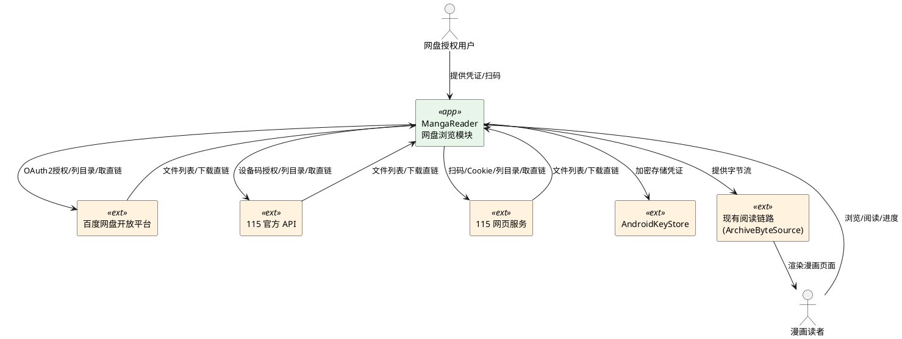
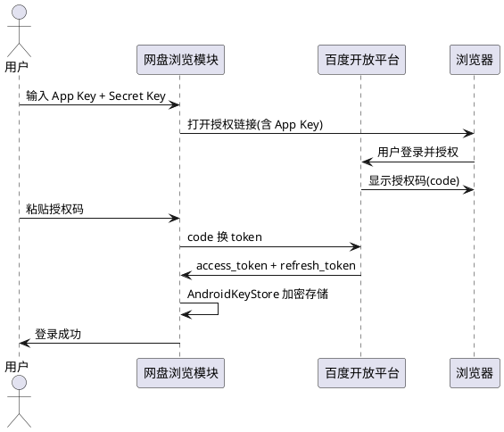
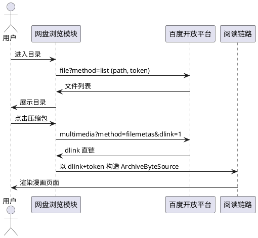
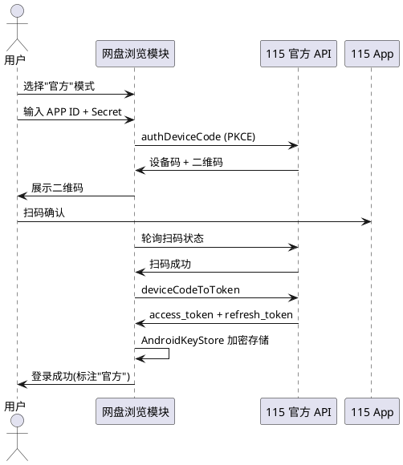
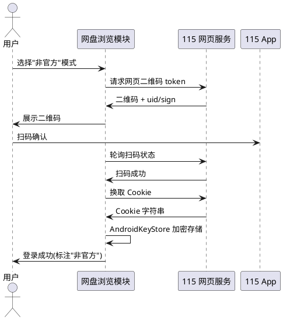
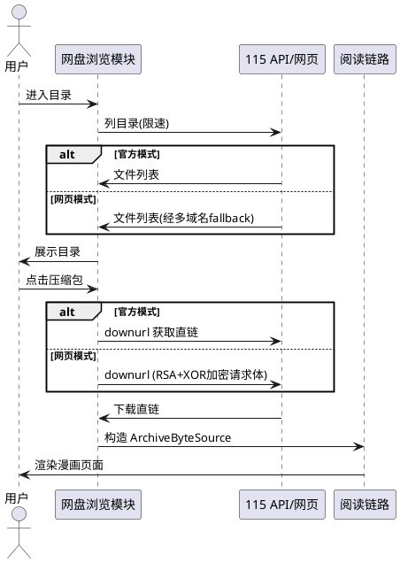
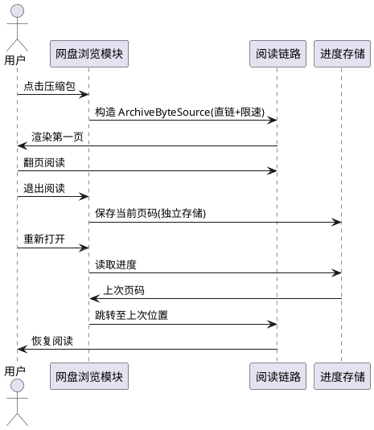
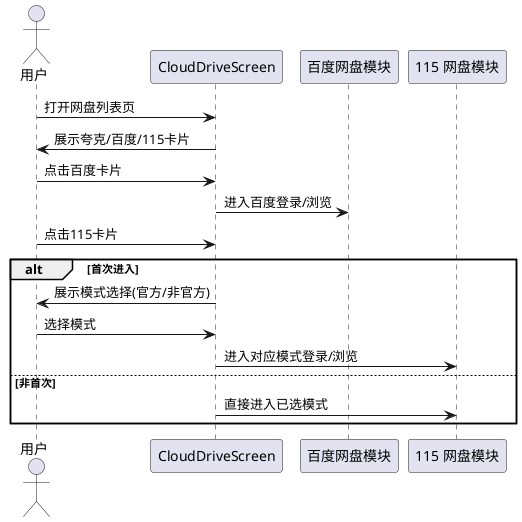

# 百度网盘 + 115 网盘浏览功能 需求规格

> 本文档采用 EARS 格B式（Easy Approach to Requirements Syntax）描述需求，聚焦"功能完成后系统应达到的外部可观测行为"，不含具体代码实现细节。
>
> - 无条件：系统应当 [动作]
> - 事件驱动：当 [触发条件] 时，系统应当 [动作]
> - 状态驱动：在 [状态] 期间，系统应当 [动作]
> - 可选：若 [功能包含]，系统应当 [动作]
> - 异常：如果 [触发条件]，则系统应当 [动作]

---

# 1. 组件定位

## 1.1 核心职责

本组件负责通过百度网盘开放平台 API 和 115 网盘（官方 API / 网页 Cookie 两种模式）浏览网盘中的漫画压缩包并接入现有阅读链路，实现用户在不导入本地文件的前提下直接阅读网盘漫画。

## 1.2 核心输入

1. **百度网盘凭证**：用户自行申请的 App Key + Secret Key，以及 OAuth2 授权码
2. **115 网盘(官方)凭证**：用户自行申请的 APP ID + APP Secret，配合设备码扫码授权
3. **115 网盘(网页)凭证**：用户通过 115 App 扫网页二维码获取的 Cookie
4. **用户操作指令**：浏览目录、打开漫画、翻页、长按加入书架、点击加载封面
5. **阅读进度信号**：用户退出阅读时产生的当前页码

## 1.3 核心输出

1. **目录列表响应**：返回给 UI 的文件夹/文件树结构
2. **漫画内容流**：通过阅读链路输出给 ArchiveByteSource 的字节流
3. **阅读进度持久化**：独立存储的每本漫画阅读进度
4. **凭证加密存储**：经 AndroidKeyStore 加密后的凭证密文
5. **UI 状态推送**：登录状态、加载进度、错误提示

## 1.4 职责边界

本组件 **不负责** 以下事项：

1. **不负责** 网盘账号注册与应用申请引导（仅提供凭证输入入口）
2. **不负责** 文件上传、删除、重命名、移动等网盘(写操作)管理
3. **不负责** 离线下载到本地存储（仅流式在线阅读）
4. **不负责** 书架管理逻辑（仅提供"长按加入书架"的触发入口，书架本身由现有模块管理）
5. **不负责** 夸克网盘的任何功能变更（零侵入，不修改 com.mangareader.quarkbridge 现有逻辑）
6. **不负责** 漫画解码与渲染（复用现有 PageLoader / ArchiveByteSource 链路）

---

# 2. 领域术语

**百度网盘开放平台**
: 百度官方提供的网2盘开发者 API 服务，需D要求用户自行在百度开发者中心创建应用并获取 App Key 与(与 Secret Key。

**App Key / Secret Key**
: 百度网盘开放平台应用的唯一标识与密钥对，由@由用户自行申请，本应用不内置。

**OAuth2 授权码模式**
: 百度网盘使用的标准授权流程：用户在浏览器中授权后获得授权码(code)，再用 code 换取 access_token 与 refresh_token。

**dlink**
: 百度网盘文件下载直链，通过 multimedia 接口获取，有效期约 8 小时，使用时须拼接当前 access_token。

**115 官方 API 模式**
: 115 生活开放平台提供的官方开发者接口，使用设备码 + PKCE 扫码授权，需用户自行申请 APP ID。UI 中标注"官方"。

**115 网页 Cookie 模式**
: 通过模拟 115 网页版扫码登录获取 Cookie 的非官方方式，无需申请 APP ID。UI 中标注"非官方"。

**设备码授权(Device Code Flow)**
: 115 官方 API 使用的授权流程：应用请求设备码生成二维码，用户用 115 App 扫码确认后，应用用设备码换取 token。

**PKCE(Proof Key for Code Exchange)**
: 115 官方授权中使用的安全扩展机制，通过 code_verifier / code_challenge 防止授权码拦截。

**RSA + XOR 加密**
: 115 网页模式下载直链请求体的加密方案：固定 key XOR → 字节反转 → XOR client key → RSA 分块加密，用于构造符合 115 网页接口预期的请求体。

**多域名 fallback**
: 115 网页模式列目录时，依次尝试 webapi.115.com、http://web.api.115.com、aps.115.com/natsort 等多个域名，任一可用即返回结果。

**WAF 冷却**
: 115 网页模式遭遇 WAF 拦截(HTTP 405)时，暂停该会话所有请求并进入冷却期，冷却结束后自动恢复。

**ArchiveByteSource**
: 现有阅读链路中的压缩包字节源抽象接口，支持随机读取(readAt)、预热(warm)、重连(requestReconnect)，网盘模块通过实现此接口接入阅读链路。

**反封控限速**
: 对网盘 API 请求施加保守的速率节流，避免高频请求触发网盘风控或封禁。

---

# 3. 角色与边界

## 3.1 核心角色

- **漫画读者**：已登录网盘的用户，浏览网盘目录、打开漫画、翻页阅读、管理阅读进度
- **网盘授权用户**：首次使用时提供凭证（百度 App Key/Secret、115 APP ID 或扫码）完成授权登录

## 3.2 外部系统

- **百度网盘开放平台**：提供 OAuth2 授权、文件列表、下载直链接口
- **115 生活开放平台(官方 API)**：提供设备码授权、文件列表、下载直链接口
- **115 网页服务(非官方)**：提供网页扫码登录、文件列表、下载直链接口
- **AndroidKeyStore**：系统级密钥库，用于凭证加密存储
- **现有阅读链路**：ArchiveByteSource + PageLoader，用于漫画解码与渲染

## 3.3 交互上下文

---

# 4. DFX 约束

## 4.1 性能

1. 系统应当 对网盘 API 请求施加限速，百度网盘默认不低于 1 请求/秒，115 官方 API 默认不低于 1.5 请求/秒，115 网页模式默认不低于 1 请求/秒。
2. 当 目录列表单次返回条目数不足时，系统应当 支持分页加载，单页默认 200 条。
3. 当 下载直链过期时，系统应当 自动重新获取直链并续传，对用户无感。
4. 系统应当 复用现有 ReadAheadArchiveByteSource 预读与 BlockCacheArchiveByteSource 块缓存机制，减少网盘请求次数。

## 4.2 可靠性

1. 当 access_token 过期时，系统应当 自动使用 refresh_token 刷新，刷新失败时提示用户重新授权。
2. 当 115 官方 API 的 refresh_token 轮换时，系统应当 立即持久化新 refresh_token，避免下次启动失效。
3. 当 115 网页模式某域名请求失败时，系统应当 自动 fallback 到下一个候选域名。
4. 当 115 网页模式遭遇 WAF 拦截(HTTP 405)时，系统应当 进入冷却期，冷却期间暂停该会话请求，冷却结束后自动恢复。
5. 当 网络请求超时(默认 60 秒)时，系统应当 返回明确错误提示，不无限等待。

## 4.3 安全性

1. 系统应当 使用 AndroidKeyStore 加密存储所有网盘凭证（百度 token、115 token、115 Cookie、App Key/Secret）。
2. 系统应当 禁止凭证以明文形式出现在日志、SharedPreferences 或任何持久化介质中。
3. 当 AndroidKeyStore 不可用时，系统应当 降级为不存储凭证并提示用户每次重新登录，而非明文存储。
4. 系统应当 对 115 网页模式的 Cookie 设置合理有效期，过期后提示重新扫码。

## 4.4 可维护性

1. 系统应当 以独立 package 实现百度与 115 网盘功能，不修改 com.mangareader.quarkbridge 包内任何现有文件的业务逻辑。
2. 系统应当 复用现有阅读链路接口（ArchiveByteSource / PageLoader），不新建并行解码渲染体系。
3. 系统应当 为每个网盘的阅读进度独立存储，互不干扰，且与本地书架进度隔离。

## 4.5 兼容性

1. 系统应当 在 CloudDriveScreen 网盘列表页中以与夸克网盘卡片一致的视觉风格呈现百度与 115 网盘入口。
2. 当 现有 CloudDriveScreen 中百度/115 占位卡片（当前显示"即将支持"灰色态）存在时，系统应当 将其替换为可交互的正式入口。
3. 系统应当 支持 Android 8.0(API 26)及以上设备，与项目最低 SDK 保持一致。

---

# 5. 核心能力

## 5.1 百度网盘授权登录

### 5.1.1 业务规则

1. **凭证输入**：用户须自行在百度开发者中心申请应用，提供 App Key 与 Secret Key。
   - 验收条件：[用户进入百度网盘登录页] → [系统展示 App Key / Secret Key 输入框及"申请指引"链接]
2. **授权链接生成**：系统应当 使用用户提供的 App Key 构造 OAuth2 授权链接（openapi.baidu.com/oauth/2.0/authorize，response_type=code，redirect_uri=oob，scope=basic,netdisk）。
   - 验收条件：[用户输入 App Key 并点击"获取授权链接"] → [系统生成并在浏览器中打开授权链接]
3. **授权码换取 Token**：当 用户在浏览器中完成百度授权并获取授权码后，系统应当 用授权码 + App Key + Secret Key 换取 access_token 与 refresh_token。
   - 验收条件：[用户将授权码粘贴回应用并确认] → [系统调用 token 接口换取 token 对并加密存储]
4. **Token 自动刷新**：当 access_token 过期时，系统应当 自动使用 refresh_token 刷新获取新的 access_token。
   - 验收条件：[API 返回 token 过期错误] → [系统自动刷新 token 并重试原请求，用户无感]
5. **禁止项**：禁止本应用内置任何默认 App Key / Secret Key。
   - 验收条件：[反编译应用] → [不包含硬编码的百度 App Key / Secret Key]

### 5.1.2 交互流程

### 5.1.3 异常场景

1. **授权码无效或过期**
   - 触发条件：用户粘贴的授权码错误或已超过有效期
   - 系统行为：向百度 token 接口请求失败，返回错误信息
   - 用户感知：提示"授权码无效或已过期，请重新获取"
2. **App Key / Secret Key 错误**
   - 触发条件：用户输入的凭证不正确
   - 系统行为：token 接口返回认证失败
   - 用户感知：提示"App Key 或 Secret Key 错误，请检查后重试"
3. **refresh_token 失效**
   - 触发条件：refresh_token 过期或被撤销
   - 系统行为：刷新 token 失败，清除已存储凭证
   - 用户感知：提示"登录已失效，请重新授权"

## 5.2 百度网盘目录浏览与下载

### 5.2.1 业务规则

1. **列目录**：系统应当 调用 pan.baidu.com/rest/2.0/xpan/file?method=list 接口，按目录路径返回文件列表。
   - 验收条件：[用户进入某目录] → [系统返回该目录下的文件夹与文件列表，文件夹可继续进入，压缩包文件可打开]
2. **下载直链获取**：当 用户打开某压缩包文件时，系统应当 通过 multimedia?method=filemetas&dlink=1 接口获取该文件的 dlink 下载直链。
   - 验收条件：[用户点击压缩包文件] → [系统获取 dlink 并通过阅读链路打开漫画]
3. **dlink 拼接 token**：系统应当 在使用 dlink 下载时拼接当前有效的 access_token，且 User-Agent 须设置为 "pan.baidu.com"。
   - 验收条件：[发起下载请求] → [请求 URL 包含有效 access_token，UA 为 pan.baidu.com]
4. **dlink 过期续期**：当 dlink 过期(约 8 小时)时，系统应当 自动重新获取 dlink 并续传。
   - 验收条件：[下载请求返回 dlink 失效错误] → [系统重新获取 dlink 并从断点续传]
5. **限速**：系统应当 对百度 API 请求施加限速，默认不低于 1 请求/秒。
   - 验收条件：[连续发起多个 API 请求] → [请求间隔不低于 1 秒]

### 5.2.2 交互流程

### 5.2.3 异常场景

1. **access_token 过期**
   - 触发条件：API 返回 token 过期错误码
   - 系统行为：自动刷新 token 后重试请求
   - 用户感知：无感（若刷新成功）；提示重新登录（若刷新失败）
2. **dlink 下载返回 31045**
   - 触发条件：dlink 未拼接有效 access_token 或 UA 不正确
   - 系统行为：修正 token 拼接与 UA 后重试
   - 用户感知：无感
3. **目录路径不存在**
   - 触发条件：请求的目录路径已被删除或无权限
   - 系统行为：返回空列表或错误提示
   - 用户感知：提示"目录不存在或无访问权限"

## 5.3 115 网盘授权登录(官方 API 模式)

### 5.3.1 业务规则

1. **模式选择**：当 用户首次进入 115 网盘时，系统应当 让用户在"官方 API"与"网页 Cookie"两种模式间选择，并明确标注"官方"与"非官方"。
   - 验收条件：[用户首次点击 115 网盘入口] → [系统展示模式选择界面，含"官方"与"非官方"标注及说明]
2. **凭证输入(官方)**：选择官方模式后，用户须提供自行申请的 APP ID 与 APP Secret。
   - 验收条件：[用户选择官方模式] → [系统展示 APP ID / APP Secret 输入框]
3. **设备码授权**：系统应当 调用 authDeviceCode 接口生成设备码与二维码，用户用 115 App 扫码确认后，系统通过 deviceCodeToToken 换取 token。
   - 验收条件：[用户输入 APP ID 并发起授权] → [系统展示二维码，用户扫码后系统自动换取 token 并登录]
4. **PKCE 安全**：系统应当 在设备码授权流程中使用 PKCE 机制，生成 code_verifier 与 code_challenge 防止授权码拦截。
   - 验收条件：[发起设备码授权] → [请求中包含 PKCE 相关参数]
5. **refresh_token 轮换**：当 115 官方 API 刷新 token 时，系统应当 立即持久化新的 refresh_token（每次刷新均返回新的 refresh_token）。
   - 验收条件：[token 刷新成功] → [新 refresh_token 已加密写入存储]
6. **禁止项**：禁止本应用内置任何默认 APP ID / APP Secret。
   - 验收条件：[反编译应用] → [不包含硬编码的 115 APP ID / Secret]

### 5.3.2 交互流程

### 5.3.3 异常场景

1. **扫码超时**
   - 触发条件：用户未在有效期内扫码确认
   - 系统行为：停止轮询，清除临时设备码
   - 用户感知：提示"扫码超时，请重新发起授权"
2. **用户拒绝授权**
   - 触发条件：用户在 115 App 中拒绝授权
   - 系统行为：停止轮询，清除临时状态
   - 用户感知：提示"授权被拒绝"
3. **APP ID / Secret 错误**
   - 触发条件：用户输入的凭证不正确
   - 系统行为：authDeviceCode 接口返回认证失败
   - 用户感知：提示"APP ID 或 Secret 错误"
4. **refresh_token 轮换失败**
   - 触发条件：刷新 token 时网络错误或接口异常
   - 系统行为：保留旧 refresh_token 重试若干次，仍失败则清除凭证
   - 用户感知：提示"登录已失效，请重新授权"

## 5.4 115 网盘授权登录(网页 Cookie 模式)

### 5.4.1 业务规则

1. **无需 APP ID**：选择网页模式后，用户无须提供任何开发者凭证，仅需用 115 App 扫码即可。
   - 验收条件：[用户选择"非官方"模式] → [系统直接展示二维码，无凭证输入框]
2. **网页扫码流程**：系统应当 调用 115 网页版二维码接口生成二维码，用户扫码后换取 Cookie。
   - 验收条件：[用户发起网页模式登录] → [系统展示二维码，用户扫码后自动获取 Cookie 并登录]
3. **Cookie 加密存储**：系统应当 将获取的 Cookie 经 AndroidKeyStore 加密后存储。
   - 验收条件：[扫码成功] → [Cookie 已加密存储，明文不出现在任何持久化介质]
4. **Cookie 有效期**：系统应当 对 Cookie 设置有效期检测，过期时提示重新扫码。
   - 验收条件：[Cookie 过期导致 API 返回登录失效] → [提示用户重新扫码]
5. **标注"非官方"**：系统应当 在 UI 中明确标注此模式为"非官方"。
   - 验收条件：[用户选择网页模式] → [登录后界面标注"非官方"标识]
6. **禁止项**：禁止将 Cookie 明文打印到日志中。
   - 验收条件：[抓取应用日志] → [不包含 Cookie 明文]

### 5.4.2 交互流程

### 5.4.3 异常场景

1. **扫码超时**
   - 触发条件：用户未在有效期内扫码
   - 系统行为：停止轮询
   - 用户感知：提示"扫码超时，请重新发起"
2. **Cookie 获取失败**
   - 触发条件：换取 Cookie 接口返回错误或 Cookie 为空
   - 系统行为：清除临时状态，提示重试
   - 用户感知：提示"登录失败，请重新扫码"
3. **Cookie 过期**
   - 触发条件：使用 Cookie 请求 API 时返回登录失效错误
   - 系统行为：清除已存储 Cookie
   - 用户感知：提示"登录已失效，请重新扫码"

## 5.5 115 网盘目录浏览与下载

### 5.5.1 业务规则

1. **列目录(官方)**：当 使用官方 API 模式时，系统应当 调用 proapi.115.com/open/ufile/files 接口，按文件夹 ID 返回文件列表（根目录 ID 为 0）。
   - 验收条件：[官方模式用户进入某目录] → [系统返回该目录下文件列表]
2. **列目录(网页)**：当 使用网页 Cookie 模式时，系统应当 调用 webapi.115.com/files 接口列目录，并须携带浏览器 UA 与 Cookie。
   - 验收条件：[网页模式用户进入某目录] → [系统返回该目录下文件列表，请求含 UA + Cookie]
3. **多域名 fallback(网页)**：当 网页模式某域名请求失败时，系统应当 依次尝试候选域名（webapi.115.com → http://web.api.115.com → aps.115.com/natsort），任一成功即返回。
   - 验收条件：[webapi.115.com 请求失败] → [系统自动尝试下一域名，成功后返回结果]
4. **下载直链(官方)**：当 官方模式用户打开压缩包时，系统应当 调用 proapi.115.com/open/ufile/downurl 获取下载直链。
   - 验收条件：[官方模式用户点击压缩包] → [系统获取直链并通过阅读链路打开]
5. **下载直链(网页)**：当 网页模式用户打开压缩包时，系统应当 调用 proapi.115.com/app/chrome/downurl 获取直链，请求体须经 RSA + XOR 加密，且取链与下载的 UA 须一致。
   - 验收条件：[网页模式用户点击压缩包] → [系统以加密请求体获取直链，下载时 UA 与取链一致]
6. **WAF 冷却(网页)**：当 网页模式遭遇 WAF 拦截(HTTP 405)时，系统应当 暂停该会话所有请求并进入冷却期，冷却结束后自动恢复。
   - 验收条件：[API 返回 HTTP 405] → [系统暂停请求并显示冷却提示，冷却后自动恢复]
7. **限速**：系统应当 对 115 API 请求施加限速，官方模式默认不低于 1.5 请求/秒，网页模式默认不低于 1 请求/秒。
   - 验收条件：[连续发起多个 API 请求] → [请求间隔符合限速要求]

### 5.5.2 交互流程

### 5.5.3 异常场景

1. **WAF 拦截(网页模式)**
   - 触发条件：API 返回 HTTP 405
   - 系统行为：暂停该会话请求，进入冷却期，冷却后自动恢复
   - 用户感知：提示"触发风控，正在冷却..."，冷却后自动恢复
2. **所有域名均失败(网页模式)**
   - 触发条件：多域名 fallback 全部失败
   - 系统行为：返回错误，提示重试或切换模式
   - 用户感知：提示"网络异常，请稍后重试"
3. **下载直链签名失效(网页模式)**
   - 触发条件：CDN 返回 403 "invalid signature"
   - 系统行为：重新获取直链后重试
   - 用户感知：无感
4. **token 过期(官方模式)**
   - 触发条件：API 返回 token 过期
   - 系统行为：自动刷新 token（轮换 refresh_token）后重试
   - 用户感知：无感（若刷新成功）；提示重新授权（若刷新失败）

## 5.6 阅读链路集成

### 5.6.1 业务规则

1. **复用 ArchiveByteSource**：系统应当 将网盘下载直链封装为 ArchiveByteSource 实现，接入现有 ReadAheadArchiveByteSource 预读与 BlockCacheArchiveByteSource 块缓存。
   - 验收条件：[用户打开网盘漫画] → [通过现有阅读链路解码渲染，预读与缓存行为与本地漫画一致]
2. **封面默认不加载**：系统应当 在目录浏览时默认不加载压缩包封面缩略图，以减少 API 请求并降低封控风险。
   - 验收条件：[浏览目录时] → [封面区域显示占位图，不发起封面加载请求]
3. **点击加载第一页**：当 用户点击某漫画封面占位区时，系统应当 加载该漫画第一页作为封面预览。
   - 验收条件：[用户点击封面占位区] → [系统加载第一页并显示为封面]
4. **默认不进书架**：系统应当 默认不将网盘漫画加入书架，避免书架膨胀。
   - 验收条件：[用户从网盘打开漫画] → [漫画不自动出现在书架中]
5. **长按加入书架**：当 用户长按网盘漫画时，系统应当 提供加入书架选项。
   - 验收条件：[用户长按漫画] → [弹出菜单含"加入书架"选项，点击后加入书架]
6. **进度独立存储**：系统应当 为每本网盘漫画独立存储阅读进度，且与本地书架进度隔离。
   - 验收条件：[用户退出阅读后重新打开] → [恢复至上次阅读位置，且不影响本地漫画进度]

### 5.6.2 交互流程

### 5.6.3 异常场景

1. **下载中断**
   - 触发条件：网络断开或网盘限速导致下载中断
   - 系统行为：通过 ArchiveByteSource 的 requestReconnect 机制自动重连续传
   - 用户感知：短暂卡顿后自动恢复
2. **压缩包格式不支持**
   - 触发条件：文件不是有效的压缩包格式
   - 系统行为：返回错误提示
   - 用户感知：提示"无法打开此文件格式"

## 5.7 UI 呈现

### 5.7.1 业务规则

1. **网盘列表页**：系统应当 在 CloudDriveScreen 网盘列表页中呈现百度网盘与 115 网盘入口卡片，视觉风格与夸克网盘卡片一致。
   - 验收条件：[用户打开网盘列表页] → [页面展示夸克、百度、115 三个网盘卡片，风格统一]
2. **激活占位卡片**：当 百度/115 功能就绪后，系统应当 将现有占位卡片（灰色"即将支持"态）替换为可交互的正式入口。
   - 验收条件：[功能上线后打开网盘列表页] → [百度/115 卡片为正常可点击状态，不再显示"即将支持"]
3. **登录状态展示**：系统应当 在卡片上展示各网盘的登录状态（未登录/已登录·昵称）。
   - 验收条件：[用户已登录百度网盘] → [百度卡片显示"已登录 · 昵称"]；[未登录] → [显示"点击登录"]
4. **115 模式选择界面**：当 用户首次点击 115 网盘入口时，系统应当 展示模式选择界面，含"官方 API"与"网页 Cookie"两个选项，并分别标注"官方"与"非官方"及简要说明。
   - 验收条件：[用户首次点击 115 入口] → [展示模式选择界面，含官方/非官方标注与说明]
5. **模式标注持久化**：当 用户选择 115 模式后，系统应当 记住用户选择，下次进入时直接使用已选模式。
   - 验收条件：[用户再次进入 115] → [直接进入已选模式的登录或浏览界面]
6. **错误提示统一**：系统应当 以与夸克网盘一致的 Toast / Snackbar 风格展示错误提示。
   - 验收条件：[发生错误] → [以统一风格展示错误提示]

### 5.7.2 交互流程

### 5.7.3 异常场景

1. **网盘服务不可用**
   - 触发条件：网盘 API 完全不可达
   - 系统行为：卡片展示离线状态
   - 用户感知：提示"网盘服务暂不可用"

---

# 6. 数据约束

## 6.1 百度网盘凭证

1. **App Key**：用户自行申请的应用标识，非空字符串，由用户提供，不内置
2. **Secret Key**：用户自行申请的应用密钥，非空字符串，由用户提供，不内置，加密存储
3. **access_token**：百度 API 访问令牌，非空字符串，有有效期，加密存储
4. **refresh_token**：百度 API 刷新令牌，非空字符串，长期有效，加密存储
5. **授权码(code)**：OAuth2 授权码，非空字符串，一次性使用，不持久化

## 6.2 115 网盘凭证(官方模式)

1. **APP ID**：用户自行申请的应用标识，非空字符串，由用户提供，不内置
2. **APP Secret**：用户自行申请的应用密钥，非空字符串，由用户提供，不内置，加密存储
3. **access_token**：115 官方 API 访问令牌，非空字符串，有有效期，加密存储
4. **refresh_token**：115 官方 API 刷新令牌，非空字符串，每次刷新轮换，加密存储
5. **code_verifier**：PKCE 校验码，非空字符串，授权流程中临时持有，不持久化

## 6.3 115 网盘凭证(网页模式)

1. **Cookie**：115 网页登录 Cookie 字符串，非空，格式为 "k=v; k2=v2"，加密存储
2. **user_id**：从 Cookie 中提取的用户 ID，数字字符串，用于 API 请求
3. **模式标识**：用户选择的登录模式（"official" / "web"），持久化存储

## 6.4 网盘文件条目

1. **文件名**：非空字符串，服务端返回的原始文件名
2. **文件路径/ID**：非空字符串，百度为路径(如 /漫画/xxx.cbz)，115 为文件夹 ID
3. **是否目录**：布尔值，标识该条目为文件夹或文件
4. **文件大小**：非负整数，单位为字节
5. **修改时间**：整数时间戳，单位为秒

## 6.5 阅读进度

1. **网盘类型**：枚举值（"baidu" / "115_official" / "115_web"），标识进度归属
2. **文件标识**：非空字符串，唯一标识一本漫画（百度为文件路径，115 为文件 ID）
3. **当前页码**：非负整数，从 0 开始
4. **总页数**：正整数，首次打开时确定
5. **最后阅读时间**：整数时间戳，单位为秒

---

# 7. 验收标准汇总

## 7.1 百度网盘

| 编号 | 验收条件 | 优先级 |
|------|----------|--------|
| BD-01 | 用户输入 App Key/Secret 后可获取授权链接并在浏览器中授权 | P0 |
| BD-02 | 用户粘贴授权码后成功换取 token 并加密存储 | P0 |
| BD-03 | access_token 过期时自动刷新，用户无感 | P0 |
| BD-04 | 可浏览百度网盘目录，文件夹可进入，压缩包可打开 | P0 |
| BD-05 | 下载时 dlink 拼接有效 token 且 UA 为 pan.baidu.com | P0 |
| BD-06 | dlink 过期时自动重新获取并续传 | P1 |
| BD-07 | API 请求限速不低于 1 请求/秒 | P1 |

## 7.2 115 网盘

| 编号 | 验收条件 | 优先级 |
|------|----------|--------|
| 115-01 | 首次进入 115 展示模式选择界面，标注"官方"/"非官方" | P0 |
| 115-02 | 官方模式：输入 APP ID 后设备码扫码授权成功 | P0 |
| 115-03 | 官方模式：refresh_token 轮换后立即持久化 | P0 |
| 115-04 | 网页模式：无需 APP ID，扫码后获取 Cookie 并加密存储 | P0 |
| 115-05 | 网页模式：列目录时多域名 fallback 生效 | P1 |
| 115-06 | 网页模式：下载请求体经 RSA+XOR 加密 | P1 |
| 115-07 | 网页模式：WAF 拦截时进入冷却，冷却后自动恢复 | P1 |
| 115-08 | 两种模式均可浏览目录并打开压缩包阅读 | P0 |

## 7.3 阅读链路与 UI

| 编号 | 验收条件 | 优先级 |
|------|----------|--------|
| RD-01 | 网盘漫画通过现有 ArchiveByteSource 链路渲染 | P0 |
| RD-02 | 目录浏览时封面默认不加载，点击后加载第一页 | P0 |
| RD-03 | 默认不进书架，长按可加入 | P0 |
| RD-04 | 阅读进度独立存储，互不干扰 | P0 |
| RD-05 | CloudDriveScreen 中百度/115 卡片激活，风格与夸克一致 | P0 |
| RD-06 | 凭证经 AndroidKeyStore 加密，明文不出现在日志/持久化介质 | P0 |
| RD-07 | 不修改 com.mangareader.quarkbridge 现有文件业务逻辑 | P0 |

---

# 8. 约束

1. **零侵入**：百度与 115 网盘功能须以独立 package 实现，不修改 com.mangareader.quarkbridge 包内任何现有文件的业务逻辑。仅允许修改 CloudDriveScreen.kt 中百度/115 占位卡片的 UI 状态（从灰色禁用态改为可交互态）。
2. **凭证安全**：所有凭证（百度 token、115 token、115 Cookie、App Key/Secret、APP ID/Secret）须经 AndroidKeyStore 加密存储，明文禁止出现在日志、SharedPreferences 或任何持久化介质。
3. **不内置凭证**：禁止内置任何默认的百度 App Key/Secret 或 115 APP ID/Secret，均由用户自行申请提供。
4. **反封控**：对所有网盘 API 请求施加保守限速，115 网页模式须实现多域名 fallback 与 WAF 冷却机制。
5. **UI 一致性**：百度/115 网盘的 UI 风格须与夸克网盘卡片保持一致，115 两种模式须让用户选择并标注"官方"/"非官方"。
6. **阅读链路复用**：须复用现有 ArchiveByteSource + PageLoader 阅读链路，不新建并行解码渲染体系。
7. **进度隔离**：网盘漫画阅读进度须独立存储，与本地书架进度互不干扰。