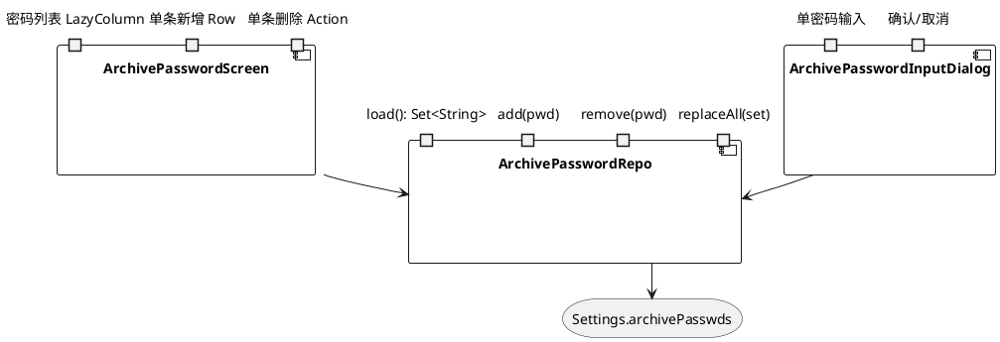
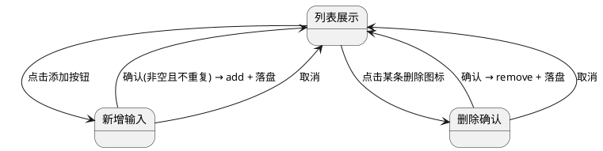
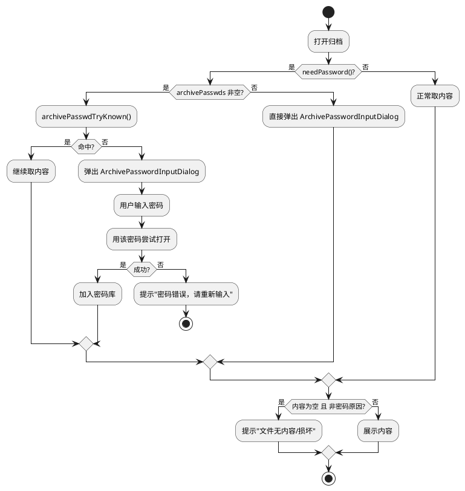
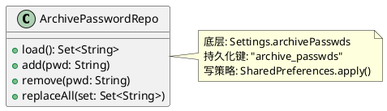

# 技术设计：归档密码功能 UI 重构（REQ-001）

- **需求ID**: REQ-001
- **基线 commit**: eb2ac412
- **状态**: 待评审

# 一、需求与存量功能关系分析

## 1.1 需求功能与存量功能对比

### 1.1.1 已实现功能

| 需求功能 | 存量功能 | 代码位置 | 匹配度 |
|---------|---------|---------|--------|
| 归档密码持久化（跨来源共用） | `Settings.archivePasswds`，stringSetPref 落盘 | `com/hippo/ehviewer/Settings.kt:543` | 100% |
| 打开加密包时自动尝试已存密码 | `archivePasswdTryKnown()`：先试最近命中 front，再遍历全集 | `com/hippo/ehviewer/gallery/ArchivePageLoader.kt:61-68` | 100% |
| 手动输入密码成功后加入密码库 | `archivePasswds += pwd; archivePasswdFront = pwd` | `ArchivePageLoader.kt:104`、`StreamArchivePageLoader.kt:229`、`SolidExtractPageLoader.kt:138` | 100% |
| 三路（本地/SMB/WebDAV）共用同一密码库 | 三处加载器均 import 同一 `Settings.archivePasswds` | `ArchivePageLoader.kt:24`、`StreamArchivePageLoader.kt:7`、`SolidExtractPageLoader.kt:8` | 100% |
| 密码管理入口存在（弹窗形式） | `showArchivePasswdsDialog` 系统原生对话框，换行输入多密码 | `com/mangareader/smbbridge/SmbSettingsScreen.kt:298` | 50% |

### 1.1.2 需要扩展的功能

| 需求功能 | 存量功能 | 差异说明 | 扩展方向 |
|---------|---------|---------|---------|
| 独立全屏管理界面（一条一记录、单条增删） | `showArchivePasswdsDialog` 弹窗，一个文本框换行输入多密码 | 输入形态差异：弹窗→全屏界面；多行文本→列表记录项；无单条删除能力 | 新增 Compose 全屏 Screen，替换三处调用点的弹窗调用 |
| 密码相关失败明确提示 | 打开失败可能走到 `check(opened>0){"Archive have no content!"}` 兜底 | 当 `needPassword()` 判定遗漏或 passwdProvider 返回空时，错误被"没有内容"掩盖 | 在归档打开失败路径上区分"密码错误/需要密码"与"内容缺失"，分别给出对应提示 |
| 密码集合为空时不做空尝试 | 现有 `archivePasswdTryKnown()` 在空集时直接返回 false，逻辑正确 | 行为已正确，仅需保证空集时不弹"尝试中"无意义 UI | 无需改动核心逻辑，仅在 UI 层保证空集直弹输入窗 |

### 1.1.3 需要新增的功能或接口

- **归档密码管理全屏界面**（`ArchivePasswordScreen`）：独立 Composable，列表展示每条密码，支持单条新增（输入框+添加按钮）、单条删除（滑动删除或删除图标），返回手势正常回退。依赖 `Settings.archivePasswds` 读写。
- **兜底密码输入弹窗**（`ArchivePasswordInputDialog`）：当自动尝试全部失败时弹出，单次输入单条密码，确认后回调尝试打开。区别于管理界面，此为阅读流程中的即时输入。
- **密码错误根因识别**：在归档打开失败时，区分"需要密码/密码错误"与"文件损坏/内容缺失"两类根因，映射到不同用户提示。

## 1.2 存量功能详细分析

### 1.2.1 密码自动尝试链路（ArchivePageLoader）

- **接口契约**：`archivePasswdTryKnown(): Boolean`，无入参，返回是否命中。副作用：命中时设置 native passwd 并更新 `archivePasswdFront`。
- **业务规则**：先试 front（最近命中且仍在库内），再遍历全集跳过 front。命中即返回，不继续尝试。
- **约束**：front 必须仍在 `archivePasswds` 集合内才试（用户经编辑器删除的密码不再自动尝试）。
- **调用点**：`useArchivePageLoader`（ArchivePageLoader.kt:102）在 `needPassword() && !archivePasswdTryKnown()` 时调 `passwdProvider` 让用户输入。三路加载器（本地/Solid/流式）共用此函数。

### 1.2.2 密码管理弹窗（showArchivePasswdsDialog）

- **接口契约**：`showArchivePasswdsDialog(activity, current: List<String>, onDone: (List<String>) -> Unit)`，系统原生 AlertDialog，一个 EditText 多行输入。
- **调用点**：`FolderManageScreen.kt:531`、`SmbSettingsScreen.kt:215`、`WebDavSettingsScreen.kt:234`，三处均 `Settings.archivePasswds = newList.toSet()` 落盘。
- **约束**：依赖 Activity（系统原生对话框），非 Compose；换行分隔多密码，易错且无法单条删除。

### 1.2.3 失败兜底提示

- `ArchivePageLoader.kt:101`：`check(opened > 0) { "Archive have no content!" }`——当归档打开返回 0 条目时抛异常，上层捕获后展示"没有内容/文件缺失"。若根因实为密码错误但 `needPassword()` 未正确判定，则密码错误被此提示掩盖。

# 二、增量设计方案

## 2.1 实现模型

### 2.1.1 上下文视图

```plantuml
@startuml
actor 用户
component "设置入口\n(文件夹管理/SMB/WebDAV)" as Entry
component "ArchivePasswordScreen\n(新增全屏界面)" as PwdScreen
storage "Settings.archivePasswds\n(stringSetPref)" as Store
component "阅读器\n归档打开流程" as Reader
component "archivePasswdTryKnown\n(自动尝试)" as AutoTry
component "ArchivePasswordInputDialog\n(新增兜底弹窗)" as InputDialog

用户 --> Entry : 进入归档密码管理
Entry --> PwdScreen : 导航(替换原弹窗)
PwdScreen --> Store : 读写/即时落盘

用户 --> Reader : 打开加密压缩包
Reader --> AutoTry : 自动尝试已存密码
alt 全部失败
  Reader --> InputDialog : 弹出兜底输入
  InputDialog --> Reader : 用户输入密码
  Reader --> Store : 成功后加入密码库
end
@enduml
```

### 2.1.2 服务/组件总体架构



### 2.1.3 实现设计文档

**密码管理界面状态流转**：



**加密包打开流程（含兜底）**：



## 2.2 接口设计

### 2.2.1 总体设计

| 接口 | 类型 | 位置 | 稳定性 |
|------|------|------|--------|
| `ArchivePasswordScreen` | Compose 全屏界面 | `com/mangareader/ui/ArchivePasswordScreen.kt`（新增） | 稳定 |
| `ArchivePasswordInputDialog` | Compose 弹窗 | `com/mangareader/ui/ArchivePasswordInputDialog.kt`（新增） | 稳定 |
| `ArchivePasswordRepo` | 仓储对象 | `com/mangareader/util/ArchivePasswordRepo.kt`（新增） | 稳定 |
| `showArchivePasswdsDialog` | 旧弹窗（保留兼容/逐步替换） | `SmbSettingsScreen.kt:298` | 废弃 |

### 2.2.2 接口清单

#### ArchivePasswordScreen

- **接口签名**：`@Composable fun ArchivePasswordScreen(onBack: () -> Unit)`
- **业务说明**：全屏管理归档密码列表，单条增删，即时落盘。
- **前置条件**：由设置入口导航进入。
- **后置条件**：返回时 `Settings.archivePasswds` 已含所有增删结果。
- **异常映射**：无（纯本地 SharedPreferences 读写）。

#### ArchivePasswordInputDialog

- **接口签名**：`@Composable fun ArchivePasswordInputDialog(onConfirm: (String) -> Unit, onDismiss: () -> Unit)`
- **业务说明**：阅读流程中自动尝试全部失败后弹出的单密码输入窗。
- **前置条件**：加密包已尝试全部已存密码仍未打开，或密码库为空。
- **后置条件**：确认时回调密码供打开流程尝试；取消时不尝试。
- **异常映射**：无。

#### ArchivePasswordRepo

- **接口签名**：
  - `fun load(): Set<String>`
  - `fun add(pwd: String)` / `fun remove(pwd: String)` / `fun replaceAll(set: Set<String>)`
- **业务说明**：封装 `Settings.archivePasswds` 读写，供界面与打开流程共用。
- **前置条件**：无。
- **后置条件**：每次写操作即时落盘（`apply()`）。

## 2.3 数据模型

### 2.3.1 设计目标

- 复用既有 `archive_passwds` stringSetPref 持久化键，不新增存储结构。
- 密码集合无序、去重；最近命中密码 front 单独存（已有 `archivePasswdsFront` 机制）。
- 跨来源（本地/SMB/WebDAV）共用同一份，不拆分。

### 2.3.2 模型实现



## 2.4 涉及文件与改动范围

| 文件 | 改动类型 | 改动说明 |
|------|---------|---------|
| `com/mangareader/ui/ArchivePasswordScreen.kt` | 新增 | 全屏密码管理界面 |
| `com/mangareader/ui/ArchivePasswordInputDialog.kt` | 新增 | 兜底密码输入弹窗 |
| `com/mangareader/util/ArchivePasswordRepo.kt` | 新增 | 密码仓储封装 |
| `com/mangareader/ui/FolderManageScreen.kt:527-532` | 修改 | 行内条目点击改为导航至 `ArchivePasswordScreen` |
| `com/mangareader/smbbridge/SmbSettingsScreen.kt:211-216` | 修改 | 同上，替换 `showArchivePasswdsDialog` 调用 |
| `com/mangareader/webdavbridge/WebDavSettingsScreen.kt:230-235` | 修改 | 同上 |
| `com/hippo/ehviewer/gallery/ArchivePageLoader.kt:101-106` | 修改 | 区分密码错误与内容缺失的失败提示 |
| `com/mangareader/smbbridge/SmbSettingsScreen.kt:298` | 废弃 | `showArchivePasswdsDialog` 标记废弃，保留至三处替换完成后移除 |

## 2.5 实现思路

1. **全屏管理界面**：新建 `ArchivePasswordScreen`，LazyColumn 展示每条密码（明文，与现有弹窗一致不加掩码以保持行为不变），顶部输入栏+添加按钮单条新增，每条尾部删除图标单条删除。所有增删经 `ArchivePasswordRepo` 即时落盘。返回手势由 `onBack` 回退，不丢失修改（已即时落盘）。
2. **三处入口替换**：`FolderManageScreen`、`SmbSettingsScreen`、`WebDavSettingsScreen` 原点击 `showArchivePasswdsDialog` 处，改为导航至 `ArchivePasswordScreen`。导航方式沿用项目既有 Compose 导航（NavController.navigate 或 Activity 跳转，与同目录其他设置子页一致）。
3. **兜底密码输入弹窗**：新建 `ArchivePasswordInputDialog`，单输入框+确认/取消。在 `useArchivePageLoader` 的 `passwdProvider` 回调处接入此弹窗（替代当前隐式输入路径），确保自动尝试全部失败后弹出。
4. **失败提示区分**：在 `ArchivePageLoader.kt:101` 的 `check(opened>0)` 之前，先判 `needPassword()`——若需要密码且当前未命中，提示"密码错误，请重新输入"并回弹输入窗；若不需要密码但 opened==0，才提示"文件无内容/损坏"。避免密码错误被"没有内容"掩盖。
5. **空集直弹**：`archivePasswdTryKnown()` 空集时已返回 false，流程自然走到 passwdProvider 弹窗，无需额外改动，仅保证 UI 层不展示"正在尝试"无意义状态。

## 2.6 风险评估

| 风险 | 等级 | 说明 | 缓解措施 |
|------|------|------|---------|
| 三处入口导航方式不一致 | 中 | 文件夹管理页与 SMB/WebDAV 设置页可能用不同导航机制 | 分别确认各入口所属导航栈，沿用同目录既有子页跳转方式 |
| 密码明文展示 | 低 | 现有弹窗即明文，保持一致；若需掩码为后续需求 | 本次不改，保持行为不变 |
| `needPassword()` 判定不准 | 中 | 若 native 层未正确识别加密包，密码错误仍可能被当内容缺失 | 在打开失败时增加日志标记 needPassword 结果，便于核实；提示文案对两类根因都给出可理解信息 |
| 旧弹窗残留调用 | 低 | 替换过程中可能遗漏调用点 | grep 全量确认 `showArchivePasswdsDialog` 调用点清零后再移除函数 |
| 密码库跨来源共用被误拆 | 低 | 改造时可能误将三路拆成独立库 | Repo 单例读写同一 `archive_passwds` 键，不按来源分键 |