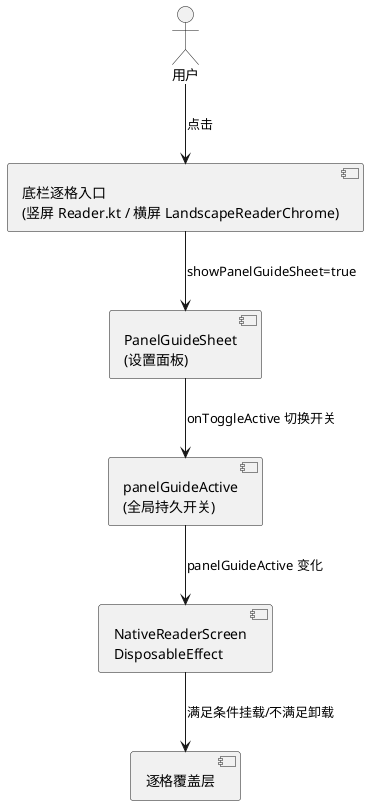
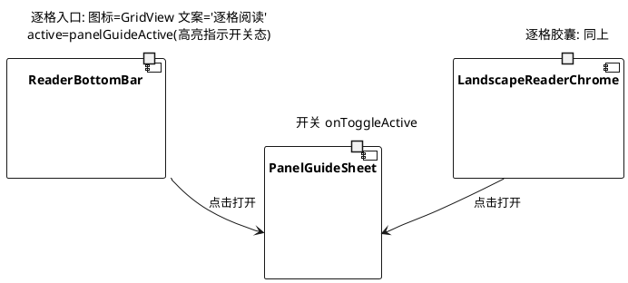
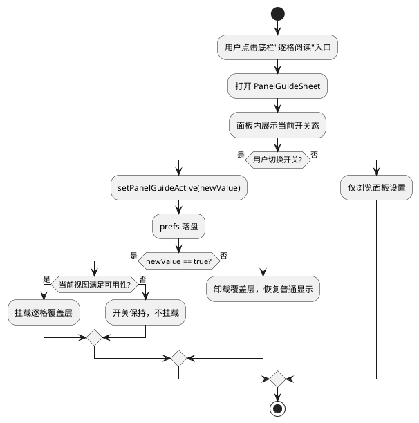

# 技术设计：逐格阅读始终常开（REQ-002）

- **需求ID**: REQ-002
- **基线 commit**: eb2ac412
- **状态**: 待评审

# 一、需求与存量功能关系分析

## 1.1 需求功能与存量功能对比

### 1.1.1 已实现功能

| 需求功能 | 存量功能 | 代码位置 | 匹配度 |
|---------|---------|---------|--------|
| 开关持久化（全局 prefs） | `panelGuideActive` 读写 `prefs.getBoolean("panelGuideActive", false)`，全局 `manga_reader` SharedPreferences | `Reader.kt:291-295` | 100% |
| 满足可用性条件自动挂载覆盖层 | `DisposableEffect(panelGuideActive,...)` 判定 PagerReaderView+非竖翻/瓦片/仿真+单页布局才挂载 | `NativeReaderScreen.kt:729-734` | 100% |
| 不满足条件时开关保持但不挂载 | 同上 DisposableEffect 条件不满足时静默不启用，开关不清 | `NativeReaderScreen.kt:734` | 100% |
| 点击入口打开设置面板 | 底栏入口点击 `{ showPanelGuideSheet = true }` | `Reader.kt:2676` | 100% |
| 面板内开关控制开/关 | `onToggleActive = { setPanelGuideActive(!panelGuideActive) }` | `Reader.kt:3451-3454` | 100% |
| 关闭立即卸载覆盖层 | DisposableEffect 依赖 panelGuideActive，关闭时 re-setup 卸载 | `NativeReaderScreen.kt:729` | 100% |
| 会话内切换即时生效 | setPanelGuideActive 直接改 state + 落盘，DisposableEffect 响应 | `Reader.kt:292-295` | 100% |

### 1.1.2 需要扩展的功能

| 需求功能 | 存量功能 | 差异说明 | 扩展方向 |
|---------|---------|---------|---------|
| 底栏图标始终为功能入口（不切"退出逐格"） | 开启时图标切 `Close`+文案"退出逐格"，关闭时 `GridView`+"逐格阅读" | 文案/图标随开关态切换，与需求"始终统一入口"冲突 | 改为始终 `GridView`+"逐格阅读"，active 高亮指示当前开/关 |

### 1.1.3 需要新增的功能或接口

- 无新增接口。本次为存量代码的入口呈现语义修正。

## 1.2 存量功能详细分析

### 1.2.1 panelGuideActive 持久化链路

- **接口契约**：`var panelGuideActive by remember { mutableStateOf(prefs.getBoolean("panelGuideActive", false)) }`，`setPanelGuideActive(v)` 改 state 并 `prefs.edit().putBoolean(...).apply()`。
- **业务规则**：全局单键 `panelGuideActive`，跨书跨进程。`remember` 在 Reader Composable 进入 composition 时从 prefs 读取初值——进书/切书/进程重启均重新读取，持久值生效。
- **约束**：prefs 为全局 `manga_reader`（`Reader.kt:104`），非按书隔离，符合"全局开关"语义。

### 1.2.2 覆盖层挂载判定（NativeReaderScreen）

- **接口契约**：`DisposableEffect(panelGuideActive, treePath, isVertical, effectiveUseCurl, tileModeEnabled, pageLayout, panelGuideEink)`，条件 `panelGuideActive && d is PagerReaderView && !isVertical && !effectiveUseCurl && !tileModeEnabled && pageLayout == 0`。
- **业务规则**：仅翻页单页族（非竖翻/瓦片/仿真/横屏自动双页）实际启用；不满足时开关保持但不挂载。
- **约束**：条件任一变化触发 re-setup，开关关闭时卸载覆盖层。

### 1.2.3 底栏入口呈现（当前问题点）

- **竖屏**：`Reader.kt:2672-2676`，图标 `if (panelGuideActive) Close else GridView`，文案 `if (panelGuideActive) "退出逐格" else "逐格阅读"`。
- **横屏**：`LandscapeReaderChrome.kt:121-125`，同上文案/图标切换。
- **问题**：开启后入口变成"退出逐格"+关闭图标，与需求"始终统一入口"冲突。`active = panelGuideActive` 高亮已能指示开关态，无需改文案。

# 二、增量设计方案

## 2.1 实现模型

### 2.1.1 上下文视图

### 2.1.2 服务/组件总体架构

本次无新增组件，仅修正两处入口呈现。架构不变：

### 2.1.3 实现设计文档

**入口点击与开关切换流程（修正后）**：

## 2.2 接口设计

### 2.2.1 总体设计

| 接口 | 类型 | 位置 | 稳定性 | 本次变更 |
|------|------|------|--------|---------|
| 底栏逐格入口 | BottomBarAction | `Reader.kt:2672-2676` | 稳定 | 图标/文案固定，active 高亮 |
| 横屏逐格胶囊 | railButton | `LandscapeReaderChrome.kt:121-125` | 稳定 | 同上 |
| PanelGuideSheet 开关 | onToggleActive | `Reader.kt:3451-3454` | 稳定 | 不变 |
| panelGuideActive 持久化 | state + prefs | `Reader.kt:291-295` | 稳定 | 不变 |

### 2.2.2 接口清单

本次无新增接口，仅修正既有入口的呈现参数：

- **底栏逐格入口（竖屏）**：图标恒为 `Icons.Default.GridView`，文案恒为 `"逐格阅读"`，`isActive = panelGuideActive`（保留高亮指示开关态），点击 `{ showPanelGuideSheet = true }`（不变）。
- **横屏逐格胶囊**：同上，图标恒 `GridView`，文案恒"逐格阅读"，`active = panelGuideActive`。

## 2.3 数据模型

### 2.3.1 设计目标

- 复用既有全局键 `panelGuideActive`，不新增存储。
- 开关语义不变：true=开启（满足条件自动挂载），false=关闭。

### 2.3.2 模型实现

无变更。`panelGuideActive: Boolean` 持久化于 `manga_reader` SharedPreferences 键 `panelGuideActive`。

## 2.4 涉及文件与改动范围

| 文件 | 改动类型 | 改动说明 |
|------|---------|---------|
| `com/mangareader/ui/Reader.kt:2672-2676` | 修改 | 底栏逐格入口：图标恒 `GridView`、文案恒"逐格阅读"，保留 `active = panelGuideActive` 高亮 |
| `com/mangareader/ui/LandscapeReaderChrome.kt:121-125` | 修改 | 横屏胶囊逐格入口：同上 |

## 2.5 实现思路

1. **竖屏底栏入口修正**：`Reader.kt:2673-2674` 将 `if (panelGuideActive) Icons.Default.Close else Icons.Default.GridView` 改为恒 `Icons.Default.GridView`，将 `if (panelGuideActive) "退出逐格" else "逐格阅读"` 改为恒 `"逐格阅读"`。保留 `isActive = panelGuideActive`（高亮指示当前开关态，用户可一眼看出是否已开启）。点击行为 `{ showPanelGuideSheet = true }` 不变。
2. **横屏胶囊入口修正**：`LandscapeReaderChrome.kt:122-123` 同上改法。
3. **持久化与自动生效确认**：`panelGuideActive` 已用全局 prefs 持久化（`Reader.kt:291`），`NativeReaderScreen` 的 DisposableEffect（`NativeReaderScreen.kt:729-734`）在进书时读取 panelGuideActive 初值，为 true 且满足可用性条件即自动挂载——跨书跨进程生效已具备，无需额外改动。
4. **面板内开关**：`onToggleActive`（`Reader.kt:3451-3454`）已实现面板内切换开关并落盘，符合需求 F"面板内开关控制开/关"，不变。
5. **不满足条件静默**：DisposableEffect 条件不满足时不挂载、开关不清，符合需求 D，不变。

## 2.6 风险评估

| 风险 | 等级 | 说明 | 缓解措施 |
|------|------|------|---------|
| 改动极小，回归面窄 | 低 | 仅两处文案/图标常量化 | 改后验证：开启逐格→底栏仍显示"逐格阅读"+高亮；关闭→高亮消失文案不变 |
| 用户习惯"退出逐格"文案 | 低 | 原文案"退出逐格"被移除，老用户可能短暂不适应 | active 高亮已指示开关态；面板内开关明确控制开/关，入口语义更清晰 |
| 持久化已实现但需求文档描述为"会话级" | 低 | 需求文档可能基于较早基线，代码已修为全局持久 | 设计如实标注"已实现"，本次仅补入口语义；验收时按需求5条逐项核实 |