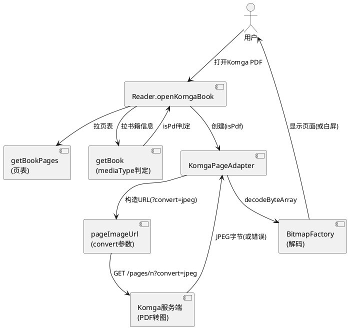
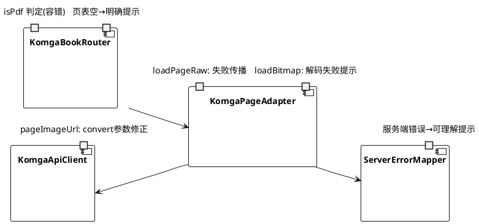
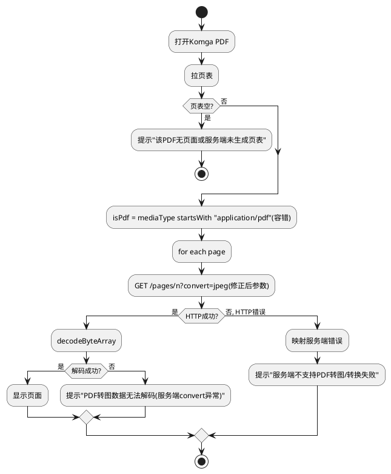

# 技术设计：Komga 配置的 PDF 打不开修复（REQ-008）

- **需求ID**: REQ-008
- **基线 commit**: eb2ac412
- **状态**: 待评审

# 一、需求与存量功能关系分析

## 1.1 需求功能与存量功能对比

### 1.1.1 已实现功能

| 需求功能 | 存量功能 | 代码位置 | 匹配度 |
|---------|---------|---------|--------|
| Komga 书籍打开路由 | `KomgaBookRouter.openKomgaBook` | `KomgaBookRouter.kt:36-105` | 100% |
| PDF 判定 | `isPdf = book.media.mediaType == "application/pdf"` | `KomgaBookRouter.kt:73` | 75% |
| PDF 页面 URL 转图参数 | `pageImageUrl: if (isPdf) "$base?convert=jpeg" else base` | `KomgaApiClient.kt:151-154` | 75% |
| 页面下载与解码 | `KomgaPageAdapter.loadPageRaw` → downloadBytes → `loadBitmap` → BitmapFactory | `KomgaPageAdapter.kt:26-62` | 75% |
| 页表拉取 | `getBookPages` → List<PageDto> | `KomgaApiClient.kt:144-149` | 100% |
| 打开失败提示 | `humanize(t)` 映射异常到中文提示 | `KomgaBookRouter.kt:107-115` | 75% |
| Komga 非 PDF 打开 | 同链路 isPdf=false 时不带 convert | `KomgaPageAdapter.kt:29` | 100% |

### 1.1.2 需要扩展的功能

| 需求功能 | 存量功能 | 差异说明 | 扩展方向 |
|---------|---------|---------|---------|
| PDF 成功打开 | PDF 打不开（白屏/失败） | convert=jpeg 参数可能不被服务端支持，或 mediaType 判定不精确，或异常被吞 | 定位根因后修正 URL 参数/端点/判定/异常处理 |
| 服务端转图异常明确提示 | loadPageRaw catch 返回 null（仅 Log.w），loadBitmap 拿 null 白屏无提示 | 异常被静默吞，用户看到白屏而非明确错误 | 失败时向上传递明确错误信息 |
| mediaType 容错 | 精确匹配 `== "application/pdf"`，不含 charset/大小写容错 | 服务端可能返回 `application/pdf; charset=...` | 改为 startsWith/忽略大小写判定 |

### 1.1.3 需要新增的功能或接口

- **PDF 转图参数/端点修正**（视根因定位结果）：可能需改 `pageImageUrl` 的 convert 参数名/值，或对 PDF 走不同端点。
- **页面加载失败明确传播**：`loadPageRaw`/`loadBitmap` 失败时区分"网络错误/服务端不支持转图/解码失败"，映射到可理解提示。

## 1.2 存量功能详细分析

### 1.2.1 KomgaBookRouter.openKomgaBook

- **接口契约**：`suspend fun openKomgaBook(filePath, startPage): OpenResult`，OpenResult = Supported(adapter, bookId) | Unsupported | Failed(message)。
- **业务规则**：解析路径 → 获取连接 → 并行拉页表+书籍信息 → 页表空判 EPUB/无页面 → isPdf 判定 → 创建 KomgaPageAdapter。
- **约束**：页表进程内缓存（TTL 10min）；client 进程内共享不 close。

### 1.2.2 KomgaPageAdapter（PDF 页面加载）

- **loadPageRaw**（`KomgaPageAdapter.kt:26-38`）：`downloadBytes(pageImageUrl(bookId, pageNumber, isPdf))` → ByteArray。catch (Throwable) 返回 null + Log.w，**异常被吞**。
- **loadBitmap**（`KomgaPageAdapter.kt:40-62`）：loadPageRaw → BitmapFactory.decodeByteArray。raw 为 null 或解码失败 → 返回 null → **白屏**。
- **问题**：PDF 转图失败时无明确错误传播，用户只看到白屏/空内容。

### 1.2.3 pageImageUrl（convert 参数）

- **当前**（`KomgaApiClient.kt:151-154`）：`"$base?convert=jpeg"` if isPdf。
- **待核实**：Komga 服务端是否支持 `?convert=jpeg` 参数。Komga 不同版本/配置对 PDF 转图的参数可能不同（如需 `?convert=jpeg&width=...` 或不同端点）。

### 1.2.4 X 盘 komiho 调研结果

- **已确认：X 盘不存在 komiho 项目**（`ls X:/komiho` → NOT_FOUND）。X 盘有 MangaReader-AI（模型相关）等目录，但无 komiho。
- **结论**：按 REQ-008-A，komiho 无方案，走"基于现有代码与日志定位根因后修复"路线。

# 二、增量设计方案

## 2.1 实现模型

### 2.1.1 上下文视图



### 2.1.2 服务/组件总体架构



### 2.1.3 实现设计文档

**根因定位与修复流程（REQ-008-A komiho 无方案→自行定位）**：

```plantuml
@startuml
start
:komiho调研: X盘不存在komiho项目;
:走自行定位根因路线;
:定位方向1: 抓HTTP请求,确认?convert=jpeg是否被服务端接受;
:定位方向2: 确认getBookPages对PDF是否返回非空页表;
:定位方向3: 确认mediaType是否精确application/pdf;
:定位方向4: 确认loadPageRaw异常是否被吞;
if (根因=convert参数?) then (是)
  :修正pageImageUrl参数/端点;
else (根因=页表空?)
  :页表空时明确提示而非"无页面";
else (根因=mediaType判定?)
  :改startsWith/忽略大小写;
else (根因=异常吞?)
  :loadPageRaw失败传播明确错误;
endif
:回归: Komga非PDF不受影响;
:回归: 其他来源PDF不受影响;
stop
@enduml
```

**PDF 页面加载与失败提示流程（修复后）**：



## 2.2 接口设计

### 2.2.1 总体设计

| 接口 | 类型 | 位置 | 稳定性 | 本次变更 |
|------|------|------|--------|---------|
| `pageImageUrl` | 函数 | `KomgaApiClient.kt:151-154` | 稳定 | convert 参数/端点修正（视根因） |
| `isPdf` 判定 | 表达式 | `KomgaBookRouter.kt:73` | 稳定 | 改为 startsWith/忽略大小写容错 |
| `loadPageRaw` | suspend | `KomgaPageAdapter.kt:26-38` | 稳定 | 失败时传播明确错误而非吞 null |
| `loadBitmap` | suspend | `KomgaPageAdapter.kt:40-62` | 稳定 | 解码失败映射提示 |
| `humanize` | 函数 | `KomgaBookRouter.kt:107-115` | 稳定 | 增加 PDF 转图相关错误映射 |

### 2.2.2 接口清单

#### pageImageUrl（修正后）

- **接口签名**：`fun pageImageUrl(bookId: String, pageNumber: Int, isPdf: Boolean = false): String`
- **业务说明**：构造页面图片 URL。PDF 时携带服务端转图参数（视根因定位确认正确参数名/值/端点）。
- **前置条件**：bookId/pageNumber 有效。
- **后置条件**：返回服务端可接受的可解码图片 URL。
- **异常映射**：无（纯字符串构造）。

#### loadPageRaw（修正后）

- **接口签名**：`override suspend fun loadPageRaw(index: Int): ByteArray?`
- **业务说明**：下载页面原始字节。失败时区分错误类型并记录，供上层给出明确提示。
- **前置条件**：index 在页表范围内。
- **后置条件**：成功返回字节；失败返回 null 但附带可查的错误标记/日志，上层可映射提示。

## 2.3 数据模型

无变更。PageDto/BookDto/MediaDto 结构不变。isPdf 仍为 Boolean 标记传给 KomgaPageAdapter。

## 2.4 涉及文件与改动范围

| 文件 | 改动类型 | 改动说明 |
|------|---------|---------|
| `com/mangareader/komgabridge/reader/KomgaBookRouter.kt:73` | 修改 | isPdf 判定改为容错（startsWith/忽略大小写） |
| `com/mangareader/komgabridge/reader/KomgaBookRouter.kt:68-71` | 修改 | 页表空时区分 PDF 给更明确提示 |
| `com/mangareader/komgabridge/reader/KomgaBookRouter.kt:107-115` | 修改 | humanize 增加 PDF 转图/convert 相关错误映射 |
| `com/mangareader/komgabridge/api/KomgaApiClient.kt:151-154` | 修改 | pageImageUrl 的 convert 参数/端点修正（视根因定位） |
| `com/mangareader/komgabridge/reader/KomgaPageAdapter.kt:26-38` | 修改 | loadPageRaw 失败时传播明确错误信息（非静默吞 null） |
| `com/mangareader/komgabridge/reader/KomgaPageAdapter.kt:40-62` | 修改 | loadBitmap 解码失败时映射可理解提示 |

## 2.5 实现思路

1. **komiho 调研结论（REQ-008-A）**：X 盘不存在 komiho 项目（已确认），走自行定位根因路线。记录调研证据。
2. **根因定位（证据驱动）**：
   - **方向1 convert 参数**：抓取实际 HTTP 请求（logcat/抓包），确认 `?convert=jpeg` 是否被 Komga 服务端接受（HTTP 200 返回 JPEG vs 406/415 错误）。对照 Komga API 文档确认 PDF 转图的正确参数/端点。
   - **方向2 页表空**：确认 `getBookPages` 对 PDF 是否返回非空 List<PageDto>。若服务端对 PDF 不生成页表 → 页表空 → 走 line 70 "该章节无页面"。
   - **方向3 mediaType 判定**：确认服务端返回的 `book.media.mediaType` 是否精确 `application/pdf`（可能含 charset 后缀或大小写差异）。
   - **方向4 异常吞**：确认 `loadPageRaw` catch(Throwable) 返回 null 时上层是否白屏无提示（`KomgaPageAdapter.kt:34-37`）。
3. **mediaType 容错**：`KomgaBookRouter.kt:73` 将 `== "application/pdf"` 改为 `startsWith("application/pdf", ignoreCase = true)`，兼容 charset 后缀/大小写。
4. **convert 参数修正**：视根因定位结果修正 `pageImageUrl`（`KomgaApiClient.kt:153`）。若 Komga 要求不同参数名/值/端点则改；若服务端不支持 convert 则在客户端给出"服务端不支持 PDF 转图"提示（REQ-008-G）。
5. **异常明确传播**：`KomgaPageAdapter.loadPageRaw` 失败时不再静默返回 null，而是区分错误类型（网络错误/HTTP 状态码/服务端 convert 异常），通过日志/状态标记供上层映射。`loadBitmap` 解码失败时给出"PDF 转图数据无法解码"提示而非白屏（REQ-008-D）。
6. **humanize 扩展**：`KomgaBookRouter.humanize`（line 107-115）增加 PDF/convert 相关错误映射（如 HTTP 406/415 → "服务端不支持该 PDF 转图"，decode null → "PDF 页面转换失败"）。
7. **不破坏 Komga 非 PDF（REQ-008-E）**：所有改动仅在 isPdf=true 分支生效；isPdf=false 的 CBZ/ZIP/图片链路不动。
8. **不破坏其他来源 PDF（REQ-008-F）**：改动限于 `komgabridge` 包，本地/SMB/WebDAV/OPDS 的 PDF 走各自引擎（`engine/pdf`），不受影响。

## 2.6 风险评估

| 风险 | 等级 | 说明 | 缓解措施 |
|------|------|------|---------|
| 根因在服务端无法客户端修复 | 高 | 若 Komga 服务端不支持 PDF convert，客户端只能提示 | REQ-008-G 已预案：客户端给"服务端不支持转图"提示，不伪装客户端 bug |
| convert 参数修正致非 PDF 受影响 | 中 | 改 pageImageUrl 可能波及非 PDF | 改动仅在 isPdf=true 分支；isPdf=false 路径不变；回归测试 Komga CBZ/ZIP |
| mediaType 容错过度 | 低 | startsWith 可能误判非 PDF | "application/pdf" 前缀足够精确，无其他常见 mediaType 以此开头 |
| 异常传播改变既有行为 | 中 | loadPageRaw 原返回 null 上层已处理白屏，改为抛异常可能影响重试逻辑 | 保留返回 null 兼容，同时增加可查错误标记；上层按需映射提示 |
| 根因定位需服务端配合 | 中 | 需 Komga 服务器抓包/查日志确认 convert 支持 | 用 logcat 抓客户端 HTTP 请求/响应码；对照 Komga API 文档；必要时联系用户确认服务端版本 |
| komiho 实际存在于其他路径 | 低 | X 盘搜索超时，可能遗漏 | 已确认 X:/komiho NOT_FOUND；若用户知道 komiho 具体路径可补充调研 |