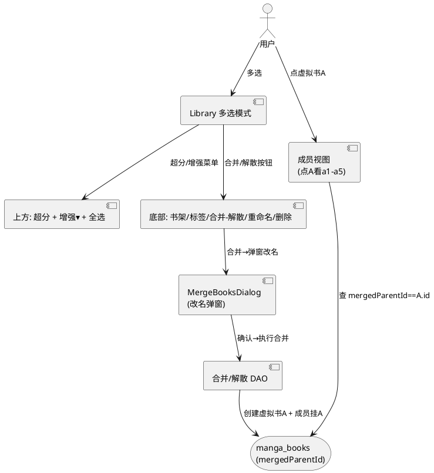
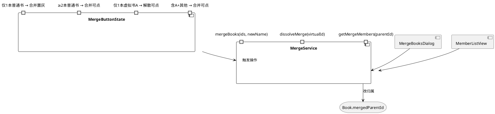
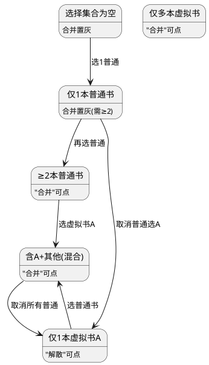
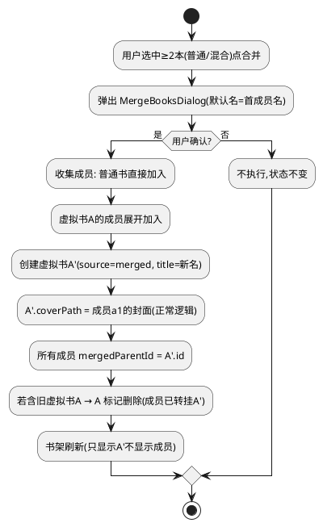
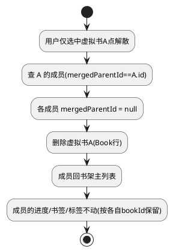
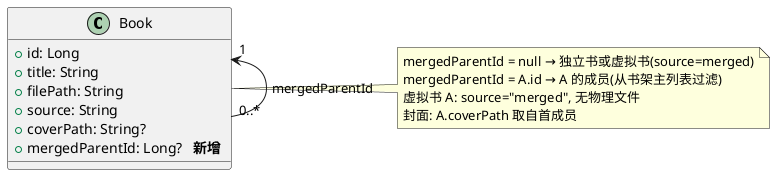

# 技术设计：合并/增强按钮重组与合并功能（REQ-005）

- **需求ID**: REQ-005
- **基线 commit**: eb2ac412
- **状态**: 待评审

# 一、需求与存量功能关系分析

## 1.1 需求功能与存量功能对比

### 1.1.1 已实现功能

| 需求功能 | 存量功能 | 代码位置 | 匹配度 |
|---------|---------|---------|--------|
| 多选模式上方"超分"按钮 | TopAppBar actions `AutoFixHigh`（批量增强入队） | `Library.kt:1366-1379` | 100% |
| 多选模式上方"全选" | `SelectAll` 图标 | `Library.kt:1380-1382` | 100% |
| 底部"增强"下拉菜单 | `增强 ▾` DropdownMenu（批量增强/整本增强/清除产物） | `Library.kt:1467-1511` | 100% |
| 底部其他操作 | 添加到书架/打标签/重命名/删除 | `Library.kt:1464-1513` | 100% |
| 书架数据模型 | `Book` 实体（manga_books 表），DAO 完整 CRUD | `Database.kt:29-56` | 100% |
| 封面提取逻辑 | displayCoverPath（自定义优先→默认） | `Database.kt:55` | 100% |
| 书架列表查询 | `getAllBooks()` 等 Flow 查询 | `Database.kt:248` | 75% |

### 1.1.2 需要扩展的功能

| 需求功能 | 存量功能 | 差异说明 | 扩展方向 |
|---------|---------|---------|---------|
| "增强"挪到上方（点击出选项菜单） | 增强菜单在底部 | 位置从底部移至上方 TopAppBar | 上方新增"增强▾"菜单，底部移除 |
| 底部原增强位置改"合并/解散" | 无合并功能 | 全新功能 | 新增合并/解散按钮与逻辑 |
| 合并多本为虚拟书 A | 无虚拟书概念（grep mergedBook/virtualBook 无果） | Book 表无合并关系字段 | Book 表加 mergedParentId 字段 + 合并/解散 DAO |
| 书架只显示 A 不显示成员 | 书架查所有书 | 需过滤成员书 | 书架查询排除 mergedParentId 非空者 |
| 点 A 看成员 | 无成员视图 | 需成员列表界面 | 复用子文件夹/书架列表样式展示成员 |
| 合并按钮置灰/解散切换 | 无状态切换 | 需按选择集合动态判定 | 按选中集合类型计算按钮态 |

### 1.1.3 需要新增的功能或接口

- **合并关系存储**：Book 表新增 `mergedParentId: Long?`（null=独立书/虚拟书，非null=某虚拟书的成员）。
- **虚拟书标记**：虚拟书 A 用 `source = "merged"` 标记，本身无物理文件，coverPath 取自成员。
- **合并操作 DAO**：`mergeBooks(memberIds, newName)`、`dissolveMerge(virtualBookId)`、`getMergeMembers(parentId)`、`getBookshelfBooks()`（排除成员）。
- **合并弹窗**：`MergeBooksDialog`（输入新名，确认/取消）。
- **成员视图**：点击虚拟书 A 进入成员列表（复用既有书卡样式）。

## 1.2 存量功能详细分析

### 1.2.1 Book 实体与书架查询

- **接口契约**：`Book(id, title, filePath, source, coverPath, customCoverPath, ...)`，`getAllBooks(): Flow<List<Book>>`。
- **业务规则**：书架展示所有未隐藏书（isHidden=false）。合并后成员书仍存在但需从书架主列表过滤。
- **约束**：成员书的阅读进度/书签/标签按各自 bookId 独立存（reading_progress/bookmark/tag 表），合并/解散不迁移这些数据，仅改 mergedParentId 归属。

### 1.2.2 多选模式按钮区

- **上方 TopAppBar actions**（`Library.kt:1364-1383`）：`AutoFixHigh`（批量增强）、`SelectAll`（全选）。
- **底部 bottomBar**（`Library.kt:1462-1515`）：添加到书架/打标签/增强▾/重命名/删除，`SpaceEvenly` 排列。

# 二、增量设计方案

## 2.1 实现模型

### 2.1.1 上下文视图

### 2.1.2 服务/组件总体架构

### 2.1.3 实现设计文档

**按钮状态机（按选择集合判定）**：

**合并操作流程**：

**解散操作流程**：

## 2.2 接口设计

### 2.2.1 总体设计

| 接口 | 类型 | 位置 | 稳定性 |
|------|------|------|--------|
| `mergeBooks(memberIds, newName)` | DAO suspend | `Database.kt` MangaDao | 稳定 |
| `dissolveMerge(virtualBookId)` | DAO suspend | `Database.kt` MangaDao | 稳定 |
| `getMergeMembers(parentId)` | DAO suspend | `Database.kt` MangaDao | 稳定 |
| `getBookshelfBooks()` | DAO Flow | `Database.kt`（改既有查询过滤成员） | 稳定 |
| `MergeBooksDialog` | Compose 弹窗 | `Library.kt` 或新文件 | 稳定 |
| `computeMergeButtonState(selected)` | 纯函数 | `Library.kt` | 稳定 |

### 2.2.2 接口清单

#### mergeBooks

- **接口签名**：`suspend fun mergeBooks(memberIds: List<Long>, newName: String): Long`（返回虚拟书 id）
- **业务说明**：将选中书合并为虚拟书。若 memberId 本身是虚拟书，先展开其成员再合并。创建虚拟书行（source="merged"），成员 mergedParentId 指向虚拟书，封面取首成员。
- **前置条件**：memberIds 非空且展开后≥2 本。
- **后置条件**：书架主列表不再显示成员，显示虚拟书；成员进度/书签/标签不变。
- **异常映射**：成员 id 不存在 → 跳过；新名为空 → 用默认名。

#### dissolveMerge

- **接口签名**：`suspend fun dissolveMerge(virtualBookId: Long)`
- **业务说明**：解散虚拟书，成员 mergedParentId 置 null，删除虚拟书行。
- **前置条件**：virtualBookId 对应 source="merged" 的虚拟书。
- **后置条件**：成员回书架主列表；成员数据不变。

#### getMergeMembers

- **接口签名**：`suspend fun getMergeMembers(parentId: Long): List<Book>`
- **业务说明**：查虚拟书的成员书列表（mergedParentId == parentId）。
- **后置条件**：返回成员列表，按原 addedAt 排序。

#### computeMergeButtonState

- **接口签名**：`fun computeMergeButtonState(selected: List<Book>): MergeButtonState`，`MergeButtonState = { label: "合并"|"解散"|null, enabled: Boolean }`
- **业务说明**：按选择集合计算底部按钮显示。仅1本虚拟书→解散；仅1本普通→合并置灰；≥2本或含虚拟书→合并可点；空→不显示。
- **异常映射**：无。

## 2.3 数据模型

### 2.3.1 设计目标

- 最小侵入：Book 表加一可空字段 `mergedParentId`，Room migration 加列。
- 虚拟书复用 Book 行（source="merged"），不新建表。
- 成员的进度/书签/标签按各自 bookId 原样保留，不迁移。

### 2.3.2 模型实现

**书架查询变更**：`getBookshelfBooks()` 排除 `mergedParentId IS NOT NULL` 的成员书，保留 source="merged" 的虚拟书与普通独立书。

## 2.4 涉及文件与改动范围

| 文件 | 改动类型 | 改动说明 |
|------|---------|---------|
| `com/mangareader/data/Database.kt:29-56` | 修改 | Book 实体加 `mergedParentId: Long? = null` 字段 |
| `com/mangareader/data/Database.kt`（DAO） | 新增 | `mergeBooks`/`dissolveMerge`/`getMergeMembers`；改 `getAllBooks` 等书架查询过滤成员 |
| `com/mangareader/data/Database.kt`（migration） | 新增 | Room migration 加列 mergedParentId |
| `com/mangareader/ui/Library.kt:1364-1383` | 修改 | 上方 actions 加"增强▾"菜单（从底部移上来），保留超分+全选 |
| `com/mangareader/ui/Library.kt:1462-1515` | 修改 | 底部原"增强▾"位置改"合并/解散"按钮，按 computeMergeButtonState 显隐/置灰 |
| `com/mangareader/ui/Library.kt`（新增） | 新增 | MergeBooksDialog 弹窗；点击虚拟书进成员视图逻辑 |
| `com/mangareader/ui/Library.kt`（书卡点击） | 修改 | 点击虚拟书 A → 进成员列表（非直接打开阅读） |

## 2.5 实现思路

1. **数据模型加字段**：Book 加 `mergedParentId: Long? = null`，Room migration ALTER TABLE 加列。虚拟书用 `source="merged"` 标记。
2. **书架查询过滤**：`getAllBooks` 等书架主列表查询加 `WHERE mergedParentId IS NULL`，成员不显示在主列表，虚拟书显示。
3. **上方按钮重组**：TopAppBar actions 保留超分（AutoFixHigh）+全选，新增"增强▾"DropdownMenu（迁移自底部 line 1467-1511 的三项菜单）。
4. **底部按钮重组**：底部原"增强▾"位置改为"合并/解散"按钮。按 `computeMergeButtonState(selectedBooks)` 计算显示：仅1本虚拟书→"解散"可点；仅1本普通→"合并"置灰；≥2本或混合→"合并"可点。
5. **合并执行**：点"合并"→弹 `MergeBooksDialog`（默认名取首成员 title 或"合并合集"）→确认→`mergeBooks(memberIds, newName)`：展开虚拟书成员→创建虚拟书 A'（source="merged", coverPath=首成员封面）→成员 mergedParentId=A'.id→旧虚拟书删除→书架刷新。
6. **解散执行**：点"解散"→`dissolveMerge(A.id)`：成员 mergedParentId=null→删 A→成员回书架。
7. **成员视图**：点击虚拟书 A（书卡 onTap）→判断 source=="merged"→进成员列表（LazyColumn/LazyGrid 复用 BookCard/BookListRow 样式，数据源 `getMergeMembers(A.id)`）→点成员进阅读。返回回书架。
8. **封面**：虚拟书 A.coverPath 创建时取首成员的 displayCoverPath（正常封面逻辑）。用户可后续自定义 A 的封面（customCoverPath 机制已有）。
9. **进度/书签/标签不丢**：合并/解散仅改 mergedParentId，不动成员的 reading_progress/bookmark/tag 行。虚拟书 A 的进度可聚合成员或不算（书架显示用聚合进度，点进成员各自进度独立）。
10. **混合合并**（A+B）：mergeBooks 展开 A 的成员 + B，全部挂新虚拟书 A'，旧 A 删除。REQ-005-H 满足。

## 2.6 风险评估

| 风险 | 等级 | 说明 | 缓解措施 |
|------|------|------|---------|
| Room migration 失败 | 高 | 加列 migration 若版本号/迁移路径不对致崩溃 | migration 严格测试；加列有默认 null 兼容旧数据 |
| 书架查询遗漏过滤点 | 中 | 多处 getAllBooks 变体，漏改则成员泄漏到主列表 | grep 全部书架查询，统一加 mergedParentId IS NULL 过滤 |
| 虚拟书被误当普通书打开 | 中 | 点击 A 若未判断 source 直接进阅读会失败（无物理文件） | 书卡 onTap 先判 source=="merged"→进成员视图，else 进阅读 |
| 合并后封面丢失/异常 | 中 | A.coverPath 取首成员时成员封面尚未就绪 | 取 displayCoverPath 兜底；封面异步加载已有机制 |
| 解散后成员顺序乱 | 低 | 成员回书架后按书架排序，非原合并顺序 | 可接受（书架自有排序）；若需保序可存成员 sortOrder |
| 搜索/过滤/标签页未过滤成员 | 中 | 搜索结果/标签筛选可能列出成员书 | 这些路径也加 mergedParentId IS NULL 或保留成员可搜（视产品定） |
| 既有 MergeTargetPickerDialog 混淆 | 低 | 已有"合并到书架"对话框（MergeTargetPickerDialog）与本需求"合并成虚拟书"不同 | 命名区分：本需求用 MergeBooksDialog，不与 MergeTargetPickerDialog 复用 |
| 批量删除含虚拟书 | 中 | 删除虚拟书 A 时成员变孤儿（mergedParentId 悬空） | 删除虚拟书时级联解散成员（mergedParentId=null）或一并删成员（视产品定） |