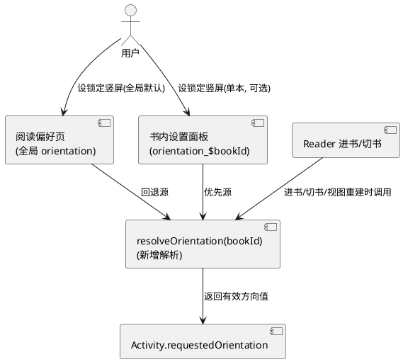
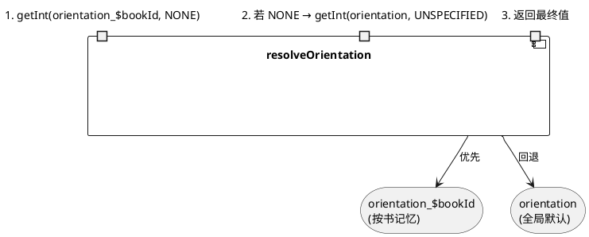
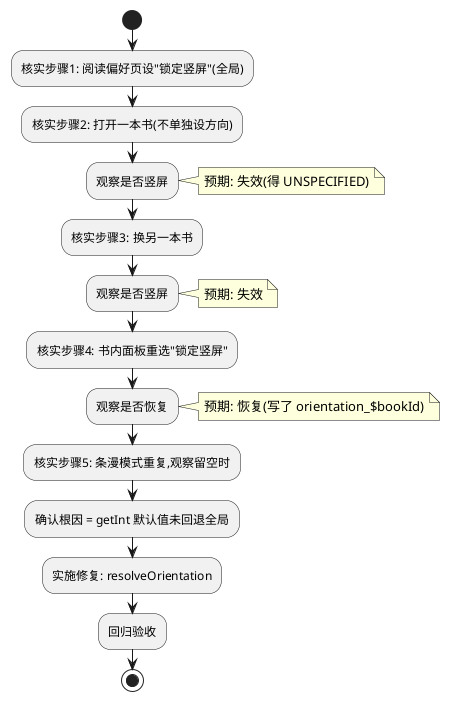
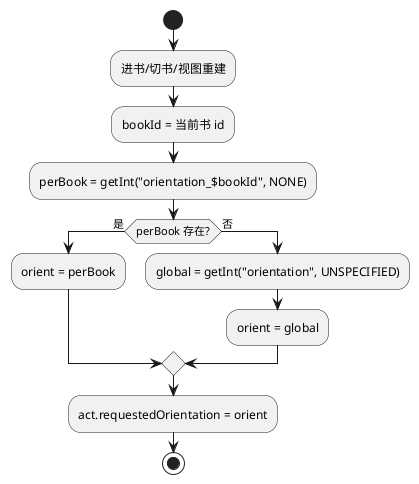
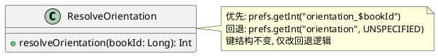

# 技术设计：锁定竖屏容易失效修复（REQ-004）

- **需求ID**: REQ-004
- **基线 commit**: eb2ac412
- **状态**: 待评审

# 一、需求与存量功能关系分析

## 1.1 需求功能与存量功能对比

### 1.1.1 已实现功能

| 需求功能 | 存量功能 | 代码位置 | 匹配度 |
|---------|---------|---------|--------|
| 全局默认方向偏好 | `PrefRow("orientation","屏幕方向")` 存全局键 `orientation` | `ReadingPrefsScreen.kt:164-168` | 100% |
| 按书记忆方向 | `saveOrientation()` 存 `orientation_$bookId` | `Reader.kt:2250-2253` | 100% |
| 书内设置方向 | `SettingsChipRow("屏幕方向")` → `onOrientationChange` | `ReaderSettingsSheet.kt:551-561` | 100% |
| 进书时应用方向 | `act?.requestedOrientation = prefs.getInt("orientation_$bookId", UNSPECIFIED)` | `Reader.kt:2344` | 50% |
| 切书时应用方向 | `prefs.getInt("orientation_$newBookId", UNSPECIFIED)` | `Reader.kt:2056` | 50% |
| 退出时重置 | `goBack()` 设 UNSPECIFIED | `Reader.kt:2198` | 100% |

### 1.1.2 需要扩展的功能

| 需求功能 | 存量功能 | 差异说明 | 扩展方向 |
|---------|---------|---------|---------|
| 全局默认偏好被进书继承 | 进书/切书 `getInt("orientation_$bookId", UNSPECIFIED)` 默认值硬编码 UNSPECIFIED | 未为单本书设过方向时，不回退读全局 `orientation`，直接得 UNSPECIFIED → 锁定竖屏失效 | 默认值改为回退读全局 `orientation`，再无则 UNSPECIFIED |
| 条漫模式下竖屏不失效 | 条漫分支/视图重建路径可能重走 getInt 默认 UNSPECIFIED | 条漫留空/内容为空时视图重建，方向被回退 UNSPECIFIED | 条漫分支也走统一 resolveOrientation |
| 换书立即生效 | 切书时同上 getInt 默认值问题 | 新书无 `orientation_$newBookId` → UNSPECIFIED | 切书改用 resolveOrientation 回退全局 |

### 1.1.3 需要新增的功能或接口

- **`resolveOrientation(bookId): Int`**：方向解析函数，按书键优先、不存在回退全局默认、再无则 UNSPECIFIED。集中所有方向应用点调用，消除散落的 getInt 默认值硬编码。

## 1.2 存量功能详细分析

### 1.2.1 方向偏好存储键

- **全局默认**：键 `orientation`，值域 {-1=默认, -2=跟随系统, PORTRAIT, LANDSCAPE, SENSOR_PORTRAIT, SENSOR_LANDSCAPE}。由 `ReadingPrefsScreen` 的 PrefRow 写入。
- **按书记忆**：键 `orientation_$bookId`，值域同上。由 `saveOrientation()`（Reader.kt:2250-2253）写入。
- **主 Activity 方向**：键 `app_orientation`（MainActivity.kt:83），独立于阅读器方向，控制首页/非阅读态。

### 1.2.2 方向应用点（当前问题所在）

- **进书**（`Reader.kt:2344`）：`prefs.getInt("orientation_$bookId", UNSPECIFIED)`——**默认值硬编码 UNSPECIFIED**，未回退全局 `orientation`。
- **切书**（`Reader.kt:2056`）：`prefs.getInt("orientation_$newBookId", UNSPECIFIED)`——同上。
- **退出**（`Reader.kt:2198`）：`UNSPECIFIED`——退出阅读器恢复正常，合理。
- **saveOrientation**（`Reader.kt:2251`）：直接设 `act?.requestedOrientation = orientation` 并写按书键——书内设置时即时生效，正确。

### 1.2.3 失效根因（待核实确认）

- 用户在全局默认偏好设"锁定竖屏"（`orientation` = SENSOR_PORTRAIT），但未为单本书设方向（`orientation_$bookId` 不存在）。
- 进书/切书时 `getInt("orientation_$bookId", UNSPECIFIED)` 返回默认值 UNSPECIFIED，而非全局 SENSOR_PORTRAIT → 竖屏失效。
- "重新打开设置才恢复"：因在书内面板重选方向写了 `orientation_$bookId`，下次 getInt 命中。
- 条漫留空失效：条漫模式下视图 release/re-setup 可能重走进书 getInt 路径，同样命中默认 UNSPECIFIED。

# 二、增量设计方案

## 2.1 实现模型

### 2.1.1 上下文视图

### 2.1.2 服务/组件总体架构

### 2.1.3 实现设计文档

**先核实后修复流程（REQ-004-E 禁止盲改）**：

**方向解析与生效流程（修复后）**：

## 2.2 接口设计

### 2.2.1 总体设计

| 接口 | 类型 | 位置 | 稳定性 | 本次变更 |
|------|------|------|--------|---------|
| `resolveOrientation(bookId)` | 函数 | `Reader.kt`（新增私有函数） | 稳定 | 新增，集中方向解析 |
| 进书方向应用 | 调用点 | `Reader.kt:2344` | 稳定 | 改用 resolveOrientation |
| 切书方向应用 | 调用点 | `Reader.kt:2056` | 稳定 | 改用 resolveOrientation |
| saveOrientation | 函数 | `Reader.kt:2250-2253` | 稳定 | 不变 |
| 退出重置 | 调用点 | `Reader.kt:2198` | 稳定 | 不变（退出回 UNSPECIFIED 合理） |

### 2.2.2 接口清单

#### resolveOrientation

- **接口签名**：`fun resolveOrientation(bookId: Long): Int`
- **业务说明**：解析某书应用的屏幕方向。优先按书记忆 `orientation_$bookId`，不存在回退全局默认 `orientation`，再无则 `SCREEN_ORIENTATION_UNSPECIFIED`。
- **前置条件**：prefs 已初始化（`manga_reader` SharedPreferences）。
- **后置条件**：返回有效方向常量，不修改任何存储。
- **异常映射**：无（纯读取）。

## 2.3 数据模型

### 2.3.1 设计目标

- 不改变存储键结构：`orientation`（全局）与 `orientation_$bookId`（按书）不变。
- 不改变按书记忆机制：单本设置仍写 `orientation_$bookId`，优先级最高。
- 仅改"未设单本时的回退源"：从硬编码 UNSPECIFIED 改为全局 `orientation`。

### 2.3.2 模型实现

## 2.4 涉及文件与改动范围

| 文件 | 改动类型 | 改动说明 |
|------|---------|---------|
| `com/mangareader/ui/Reader.kt:2344` | 修改 | 进书方向应用改用 `resolveOrientation(bookId)` |
| `com/mangareader/ui/Reader.kt:2056` | 修改 | 切书方向应用改用 `resolveOrientation(newBookId)` |
| `com/mangareader/ui/Reader.kt`（新增函数） | 新增 | `resolveOrientation(bookId)` 私有函数 |
| `com/mangareader/ui/Reader.kt:2198` | 不变 | 退出重置 UNSPECIFIED 保留（退出阅读器恢复正常态） |
| `com/mangareader/ui/Reader.kt:2250-2253` | 不变 | saveOrientation 按书写入逻辑不变 |

**需排查的条漫分支**：grep 确认除 line 2344/2056 外是否有其他 `requestedOrientation` 赋值点（如条漫视图 re-setup、配置重载），若有同样改用 resolveOrientation。

## 2.5 实现思路

1. **先核实（REQ-004-E）**：按 2.1.3 核实流程，在漫画内设全局"锁定竖屏"，逐场景验证失效，确认根因为 `getInt("orientation_$bookId", UNSPECIFIED)` 默认值未回退全局。记录核实证据（日志/截图），有据可查后再改。
2. **新增 resolveOrientation**：私有函数，先读 `orientation_$bookId`（用哨兵默认值如 `Int.MIN_VALUE` 判存在性），不存在则读全局 `orientation`（默认 UNSPECIFIED），返回最终方向值。
3. **进书点替换**：`Reader.kt:2344` 的 `prefs.getInt("orientation_$bookId", UNSPECIFIED)` 改为 `resolveOrientation(bookId)`。
4. **切书点替换**：`Reader.kt:2056` 的 `prefs.getInt("orientation_$newBookId", UNSPECIFIED)` 改为 `resolveOrientation(newBookId)`。
5. **条漫分支排查**：grep 全部 `requestedOrientation` 赋值点，确认条漫视图重建/配置重载路径是否也走进书 getInt（若是则已被 resolveOrientation 覆盖；若有独立赋值点则一并改）。
6. **退出保持不变**：`goBack()`（line 2198）退出阅读器时设 UNSPECIFIED 恢复正常态，合理，不改。
7. **横屏不在本次范围**：职责边界限定仅修竖屏锁定失效，但 resolveOrientation 对横屏锁定同样生效（因回退逻辑统一），属正向附带，不额外处理横屏特例。

## 2.6 风险评估

| 风险 | 等级 | 说明 | 缓解措施 |
|------|------|------|---------|
| 核实后发现根因与预期不符 | 中 | 可能还有其他重置点（如 Activity recreate、config change） | 核实时覆盖翻页/切章/视图重建/条漫分支全场景，grep 全部 requestedOrientation 赋值点 |
| 全局回退影响"跟随系统"行为 | 低 | 全局 orientation=-2（跟随系统）时回退也得 -2，需确认 -2 的实际行为 | 核实时确认 -2 在 requestedOrientation 下的表现（UNSPECIFIED 即跟随系统，-2 可能需映射） |
| 条漫分支有独立赋值点遗漏 | 中 | 若条漫 re-setup 时单独设方向未走 resolveOrientation | grep `requestedOrientation =` 全量排查，逐点确认 |
| 退出重置与进书冲突 | 低 | 快速退出再进可能竞态 | 退出 UNSPECIFIED 仅在 goBack，进书重新 resolveOrientation 覆盖，无残留 |
| 改动范围扩大 | 低 | 若发现多个独立赋值点需统一 | 均改用 resolveOrientation，集中化反而降低散落风险 |