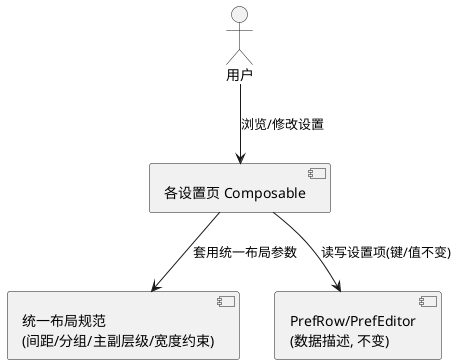
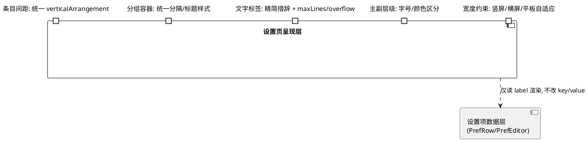
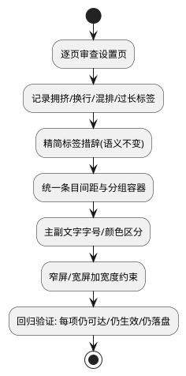

# 技术设计：设置 UI 优化（REQ-003）

- **需求ID**: REQ-003
- **基线 commit**: eb2ac412
- **状态**: 待评审

# 一、需求与存量功能关系分析

## 1.1 需求功能与存量功能对比

### 1.1.1 已实现功能

| 需求功能 | 存量功能 | 代码位置 | 匹配度 |
|---------|---------|---------|--------|
| 设置项数据描述与渲染框架 | `PrefRow` + `PrefEditor`（Toggle/Slider/Chips/Group/ReadMode/AmbienceSound）描述项，统一渲染 | `ReadingPrefsScreen.kt:48-70,614-732` | 100% |
| 设置项分组（section/tab） | PrefRow 含 `section` 与 `tab` 字段，按分组渲染 | `ReadingPrefsScreen.kt:68` | 75% |
| 主标题与副说明（info） | Chips/Toggle 支持 `info` 说明小字 | `ReadingPrefsScreen.kt:50` 等 | 75% |
| 多设置页存在 | 阅读偏好页/书内设置面板/文件夹管理/主设置/外观/分组排序/书架管理等 | `ui/*.kt` 多文件 | 100% |

### 1.1.2 需要扩展的功能

| 需求功能 | 存量功能 | 差异说明 | 扩展方向 |
|---------|---------|---------|---------|
| 条目间距合理、分组清晰 | 各页间距/分组未统一规划，存在拥挤、混排 | 布局参数（spacing/padding）与分组容器未统一 | 统一各设置页的条目间距、分组分隔与容器样式 |
| 文字不溢出/不挤/不换行 | 部分标签过长（如"非全面屏阅读时隐藏底部导航栏"、"仿真翻页Beta（仅静图左右翻页生效）"）致挤/换行 | 标签措辞过长 | 精简措辞（缩写/精简），语义不变 |
| 主副文字层级分明 | info 小字与主标题字号/颜色区分已有但部分页面混排 | 个别页面主副未严格区分 | 统一主标题与 info 副说明的字号/颜色/间距 |
| 竖屏/横屏/平板不错乱 | 部分设置页未做宽度自适应，窄屏/宽屏下文字截断或错乱 | 缺少响应式宽度约束 | 关键文字加 `maxLines`/`overflow` 约束与权重分配 |

### 1.1.3 需要新增的功能或接口

- 无新增功能接口。本次为既有设置页 Composable 的布局参数与文字标签调整，纯呈现层。

## 1.2 存量功能详细分析

### 1.2.1 PrefRow / PrefEditor 渲染框架

- **接口契约**：`PrefRow(key, label, tab, editor, section, subKeys)`，editor 为 sealed interface（Chips/Toggle/Slider/Group/ReadMode/AmbienceSound）。渲染时按 editor 类型分发到对应 Composable。
- **业务规则**：每项读写 `ReaderScope`（全局/单本作用域），控件与阅读界面同款。
- **约束**：**本次不得改动 key、editor 的 options 取值、默认值、持久化逻辑**——仅改 label 文字与布局参数。

### 1.2.2 涉及的设置页面清单

| 页面 | 文件 | 主要内容 |
|------|------|---------|
| 阅读偏好页 | `ReadingPrefsScreen.kt` | 阅读模式/布局/翻页/画面/常规/滤镜等 PrefRow 列表 |
| 书内设置面板 | `ReaderSettingsSheet.kt` | 阅读中快捷设置（方向/双页/条漫等） |
| 文件夹管理页 | `FolderManageScreen.kt` | 文件夹列表/归档密码入口等 |
| 主设置页 | `SettingsScreen.kt` | 通用设置入口集合 |
| 外观设置页 | `AppearanceSettingsScreen.kt` | 主题/字号等 |
| 分组排序设置页 | `GroupSortSettingsScreen.kt` | 书架分组与排序 |
| 书架管理设置页 | `ShelfManageSettingsScreen.kt` | 书架管理 |

# 二、增量设计方案

## 2.1 实现模型

### 2.1.1 上下文视图

### 2.1.2 服务/组件总体架构

无新增组件，仅对既有设置页 Composable 的布局参数与文字标签做正向调整：

### 2.1.3 实现设计文档

**优化决策流程（逐页审查）**：

## 2.2 接口设计

### 2.2.1 总体设计

| 接口 | 类型 | 位置 | 稳定性 | 本次变更 |
|------|------|------|--------|---------|
| PrefRow.label | 文字标签 | `ReadingPrefsScreen.kt` 各 PrefRow | 稳定 | 精简措辞，语义不变 |
| 设置页布局参数 | Compose 布局 | 各设置页 Composable | 稳定 | 间距/分组/宽度约束调整 |
| PrefEditor 渲染 | Composable | `ReadingPrefsScreen.kt:614-732` | 稳定 | 主副层级样式统一 |

### 2.2.2 接口清单

本次无新增接口。变更限于：
- **PrefRow.label 精简**：如"非全面屏阅读时隐藏底部导航栏"→"隐藏导航栏(非全面屏)"、"仿真翻页Beta（仅静图左右翻页生效）"→"仿真翻页(Beta)"等，语义不变。
- **布局参数统一**：条目 `verticalArrangement` 间距、分组间分隔高度、info 副说明字号/颜色。
- **宽度约束**：过长标签加 `maxLines(1)` + `overflow(Ellipsis)` 或权重分配，避免换行/截断。

## 2.3 数据模型

无变更。所有设置项的 key、取值范围、默认值、持久化键均不变。

## 2.4 涉及文件与改动范围

| 文件 | 改动类型 | 改动说明 |
|------|---------|---------|
| `com/mangareader/ui/ReadingPrefsScreen.kt` | 修改 | PrefRow label 精简；渲染部分（614-732）间距/主副层级/宽度约束统一 |
| `com/mangareader/ui/ReaderSettingsSheet.kt` | 修改 | 书内设置面板条目间距与文字排列优化 |
| `com/mangareader/ui/FolderManageScreen.kt` | 修改 | 文件夹管理页布局优化 |
| `com/mangareader/ui/SettingsScreen.kt` | 修改 | 主设置页分组与间距优化 |
| `com/mangareader/ui/AppearanceSettingsScreen.kt` | 修改 | 外观设置页布局优化 |
| `com/mangareader/ui/GroupSortSettingsScreen.kt` | 修改 | 分组排序页布局优化 |
| `com/mangareader/ui/ShelfManageSettingsScreen.kt` | 修改 | 书架管理页布局优化 |

**改动边界**：仅改 Composable 中的布局参数（padding/spacing/Arrangement/maxLines/overflow）与字符串字面量（label/info），不触碰任何 `key`、`editor.options`、默认值、读写逻辑。

## 2.5 实现思路

1. **逐页审查记录问题**：打开每个设置页，记录拥挤/换行/混排/过长标签的具体位置，形成清单。
2. **标签精简（REQ-003-G）**：对过长 label 予以缩写或精简措辞，保持语义不变。例如含括号补充说明的，将补充说明移至 info 副说明或缩短；过长描述性标签提炼为短词。用户偏好简短标签（如"Kindlish"类过长项缩写）。
3. **条目间距统一**：各设置页 LazyColumn/Column 的 `verticalArrangement` 与条目 `padding` 统一到合理值（如条目间 8-12dp，分组间 16-20dp），消除拥挤。
4. **分组容器统一**：分组标题（section）与组间分隔样式统一（字号/颜色/分隔线），分组内条目缩进一致。
5. **主副层级分明（REQ-003-C）**：主标题与 info 副说明严格用不同字号（如主 14sp/副 12sp）与颜色（主 onSurface/副 onSurfaceVariant），副说明置于主标题下方独立行，不混排。
6. **宽度约束（REQ-003-B）**：过长标签加 `maxLines(1)` + `TextOverflow.Ellipsis` 或用 `weight(1f)` 分配宽度，确保竖屏/横屏/平板下不溢出/不截断/不错乱。Chips 选项块确保不换行挤占。
7. **回归验证**：改后逐项确认——每项仍可见、仍可改、改后仍生效、仍落盘、跨页/跨进程保持。无任何项被移除或语义改变。

## 2.6 风险评估

| 风险 | 等级 | 说明 | 缓解措施 |
|------|------|------|---------|
| 标签精简致语义偏差 | 中 | 缩写可能让用户误解含义 | 精简后保留 info 副说明补充完整语义；语义不变才改，有歧义的不改 |
| 布局参数调整致窄屏错乱 | 低 | 间距/约束改动可能在新宽度下表现不同 | 竖屏/横屏/平板三宽度实测每页 |
| 误触 key/value | 低 | 改 label 时手误改到 key | 改动仅限字符串字面量与布局参数，改前 grep 确认 key 不在改动范围 |
| 纯正向但回归面广 | 中 | 涉及7+设置页，每页多项 | 逐页逐项回归清单，确认可达/生效/落盘；优先级 P2 可分页分批合入 |
| maxLines(1)+Ellipsis 截断重要信息 | 低 | 过长标签被截断反而丢信息 | 优先精简措辞而非截断；maxLines 仅兜底，label 已精简则不触发 |