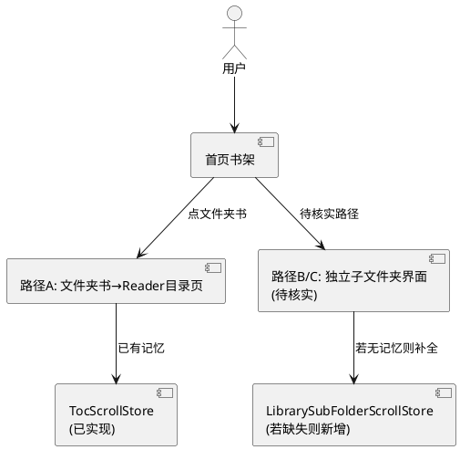
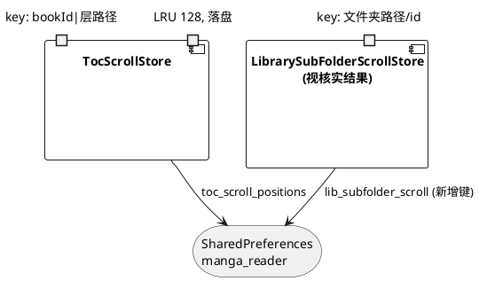
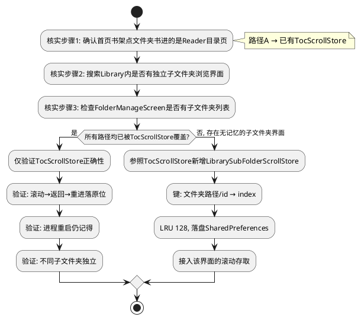
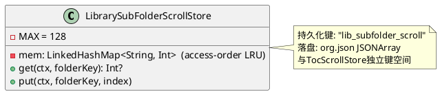

# 技术设计：子文件夹滑动记忆点核实与补全（REQ-007）

- **需求ID**: REQ-007
- **基线 commit**: eb2ac412
- **状态**: 待评审

# 一、需求与存量功能关系分析

## 1.1 需求功能与存量功能对比

### 1.1.1 已实现功能

| 需求功能 | 存量功能 | 代码位置 | 匹配度 |
|---------|---------|---------|--------|
| 阅读器目录页签子文件夹滚动记忆 | `TocScrollStore`：键 `bookId|当前层路径`→首可见 index，LRU 128，落盘 SharedPreferences | `ReaderTocSheet.kt:225-258` | 100% |
| 目录页签滚动记忆应用 | 滚动停止时 `TocScrollStore.put`，列表就绪时 `TocScrollStore.get` 恢复 | `ReaderTocSheet.kt:348,353` | 100% |
| 首页书架滚动记忆 | `library_scroll_index` + `library_scroll_anchor`，落盘 | `Library.kt:1655-1694` | 100% |
| 首页书架点击文件夹书进目录 | 文件夹书（d:/z:/smb:/webdav:）onTap → `openBookThrottled` → Reader 目录页 | `Library.kt:1721` | 100% |

### 1.1.2 需要扩展的功能

| 需求功能 | 存量功能 | 差异说明 | 扩展方向 |
|---------|---------|---------|---------|
| 首页书架进入的子文件夹界面滚动记忆 | 待核实：若即 Reader 目录页则已由 TocScrollStore 覆盖；若有独立子文件夹界面则需补全 | 需求要求先核实是否存在 | 核实所有"首页→子文件夹"路径，已覆盖则验证，缺失则参照 TocScrollStore 补全 |

### 1.1.3 需要新增的功能或接口

- **视核实结果而定**：
  - 若所有"首页→子文件夹"路径均走 Reader 目录页（已有 TocScrollStore）→ 无需新增，仅验证。
  - 若存在独立的 Library 内子文件夹浏览界面且无记忆 → 新增 `LibrarySubFolderScrollStore`（参照 TocScrollStore 模式，键 `文件夹路径/id`，LRU 128，落盘）。

## 1.2 存量功能详细分析

### 1.2.1 TocScrollStore（阅读器目录页子文件夹记忆）

- **接口契约**：`get(ctx, key): Int?` / `put(ctx, key, index)`，key = `"$bookId|${tocCurPath.value}"`。
- **业务规则**：滚动停止时存首可见项 index；列表就绪时读 index 恢复。LRU 128 超限淘汰最久未访问。org.json 数组落盘 SharedPreferences（键 `toc_scroll_positions`）。
- **约束**：存 index 不存像素 offset（列数/屏幕变化容差一屏内）。进程重启后 load 从 prefs 恢复内存。
- **覆盖范围**：仅阅读器目录页签的子文件夹，不覆盖首页书架或其他独立子文件夹界面。

### 1.2.2 首页书架滚动记忆

- **接口契约**：`library_scroll_index`（Int）+ `library_scroll_anchor`（String，首项 key），落盘 `manga_reader` SharedPreferences。
- **覆盖范围**：仅首页书架主列表，不覆盖从首页进入的子文件夹界面。

### 1.2.3 首页→子文件夹路径（待核实）

- **路径A**：首页书架点击文件夹书（d:/z:/smb:/webdav:）→ `openBookThrottled` → Reader 目录页（`Library.kt:1721`）→ **已有 TocScrollStore 覆盖**。
- **路径B（待核实）**：是否存在 Library 内独立的子文件夹浏览界面（如文件夹管理页 FolderManageScreen 进入子文件夹、或某种文件夹展开模式）。
- **路径C（待核实）**：FolderManageScreen（`FolderManageScreen.kt`）是否有子文件夹列表且需滚动记忆。

# 二、增量设计方案

## 2.1 实现模型

### 2.1.1 上下文视图

### 2.1.2 服务/组件总体架构

### 2.1.3 实现设计文档

**核实与补全流程（REQ-007-A 先核实）**：

## 2.2 接口设计

### 2.2.1 总体设计

| 接口 | 类型 | 位置 | 稳定性 | 本次变更 |
|------|------|------|--------|---------|
| `TocScrollStore` | object | `ReaderTocSheet.kt:225` | 稳定 | 不变（仅验证） |
| `LibrarySubFolderScrollStore` | object（视核实结果新增） | `Library.kt` 或新文件 | 稳定 | 若缺失则新增 |

### 2.2.2 接口清单

#### LibrarySubFolderScrollStore（若核实发现缺失则新增）

- **接口签名**：`fun get(ctx, folderKey: String): Int?` / `fun put(ctx, folderKey: String, index: Int)`
- **业务说明**：首页书架进入的独立子文件夹界面滚动记忆。键为文件夹身份（路径或 id），值为首可见项 index。LRU 128，落盘 SharedPreferences。
- **前置条件**：子文件夹界面有可标识的 folderKey（路径/id）。
- **后置条件**：返回/重进/进程重启后恢复至原 index 附近。
- **异常映射**：内容变化致 index 越界 → 以 `coerceAtMost(size-1)` 兜底（REQ-007-F）。

## 2.3 数据模型

### 2.3.1 设计目标

- 若需补全：复用 TocScrollStore 的设计模式（LRU + org.json 落盘 + 存 index），独立键空间不干扰。
- 不同子文件夹按 folderKey 独立存储（REQ-007-G）。
- 记忆数量有上限（REQ-007-D，LRU 128）。

### 2.3.2 模型实现

## 2.4 涉及文件与改动范围

| 文件 | 改动类型 | 改动说明 |
|------|---------|---------|
| `com/mangareader/ui/ReaderTocSheet.kt:225-258` | 不变 | TocScrollStore 已实现，仅验证正确性 |
| `com/mangareader/ui/Library.kt` | 排查/修改 | 核实是否有独立子文件夹界面；若有且无记忆则接入新 Store |
| `com/mangareader/ui/FolderManageScreen.kt` | 排查 | 核实是否有子文件夹列表需记忆 |
| `com/mangareader/ui/LibrarySubFolderScrollStore.kt`（视核实结果） | 新增 | 若缺失则新增，参照 TocScrollStore 模式 |

## 2.5 实现思路

1. **先核实（REQ-007-A）**：
   - 确认首页书架点击文件夹书（d:/z:/smb:/webdav:）后进入 Reader 目录页（`Library.kt:1721` openBookThrottled → Reader），该路径子文件夹记忆已由 TocScrollStore 覆盖。
   - 搜索 Library.kt 内是否有独立子文件夹浏览界面（非 Reader 目录页）：grep openFolder/navStack/FolderBrowse 等，确认是否存在 Library 内的子文件夹列表。
   - 检查 FolderManageScreen.kt 是否有子文件夹列表界面。
2. **若已覆盖（路径A 即全部）**：仅验证 TocScrollStore 正确性——滚动→返回→重进落原位附近；进程重启仍记得；不同子文件夹独立；LRU 上限生效。记录核实证据。
3. **若存在未覆盖的子文件夹界面**：参照 TocScrollStore 新增 `LibrarySubFolderScrollStore`：
   - 键：文件夹身份（d: 路径或 SAF docId 或远程路径），独立于 TocScrollStore 的 `bookId|层路径` 键空间。
   - LRU 128 + org.json 落盘 SharedPreferences（新键 `lib_subfolder_scroll`）。
   - 滚动停止时 put 首可见 index，列表就绪时 get 恢复（与 TocScrollStore 接入方式一致，`ReaderTocSheet.kt:348,353` 参照）。
4. **内容变化容错（REQ-007-F）**：恢复时 `index.coerceAtMost(items.size - 1)`，避免文件增删后越界。
5. **不同子文件夹独立（REQ-007-G）**：按 folderKey 独立存储，互不干扰。
6. **不重复实现**：阅读器目录页签不动（TocScrollStore 已覆盖），仅补首页书架侧缺失路径。

## 2.6 风险评估

| 风险 | 等级 | 说明 | 缓解措施 |
|------|------|------|---------|
| 核实后发现无需补全 | 低 | 所有路径已由 TocScrollStore 覆盖 | 仅出验证报告，无代码改动，符合需求"若已存在则仅验证" |
| 核实遗漏某子文件夹路径 | 中 | 可能有隐蔽的子文件夹入口未排查 | 全面 grep 子文件夹/目录浏览相关入口，覆盖 Library/FolderManage/Reader 全部 |
| 新增 Store 与 TocScrollStore 键冲突 | 低 | 两者键空间不同（folderKey vs bookId|层路径） | 独立 SharedPreferences 键（lib_subfolder_scroll vs toc_scroll_positions） |
| LRU 上限致常用子文件夹被淘汰 | 低 | 128 足够日常；超限淘汰最久未访问 | 与 TocScrollStore 一致策略，可接受 |
| 内容变化后恢复错乱 | 低 | 文件增删后 index 偏移 | coerceAtMost 兜底 + 存 index 容差一屏内（既定取舍） |