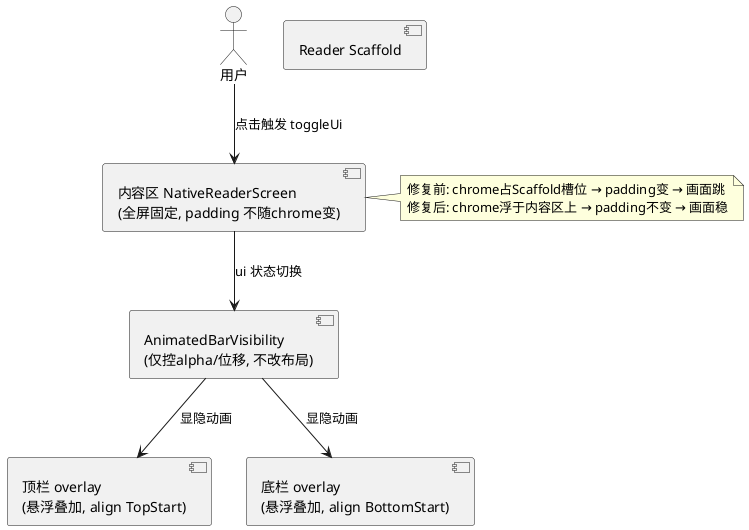
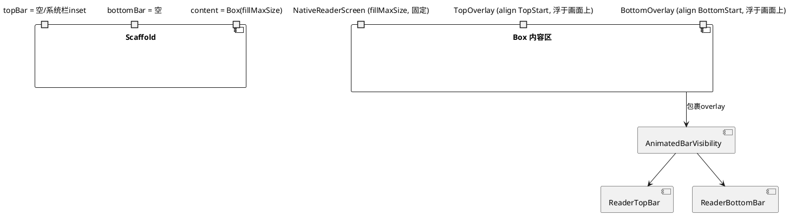
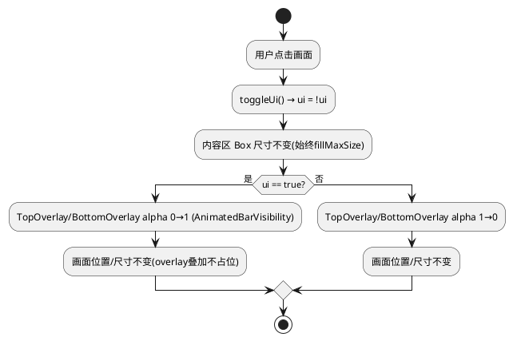

# 技术设计：点击漫画画面漂移修复（REQ-006）

- **需求ID**: REQ-006
- **基线 commit**: eb2ac412
- **状态**: 待评审

# 一、需求与存量功能关系分析

## 1.1 需求功能与存量功能对比

### 1.1.1 已实现功能

| 需求功能 | 存量功能 | 代码位置 | 匹配度 |
|---------|---------|---------|--------|
| chrome 显隐切换 | `toggleUi()` 切换 `ui` 状态，`hideUi()`/`showUi()` 控制系统栏 | `Reader.kt:2255-2269,442-444` | 100% |
| 顶栏显隐动画 | `AnimatedBarVisibility(visible = (ui||!viewing) && !landscapeReading)` 包 ReaderTopBar | `Reader.kt:2585-2651` | 100% |
| 底栏显隐动画 | `AnimatedBarVisibility(visible = viewing && ui && !landscapeReading)` 包 ReaderBottomBar | `Reader.kt:2656-2698` | 100% |
| 系统栏显隐 | `hideSystemBars`/`showSystemBars`/`restoreSystemBarsSync` | `ReaderSystemBars.kt:8-115` | 100% |
| 漫画内容区 | `NativeReaderScreen` 置于 Scaffold content | `Reader.kt:2808` | 75% |

### 1.1.2 需要扩展的功能

| 需求功能 | 存量功能 | 差异说明 | 扩展方向 |
|---------|---------|---------|---------|
| chrome 显隐不改变内容区位置 | chrome 置于 Scaffold `topBar`/`bottomBar` 槽位，显隐改变槽位占位高度 → Scaffold content padding 变化 → 画面重定位 | 槽位占位机制致漂移 | chrome 改为悬浮 overlay 叠加在内容区之上，不占 Scaffold 槽位 |
| 画面锚点不变 | 内容区 padding 随 chrome 显隐变化，缩放/平移基准重定位 | padding 变化触发重布局 | 内容区固定全屏，chrome 浮于其上 |

### 1.1.3 需要新增的功能或接口

- 无新增接口。本次为 Reader 布局结构调整：chrome 从 Scaffold 槽位改为 overlay 叠加。

## 1.2 存量功能详细分析

### 1.2.1 Scaffold 槽位占位机制（漂移根因）

- **当前结构**：`Scaffold(topBar = { AnimatedBarVisibility { ReaderTopBar } }, bottomBar = { AnimatedBarVisibility { ReaderBottomBar } })`（`Reader.kt:2581-2654`）。
- **业务规则**：Scaffold 的 topBar/bottomBar 槽位会测量子项高度并施加于 content 的 padding。`AnimatedBarVisibility` visible=false 时高度塌缩为 0 → content padding 减小 → 内容区扩大/上移 → **画面跳动**。
- **约束**：注释（`Reader.kt:2584`）称"滑出与占位高度塌缩同步，阅读区不再尾帧突跳"——原意是平滑动画，但占位高度变化本身即漂移源。

### 1.2.2 系统栏与沉浸模式

- `hideSystemBars`/`showSystemBars`（`ReaderSystemBars.kt`）控制 Window 级系统栏（状态栏/导航栏）显隐，使用 `LAYOUT_STABLE|LAYOUT_FULLSCREEN` 使内容布局不随系统栏变化——这部分**不漂移**。
- 漂移来自 **Compose 层 Scaffold 槽位**（ReaderTopBar/ReaderBottomBar），非系统栏。

### 1.2.3 横屏 chrome

- 横屏用 `LandscapeReaderChrome`（胶囊式 overlay，`LandscapeReaderChrome.kt:116-136`），已是 align 叠加式，可能不漂移。需确认横屏路径是否也走 Scaffold 槽位。

# 二、增量设计方案

## 2.1 实现模型

### 2.1.1 上下文视图

### 2.1.2 服务/组件总体架构

### 2.1.3 实现设计文档

**chrome 显隐与画面稳定性流程（修复后）**：

## 2.2 接口设计

### 2.2.1 总体设计

| 接口 | 类型 | 位置 | 稳定性 | 本次变更 |
|------|------|------|--------|---------|
| Scaffold topBar 槽位 | 布局 | `Reader.kt:2582-2652` | 稳定 | 移出 ReaderTopBar，槽位留空/仅系统栏 inset |
| Scaffold bottomBar 槽位 | 布局 | `Reader.kt:2654-2698` | 稳定 | 积出 ReaderBottomBar，槽位留空 |
| 内容区 Box | 布局 | `Reader.kt:2808` 附近 | 稳定 | 改为 Box(fillMaxSize) 叠加 NativeReaderScreen + chrome overlay |
| AnimatedBarVisibility | 动画 | `Reader.kt:2585,2656` | 稳定 | 保留动画，仅改包裹位置(槽位→overlay) |

### 2.2.2 接口清单

本次无新增接口，仅布局结构调整：
- **ReaderTopBar overlay**：从 Scaffold `topBar` 移至内容区 Box 内 `align(Alignment.TopStart)`，`AnimatedBarVisibility` 包裹控制显隐动画。
- **ReaderBottomBar overlay**：从 Scaffold `bottomBar` 移至内容区 Box 内 `align(Alignment.BottomStart)`，同上。
- **内容区**：`Box(Modifier.fillMaxSize())` 内先放 `NativeReaderScreen`（fillMaxSize，固定），再叠 chrome overlay（后绘制者在上层）。

## 2.3 数据模型

无变更。本次纯布局层调整，不涉及数据/状态/持久化。

## 2.4 涉及文件与改动范围

| 文件 | 改动类型 | 改动说明 |
|------|---------|---------|
| `com/mangareader/ui/Reader.kt:2581-2698` | 修改 | Scaffold topBar/bottomBar 槽位清空；ReaderTopBar/ReaderBottomBar 移至内容区 Box overlay |
| `com/mangareader/ui/Reader.kt:2808` 附近 | 修改 | 内容区改为 Box(fillMaxSize) 叠加 NativeReaderScreen + chrome overlay |
| `com/mangareader/ui/LandscapeReaderChrome.kt` | 排查 | 确认横屏胶囊已是 overlay 式（不漂移），若横屏也走 Scaffold 槽位则同改 |

## 2.5 实现思路

1. **根因确认**：当前 Scaffold topBar/bottomBar 槽位随 AnimatedBarVisibility 占位高度变化，content padding 随之变化 → 画面重定位。先在阅读中点击画面观察漂移方向/幅度，确认与 chrome 显隐同步。
2. **chrome 移出 Scaffold 槽位**：将 `ReaderTopBar`（含 AnimatedBarVisibility 包裹）从 Scaffold `topBar = {}` 移出；`ReaderBottomBar` 同理从 `bottomBar = {}` 移出。Scaffold 的 topBar/bottomBar 设为空（或仅保留系统状态栏 inset 处理，不占可见高度）。
3. **内容区改 Box 叠加**：Scaffold content 区改为 `Box(Modifier.fillMaxSize())`，内层顺序：① `NativeReaderScreen(Modifier.fillMaxSize())`（画面，固定全屏）；② `ReaderTopBar` overlay `Modifier.align(Alignment.TopStart)`；③ `ReaderBottomBar` overlay `Modifier.align(Alignment.BottomStart)`。后绘制者浮于上层。
4. **AnimatedBarVisibility 保留**：仍包裹 chrome overlay 控制显隐动画（alpha/位移），但因其不再在 Scaffold 槽位内，高度塌缩不影响 content padding → 画面不漂移。
5. **系统栏 inset 处理**：系统栏显隐由 `hideSystemBars`/`showSystemBars`（Window �）控制，已用 `LAYOUT_STABLE|LAYOUT_FULLSCREEN` 保证内容不随系统栏重布局，这部分不动。
6. **横屏排查**：确认横屏 `LandscapeReaderChrome` 是否已是 overlay 胶囊式（`LandscapeReaderChrome.kt:116` 用 align 叠加，疑似已是 overlay）。若横屏不漂移则不动；若横屏也走 Scaffold 槽位则同改。
7. **缩放/平移锚点**：内容区固定全屏后，缩放/平移基准不再因 padding 变化重定位，锚点自然稳定（REQ-006-D 满足）。

## 2.6 风险评估

| 风险 | 等级 | 说明 | 缓解措施 |
|------|------|------|---------|
| chrome overlay 遮挡画面内容 | 中 | chrome 浮于画面上，可能挡住顶部/底部画面 | 阅读态 chrome 本就临时显示(10s自动隐藏)；沉浸阅读时画面全屏无遮挡 |
| chrome 点击区与画面点击区冲突 | 中 | overlay 在上层可能拦截画面点击 | chrome 仅占顶部/底部条带高度，中间区域点击穿透到 NativeReaderScreen；overlay 用精确高度非全屏 |
| AnimatedBarVisibility 动画行为变化 | 低 | 从槽位移到 overlay 后动画路径不同 | 保留 AnimatedBarVisibility 包裹，仅改父容器；验证滑入滑出效果不变 |
| Scaffold content padding 语义变化 | 中 | 槽位清空后 content padding 不含 chrome 高度，需确认无其他依赖 padding 的逻辑 | grep Scaffold padding 消费点；系统栏 inset 由 Window �处理不依赖 Scaffold 槽位 |
| 横屏路径遗漏 | 低 | 若横屏也漂移但未改 | 核实横屏 chrome 布局方式，一并处理 |
| 系统栏非沉浸态下漂移 | 低 | 非沉浸模式系统栏常显，可能仍有 inset 变化 | 系统栏用 LAYOUT_STABLE 已稳；本次聚焦 Compose 层 Scaffold 槽位漂移 |